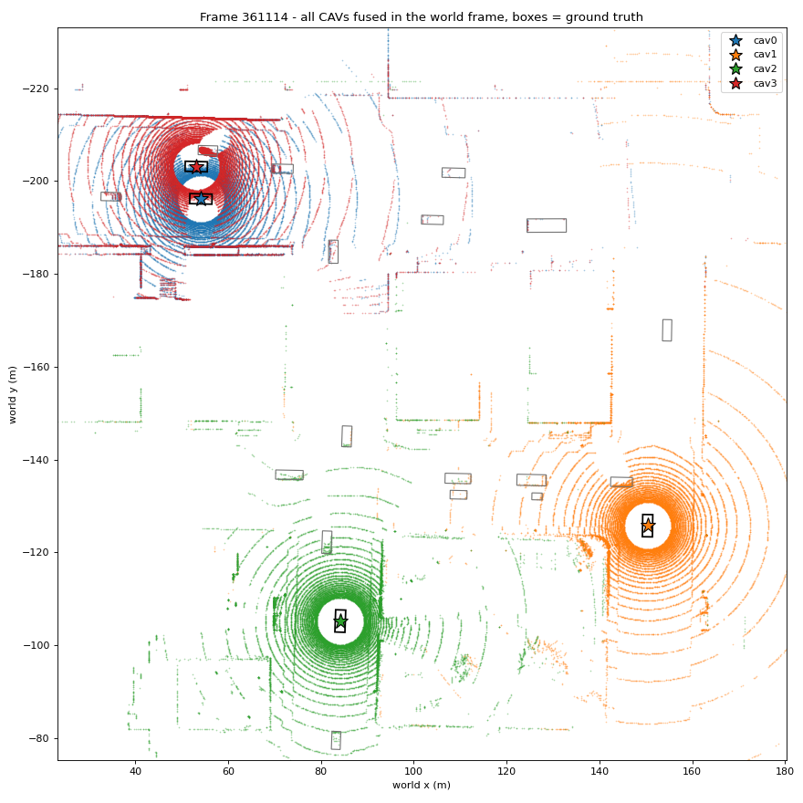
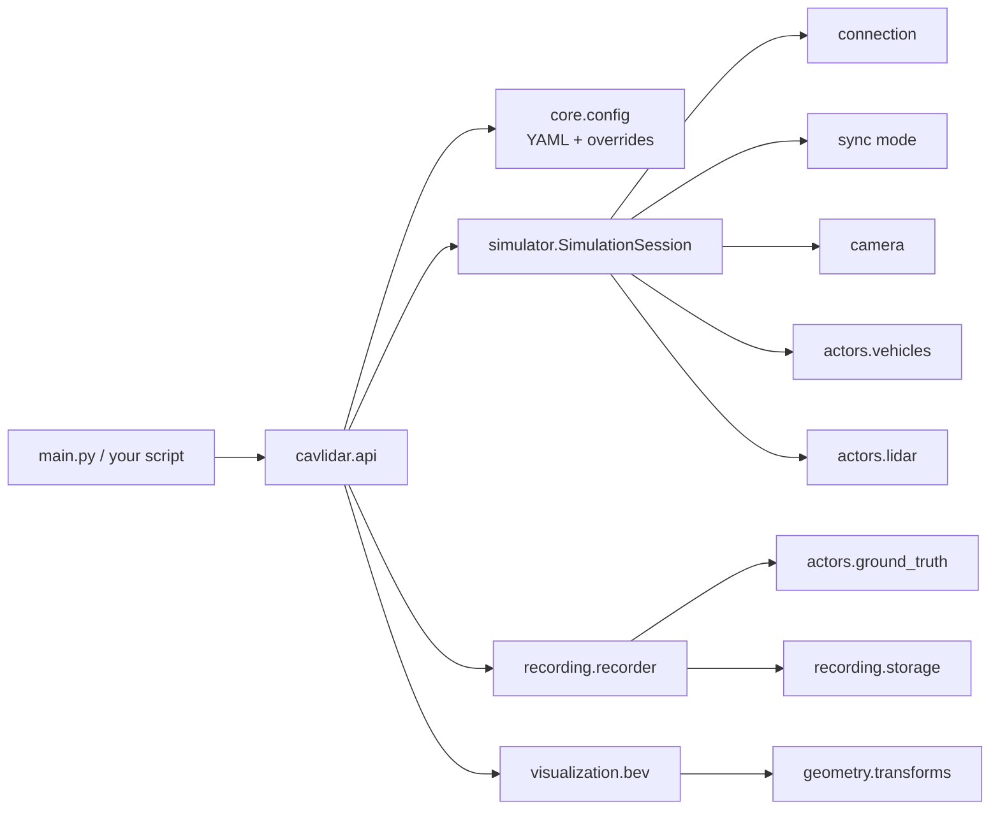

# CARLA LiDAR Cooperative Perception

LiDAR data collection in the [CARLA](https://carla.org) simulator for **cooperative perception between connected and autonomous vehicles (CAVs)**.

This repository is the first building block of a re-implementation of:

> *Optimized BEV-Guided Point Cloud Sharing for Enhanced LiDAR-Based Collaborative Perception in CAVs* (IEEE Access, submitted 2026).

It spawns CAVs and other traffic in **Town03**, mounts the paper's LiDAR on every CAV (32 channels, 120 m, 1M points/s, 20 Hz), and records **full 360° sweeps** together with the **sensor poses** and **ground-truth vehicle boxes**. These are the inputs needed later for ground removal, BEV sectorization, the sharing optimization (ILP / greedy-swap) and early fusion.



*Experiment `e01`: 4 CAVs near the sloped junction of Town03. Each colour is one CAV's LiDAR; boxes are ground truth (black = CAV).*

---

## Quick start

```bash
# 1. Start CARLA 0.9.12 (keep this window open)
CarlaUE4.exe -windowed -ResX=1280 -ResY=720

# 2. Python 3.7 or 3.8 environment
conda create -n carla012 python=3.8 -y
conda activate carla012
pip install -r requirements.txt

# 3. Use it
python main.py check                                                    # connection test
python main.py drive --seconds 40                                       # watch vehicles drive
python main.py record --config config/experiments/scenario/e01_baseline_4cavs.yaml --name e01
python main.py show data/runs/<run_folder> --view world                 # plots, no CARLA needed
```

Change any parameter without editing a file:

```bash
python main.py record --set lidar.channels=64 --set scenario.num_cavs=6 --name test64
```

Or from Python:

```python
from cavlidar import load_config, record_lidar, show_frame

cfg = load_config("config/experiments/lidar/e04_short_range_50m.yaml",
                  overrides=["scenario.num_cavs=6"])
run_dir = record_lidar(cfg, name="short_range")
show_frame(run_dir, view="world")
```

## Project layout

```
carla-lidar-cooperative-perception/
├── main.py                      command line: check | drive | record | show
├── config/
│   ├── default.yaml             every parameter with its default value
│   └── experiments/             ready-made cases, grouped by what they change
│       ├── scenario/            e01 baseline, e02 paper 10 CAVs, e08 chaotic traffic
│       ├── lidar/               e03 64 ch, e04 50 m, e05 ideal, e06 noisy, e07 low mount
│       └── recording/           e09 partial-sweep demo, e10 PLY export
├── cavlidar/                    the library
│   ├── api.py                   FRONT: 5 simple functions
│   ├── core/                    config, enums, constants, errors (no CARLA)
│   └── backend/                 implementation
│       ├── simulator/           connection, sync mode, camera, SimulationSession
│       ├── actors/              vehicles, LiDAR, ground truth
│       ├── recording/           recording loop, storage on disk
│       ├── geometry/            poses and transforms
│       └── visualization/       BEV plots
├── tests/                       unit tests (no CARLA needed)
└── docs/
    ├── ARCHITECTURE.md          every module and function explained
    ├── PARAMETERS.md            every parameter: meaning, effect, examples
    ├── EXPERIMENTS.md           the 10 experiments + ideas for new ones
    └── PAPER_FIDELITY.md        what matches the paper, what differs, what is unknown
```



The user only touches **YAML parameters** (or `--set`). `api.py` exposes simple functions; everything that talks to CARLA is in `backend/`.

## Output of one run

```
data/runs/2026-10-22_215825_e01/
├── config.yaml                 exact parameters used (reproducible)
├── spawn.json                  every vehicle's initial pose, right after spawning
├── preview_sensor.png          each CAV in its own LiDAR frame
├── preview_world.png           all CAVs fused in the world frame + ground truth
└── frames/361105/
    ├── cav0.npy ... cav3.npy   (N, 4) float32: x, y, z, intensity in the sensor frame
    └── meta.json               sensor poses, CAV ids, every vehicle's pose/box/speed
```

## Requirements and tested setup

| | |
|---|---|
| CARLA | 0.9.12 (Windows package) |
| Python | 3.7 or 3.8 (CARLA 0.9.12 client wheels) |
| Tested on | Windows 11, Ryzen 5 4600H, 32 GB RAM, GTX 1650 4 GB |
| Speed | 4 CAVs + 20 vehicles: 0.06 s/tick; 10 CAVs + 40 vehicles: 0.15 s/tick |

Known issues on a 4 GB GPU: starting CARLA with `-quality-level=Low` crashes with *"Shader compilation failures are Fatal"*, and changing map with `load_world()` crashed the server. Set the default map in `CarlaUE4/Config/DefaultEngine.ini` instead (see `server.allow_map_change` in [PARAMETERS.md](docs/PARAMETERS.md)).

## Tests

```bash
python -m unittest discover -s tests -t . -v
```

## Roadmap

1. **Data collection** (this repository)
2. Ground removal (Patchwork RANSAC) and obstacle clustering
3. Local BEV and static / dynamic sectorization, sector metadata (size, quality, footprint)
4. Sharing optimization: ILP and greedy-swap heuristic under a budget B̄
5. Point-level fusion and PIXOR detection (OpenCOOD), AP@0.5
