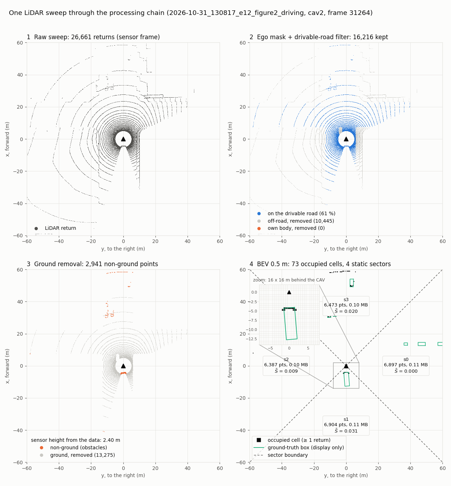
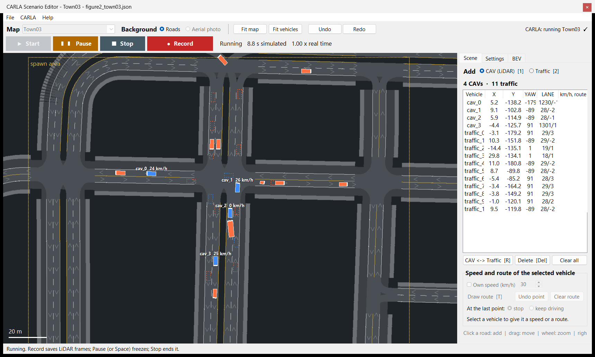

# CARLA LiDAR to BEV

From a simulated LiDAR to a bird's-eye-view (BEV) grid, for **cooperative perception between connected and
autonomous vehicles (CAVs)**, in the [CARLA](https://carla.org) simulator.

This repository is the first part of a re-implementation of:

> *Optimized BEV-Guided Point Cloud Sharing for Enhanced LiDAR-Based Collaborative Perception in CAVs* (IEEE Access,
> submitted 2026).

It covers everything up to the BEV, per CAV: building the scene (by configuration or by hand in a scenario editor),
recording full 360° LiDAR sweeps with the sensor poses and the ground-truth vehicle boxes, and processing each sweep
offline: **ego-body mask → drivable-road filter → ground removal → BEV grids → static sectors → sector metadata**. The
processing is validated against CARLA's ground truth, and a sensitivity benchmark measures how the BEV depends on the
LiDAR. The steps that build on the sector metadata (the sharing optimization, the fusion and the detection) are not
part of this repository.



*One real sweep (e12, cav2): raw returns, then the drivable road, then the obstacles left by the ground removal, then
the 0.5 m BEV with its 4 static sectors and their metadata.*

**Start here: [docs/GUIDE.md](docs/GUIDE.md)** explains every step in detail, from installing CARLA to the sector
metadata. The scenario editor has its own tutorial: [docs/EDITOR.md](docs/EDITOR.md).

---

## Quick start

```bash
# 1. Start CARLA 0.9.12 (keep this window open; do not add -quality-level=Low)
CarlaUE4.exe -windowed -ResX=1280 -ResY=720

# 2. Python 3.7 or 3.8 environment (CARLA 0.9.12 client wheels)
conda create -n carla012 python=3.8 -y
conda activate carla012
pip install -r requirements.txt

# 3. Record a scene (the paper's Figure 2 junction, 4 CAVs, everyone driving) and process it up to the BEV
python main.py check
python main.py record --config config/experiments/scenario/e12_figure2_driving.yaml --name e12 --process
python main.py show data/runs/<run_folder> --view world          # plots, no CARLA needed

# 4. Process a run recorded earlier (offline, no CARLA): BEV grids + sector metadata of every frame
python main.py process data/runs/<run_folder>

# Or all of it in the scenario editor: place vehicles, Start (real-time view), Record, see every CAV's BEV on the map
python main.py editor --map Town03
```



Any parameter can be changed without editing a file: `--set lidar.channels=64 --set scenario.num_cavs=6`.

## What is inside

| Part | What it does | Details |
|---|---|---|
| Data collection | spawns CAVs and traffic (random, from a spawn plan, the editor or OpenSCENARIO), mounts the paper's LiDAR (32 channels, 120 m, 1M points/s, 20 Hz) on each CAV, records full sweeps in synchronous mode with poses and ground truth of the same tick | [GUIDE.md §3–6](docs/GUIDE.md), [PARAMETERS.md](docs/PARAMETERS.md), [EXPERIMENTS.md](docs/EXPERIMENTS.md) |
| Scenario editor | a window to place vehicles on any CARLA map (routes, speeds), set the LiDAR and the traffic, then Start / Pause / Record / Stop a live simulation shown in real time, and every CAV's BEV drawn on the map | [EDITOR.md](docs/EDITOR.md), [OPENSCENARIO.md](docs/OPENSCENARIO.md) |
| OpenCDA scenarios | the paper's tool: random scenarios on Town03 (4–10 CAVs driven by OpenCDA's behaviour agent, 20–40 vehicles, Table 1 speeds and red lights), saved in the same run format | [OPENCDA.md](docs/OPENCDA.md) |
| Processing | ego-body mask, OpenDRIVE drivable-road filter, slope-aware ground removal, BEV grids, static sectors, metadata σ / S̃ / A | [GUIDE.md §7](docs/GUIDE.md#7-step-4-from-the-point-cloud-to-the-bev), [PROCESSING.md](docs/PROCESSING.md) |
| Validation | ground removal and ground-truth boxes scored against CARLA | [PROCESSING.md](docs/PROCESSING.md), [LABEL_ALIGNMENT.md](docs/LABEL_ALIGNMENT.md) |
| Sensitivity benchmark | 15 scenes, 240 scored runs: noise, mount height, channels, range, drop-off, point rate, CAV count, traffic | [SENSITIVITY.md](docs/SENSITIVITY.md) |
| Summary | choices, findings and limits of the whole chain | [SUMMARY_BEV.md](docs/SUMMARY_BEV.md), [EXPERIMENT_LOG.md](docs/EXPERIMENT_LOG.md), [PAPER_FIDELITY.md](docs/PAPER_FIDELITY.md) |
| All experiments and results | every experiment on one page: setup, numbers, figures | [results/README.md](results/README.md) |

## Main results

**Every experiment and its results on one page: [results/README.md](results/README.md)**. It covers data collection,
the processing quality, what each CAV sees, the LiDAR sensitivity (channels, range, noise, mount, drop-off,
points/s), CAV count and traffic, CARLA's reproducibility, the ground-truth boxes, the OpenCDA scenarios and the
timings.

| Measured | Value |
|---|---|
| Points per sweep (paper's LiDAR) | about 27 000 |
| Vehicle points removed by road filter + ground removal | **0.20 %** (260 scans; first prototype: 11 %) |
| Ground points left after ground removal | 0.77 % |
| Close pairs (car a few metres from a CAV): body removed | 22–37 % → **0 %** |
| Own-body returns at a 1.6 m mount, after the ego mask | 9 244 → **0** per scan |
| Ground-truth boxes of moving vehicles | frame-matched: time offset +0.0005 s [−0.0024, +0.0036] (one tick late = −0.05 s) |
| Processing time | about 0.1 s per CAV in Python, one core: **not real-time** (one sweep every 50 ms) |
| Most influential sensor setting | point density: 0.5M points/s costs 21 points of vehicle visibility |

Everything is simulated: CARLA's ray-cast LiDAR, no real data, no network. Nothing here reproduces the paper's final
results yet.

## Project layout

```
carla-lidar-to-bev/
├── main.py                      command line: check | drive | record [--process] | process | show | editor | xosc-import | xosc-export
├── config/
│   ├── default.yaml             every parameter with its default value
│   ├── experiments/             ready-made cases: scenario/, lidar/, recording/, custom/ (editor), ablation/ (benchmark)
│   ├── opencda/                 the paper's setting for OpenCDA (paper_town03.yaml)
│   └── spawn_plans/             fixed start poses (figure2_town03.json = the paper's Figure 2)
├── cavlidar/                    the library
│   ├── api.py                   simple public functions
│   ├── editor/                  scenario editor window (Tkinter)
│   ├── core/                    config, enums, constants, errors (no CARLA)
│   └── backend/
│       ├── simulator/           connection, synchronous mode, camera, SimulationSession
│       ├── actors/              vehicles, LiDAR, ground truth, spawn plans, route driver
│       ├── recording/           recording loop, storage on disk
│       ├── maps/                OpenDRIVE maps, lane snapping, routes, road images, aerial photos
│       ├── interop/             OpenSCENARIO (.xosc) read / write
│       ├── processing/          ego mask, road filter, ground removal, BEV grids, sectors + metadata (offline)
│       ├── geometry/            poses and transforms
│       └── visualization/       BEV plots
├── tools/                       validation and benchmark scripts (eval_ground, make_figure2_plan,
│                                make_sensitivity_scenes, run_ablation, record_moving_sensors, eval_ablation,
│                                audit_sensitivity, label_alignment, diagnose_label_alignment, make_pipeline_figure,
│                                compare_cavs, opencda_scenario; demo/ = the narrated walkthrough video)
├── tests/                       unit tests (no CARLA needed)
├── results/                     README = every experiment and its results; metrics and plots of the sensitivity
│                                benchmark and the label-alignment diagnostic
└── docs/                        GUIDE (start here), EDITOR, PARAMETERS, EXPERIMENTS, EXPERIMENT_LOG, ARCHITECTURE,
                                 PROCESSING, SENSITIVITY, LABEL_ALIGNMENT, SUMMARY_BEV, PAPER_FIDELITY, OPENSCENARIO,
                                 OPENCDA
```

The user only touches **YAML parameters** (or `--set`); `api.py` exposes simple functions; everything that talks to
CARLA is in `backend/`. Every module and function: [ARCHITECTURE.md](docs/ARCHITECTURE.md).

## Output

```
data/runs/<date>_<time>_<name>/
├── config.yaml                 exact parameters used (reproducible)
├── spawn.json                  every vehicle's initial pose
├── preview_sensor.png          each CAV in its own LiDAR frame
├── preview_world.png           all CAVs in the world frame + ground truth
├── frames/<frame>/
│   ├── cav0.npy ... cavN.npy   (N, 4) float32: x, y, z, intensity in the sensor frame
│   └── meta.json               sensor poses, CAV ids, every vehicle's pose / box / speed
└── processed/<frame>/          after the processing: ground / non-ground clouds, BEV grids,
                                sector of each cell, summary.json, metadata.json (σ, S̃, footprint per sector)
```

`data/` is not in git (recordings are large).

## Requirements and tested setup

| | |
|---|---|
| CARLA | 0.9.12 (Windows package) |
| Python | 3.7 or 3.8; `carla==0.9.12`, numpy, pyyaml, matplotlib |
| Tested on | Windows 11, Ryzen 5 4600H, 32 GB RAM, GTX 1650 4 GB |
| Simulation speed | 4 CAVs + 20 vehicles: 0.06 s per tick; 10 CAVs + 40 vehicles: 0.15 s per tick |

Known issues on a 4 GB GPU: `-quality-level=Low` crashes CARLA (*"Shader compilation failures are Fatal"*), and
changing map with `load_world()` crashed the server: set the start map in `CarlaUE4/Config/DefaultEngine.ini` (the
editor's CARLA menu does it). More in [GUIDE.md §11](docs/GUIDE.md#11-troubleshooting).

## Tests

```bash
python -m unittest discover -s tests -t . -v      # 115 tests, no CARLA needed
```

## Not in this repository

- Sharing optimization (sector IoU, complementarity, ILP, Greedy–Swap), point-level fusion and detection (PIXOR,
  AP@0.5): they take the sector metadata produced here as input.
- Dynamic sectorization, the paper's 57 scenarios per CAV count, real-time operation, real network transmission.
