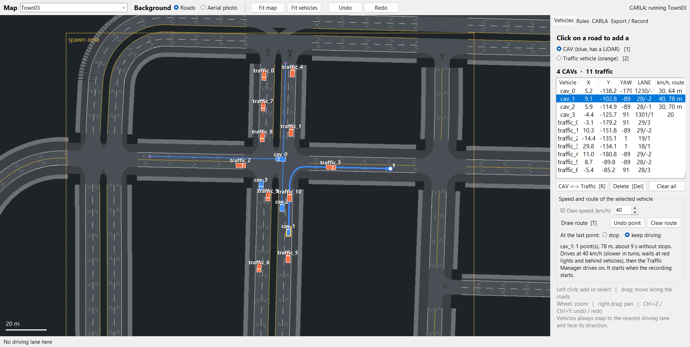
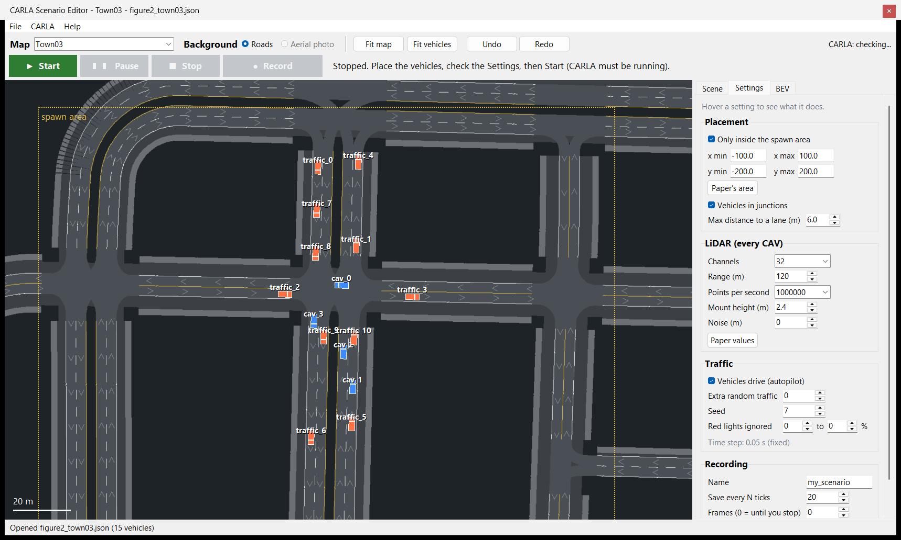
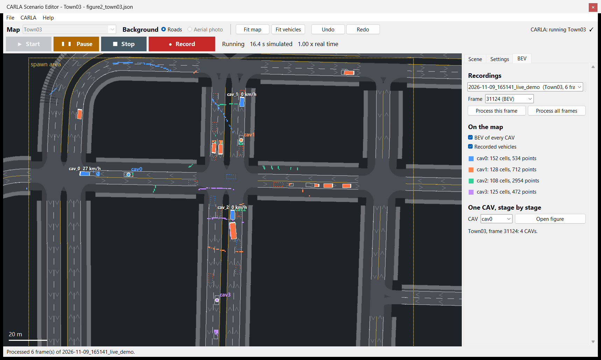
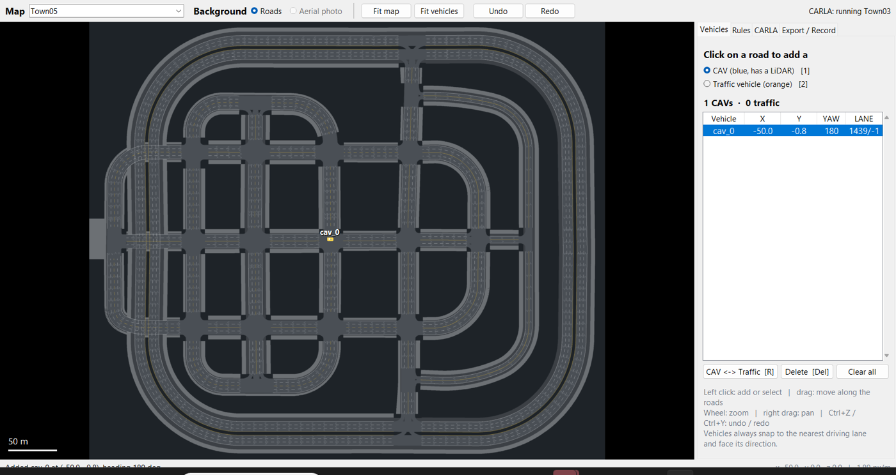
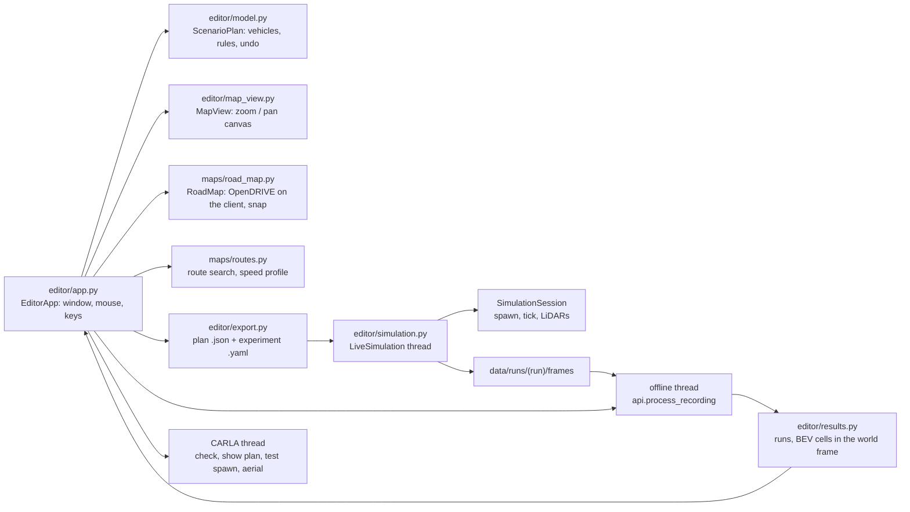

# Scenario editor

One window for the whole chain: place CAVs and traffic on any CARLA map, set the LiDAR and the traffic, press
**Start** and watch the vehicles drive in real time, **Record** the LiDAR sweeps, and see every CAV's **BEV** on the
map when the recording stops.

```bash
python main.py editor                                            # last map used (Town03 the first time)
python main.py editor --map Town05
python main.py editor --plan config/spawn_plans/figure2_town03.json
```


| You need | For |
|---|---|
| the project's Python environment (Tkinter and Pillow come with Python and matplotlib) | the window |
| the CARLA folder (asked once, or `server.carla_root`, or `$CARLA_ROOT`) | the list of maps and their road networks |
| CARLA **running the plan's map** | Start / Record, and the CARLA menu |

Placing vehicles, processing recordings and showing their BEV work with CARLA closed, or while CARLA runs another map.

## The window

```
 File  CARLA  Help
 Map [Town03 v]  Background (o) Roads ( ) Aerial photo   [Fit map] [Fit vehicles] [Undo] [Redo]     CARLA: running Town03 ✓
 [▶ Start] [❚❚ Pause] [■ Stop] [● Record]   Running   8.8 s simulated   1.00 x real time
+--------------------------------------------------------------+---------------------------+
|                                                              |  Scene | Settings | BEV   |
|                    map: roads or aerial photo                |                           |
|          planned vehicles, live vehicles, BEV cells          |                           |
+--------------------------------------------------------------+---------------------------+
 status: what just happened, or why a click was refused                  x 2.9  y -136.5  z 0.0
```

| Part | What it is for |
|---|---|
| **Simulation bar** | Start, Pause / Resume, Stop, Record. A button is grey when it cannot be used now. The text says what runs, the simulated time, the speed compared with real time, and the frames being recorded. |
| **Scene** tab | the vehicles: add, move, CAV ↔ traffic, delete, speed and route of the selected one |
| **Settings** tab | placement rules, LiDAR, traffic, recording. **Hover a setting to see what it does.** |
| **BEV** tab | recordings, processing, BEV on the map, one CAV stage by stage |
| **File** menu | new / open / save plan, export the experiment files, OpenSCENARIO, CARLA folder |
| **CARLA** menu | check connection, show the plan in CARLA, test spawn, record in a new console, aerial photo, start CARLA on another map |

---

## Tutorial: from an empty map to the BEV

Goal: 4 CAVs and some traffic around the paper's junction (Town03, junction 1221, centre x 2.9, y −136.5), watch them
drive, record 10 s, look at the BEV.

### 1. Open the map

`python main.py editor --map Town03`. If the editor cannot find the CARLA folder it asks for it once (the folder with
`CarlaUE4.exe`, e.g. `D:\CARLA\CARLA_0.9.12\WindowsNoEditor`). Zoom with the wheel, pan with the right or middle
button; the bottom right shows the world coordinates under the cursor. *Aerial photo* shows the buildings once a
photo has been taken (CARLA menu).

### 2. Place the vehicles (*Scene*)

- Press **1** (CAV) or **2** (traffic) and move over a road: a dashed outline shows where the vehicle would go,
  **green** if allowed, **red** if not (the reason is in the status bar). Click to place it. It snaps to the centre of
  the nearest driving lane, facing the driving direction, with the lane's height and slope.
- Drag a vehicle to slide it along the lanes; **R** switches CAV ↔ traffic; **Del** deletes; **Ctrl+Z / Ctrl+Y** undo
  and redo. Vehicles may not overlap (4.8 × 2.1 m + 0.6 m of free space).
- Optional, for the selected vehicle: *Own speed* (km/h), and a route: press **T**, click points on the roads in driving
  order, **Enter** to finish, then *stop* or *keep driving* at the last point.



**Ctrl+S** saves the plan (`config/spawn_plans/<name>.json`); **Ctrl+O** opens one.

### 3. Check the settings (*Settings*)



The defaults are the paper's (LiDAR) and the project's (the rest). Each setting explains itself when the mouse rests
on it; the full list with the YAML key it writes is in [Settings](#settings) below.

### 4. Check the plan in CARLA (optional)

Start CARLA with the plan's map, then **CARLA → Check connection** (the top right then shows `CARLA: running Town03 ✓`).
*Show the plan in the CARLA window* draws boxes, arrows and routes in the simulator for 60 s; *Test spawn* spawns every
vehicle and removes it at once, listing any vehicle whose pose is blocked.

### 5. ▶ Start: watch it drive

**Start** writes the plan and the experiment (`config/spawn_plans/<name>.json`, `config/experiments/custom/<name>.yaml`),
spawns every vehicle in CARLA and runs the simulation at real-time speed. The map shows each vehicle at its current
pose with its real box; CAVs are labelled with their speed (traffic too when zoomed in); the plan stays as dashed
outlines. The scene and the settings cannot be edited while it runs.

- **Pause** (or **Space**) freezes everything (CARLA waits in synchronous mode); **Resume** continues.
- Measured on this laptop with the Figure 2 scene (15 vehicles): **1.00 × real time** while watching.

### 6. ● Record

**Record** mounts one LiDAR per CAV (the *Settings*) and saves one frame every *Save every N ticks* (20 = one frame
per simulated second): the CAVs' sweeps, their poses and every vehicle's ground-truth box, exactly as `main.py
record` saves them. The bar shows `● REC 6 frames -> <run folder>`. The LiDARs cost most of the time of a tick, so the
simulation runs slower meanwhile (0.74 × real time with 4 CAVs here) and returns to real time afterwards.

Press **Stop recording** (or let *Frames* end it). The LiDARs are removed, and with *Process up to the BEV when it
ends* on, every frame goes through ego mask → drivable-road filter → ground removal → BEV → sectors → metadata in the
background (about 0.1 s per CAV and frame).

### 7. See the BEV

When the processing is done the **BEV** tab opens on the new run and its last frame, and the map shows **every CAV's
BEV**: each coloured square is an occupied 0.5 m cell of one CAV (at least one non-ground return), placed with the
CAV's recorded pose; the dot is the LiDAR; grey outlines are the recorded vehicles. The simulation keeps running
meanwhile.



| *BEV* tab | What it does |
|---|---|
| Recordings, *Refresh* | every run in `data/runs/`, newest first, with its map, frames and how many are processed |
| Frame | the frames of the run; `(BEV)` marks a processed one |
| *Process this frame* / *Process all frames* | the processing, in the background, no CARLA needed (same as `python main.py process`) |
| *BEV of every CAV*, *Recorded vehicles* | what the map shows; the legend gives each CAV's occupied cells and non-ground points |
| CAV, *Open figure* | one CAV stage by stage: raw sweep → drivable road → ground removed → BEV with the 4 sectors and their size σ and quality S̃ (`processed/<frame>/<cav>_pipeline.png`) |
| *Raw, all CAVs* | the raw point clouds of every CAV superposed in the world frame, one colour per CAV, CARLA's boxes in grey (`world_raw.png`) |
| *After filtering* | the points left after ego mask, road filter and ground removal, every CAV in the world frame; a box is solid when a CAV sees the car, dashed when none does (`world_filtered.png`) |
| *BEV, all CAVs* | the BEV of all CAVs together, points per 0.5 m cell, with a zoom (`world_bev.png`) |
| *Points per car* | each car's points before → after filtering, and which CAVs see it (`vehicles.png`) |
| CAV, *This CAV: before / after* | one CAV in its own frame: raw sweep, after filtering, BEV (`cavN_before_after.png`) |

Each opens in its own window; the numbers go to `vehicles.csv` and `cavs.csv` next to them
([GUIDE.md](GUIDE.md#every-cav-before-and-after-filtering)).

Runs recorded outside the editor appear in the same list. A run recorded on another map is shown once that map is
open.

### 8. ■ Stop

**Stop** removes every vehicle and sensor from CARLA and puts it back in asynchronous mode; the scene can be edited
again. Closing the window while it runs asks first and stops it too.

### Repeatable recordings

A live recording starts whenever Record is pressed, and CARLA's Traffic Manager is not repeatable, so two live
recordings never hold the same frames. For an experiment, use the fixed procedure (warm-up, then a set number of
frames): **CARLA → Record in a new console (fixed frames)** (uses *Frames*, 10 when it is 0, and follows the console
until the BEV is shown), or **File → Export experiment** and `python main.py record --config ... --name ... --process`.

### On another map

1. Pick the map in the *Map* list and place the vehicles (CARLA can keep running Town03).
2. **CARLA → Start CARLA on this map next time** (writes CARLA's `DefaultEngine.ini`, keeps a backup), then close
   and reopen CARLA. This is safer than `load_world()`, which crashed CARLA on a 4 GB GPU.
3. Optional: **CARLA → Take aerial photo of this map** (once; stored in `data/maps/`).
4. **Start**.

Maps whose level is not installed (Town06 and Town07 in the base 0.9.12 package) are marked *edit only*.



---

## Reference

### Controls

| Action | Mouse / key |
|---|---|
| Add a vehicle | left click on a road (**1** = CAV, **2** = traffic) |
| Select / move | click a vehicle / drag it (it slides along the lanes) |
| CAV ↔ traffic, delete | **R**, **Del** |
| Route of the selected vehicle | **T**, clicks on the roads in driving order; **Enter** / **Esc** ends, **Backspace** removes the last point |
| Zoom / pan / fit | wheel / right or middle drag / **F** |
| Undo / redo | **Ctrl+Z** / **Ctrl+Y** |
| New / open / save plan | **Ctrl+N** / **Ctrl+O** / **Ctrl+S** |
| Pause / resume the simulation | **Space** |

Keys are ignored while typing in a field. Help → Controls lists them in the window.

### Settings

| Setting | Writes | Default | Meaning |
|---|---|---|---|
| Only inside the spawn area, x / y min / max | `scenario.spawn_bbox` | on, paper's area | vehicles may only be placed inside |
| Vehicles in junctions | (placement only) | on | off: only on the legs |
| Max distance to a lane (m) | (placement only) | 6 | farther clicks are refused |
| Channels | `lidar.channels` | 32 (paper) | laser rings from +2° to −25° |
| Range (m) | `lidar.range` | 120 (paper) | farthest distance measured |
| Points per second | `lidar.points_per_second` | 1 000 000 (paper) | one sweep gets 1/20 of them |
| Mount height (m) | `lidar.mount_z` | 2.4 | below about 2 m the LiDAR also hits its own roof (the ego mask removes those points) |
| Noise (m) | `lidar.noise_stddev` | 0 | random range error |
| Vehicles drive (autopilot) | `scenario.autopilot` | on | off: vehicles without a route or a speed stay parked |
| Extra random traffic | `scenario.num_traffic` (+ planned) | 0 | added at random spawn points |
| Seed | `simulation.seed` | 7 | random traffic, models, Traffic Manager draws |
| Red lights ignored (%) | `scenario.ignore_lights_range` | 0 to 0 | per Traffic Manager vehicle; the paper varies it over 0–100 %; routed vehicles always stop |
| Name | run folder and plan name | `my_scenario` | `data/runs/<date>_<time>_<name>` |
| Save every N ticks | `recording.save_every` | 20 | 20 ticks = 1 simulated second |
| Frames (0 = until you stop) | `recording.num_frames` | 0 | a recording ends by itself after this many frames |
| Process up to the BEV when it ends | (editor) | on | runs the processing and shows the BEV |

Not in the window on purpose: the **time step** stays 0.05 s = 1 / 20 Hz, because only then is every tick one full
360° sweep (another value gives partial sweeps, see `e09_partial_sweep_demo`); the Traffic Manager's **speed offset**
stays the paper's −20…+20 %. Both can be changed in the exported YAML.

### Routes and speeds

CARLA 0.9.12's Traffic Manager can neither follow a given path nor hold a given speed, so the project drives routed
vehicles itself (`backend/actors/route_driver.py`).

| Vehicle has | How it drives |
|---|---|
| a route (+ speed, 30 km/h by default) | Follows the path through the clicked points along the lanes (any branch at junctions, lane changes where the markings allow). Holds the speed (CARLA constant-velocity mode), slower in sharp turns (≤ 2.5 m/s² sideways), speeds up at 2.5 m/s², brakes at 3 m/s² for a red light on its route (stops 1 m before the line), for a vehicle on its path ahead (3 m gap) and at the last point. **Stop**: it stays there. **Keep driving**: the Traffic Manager takes over. |
| only a speed | The Traffic Manager, at about that speed (0.9.12 only takes a percentage of the road's limit, so the speed is exact on the start road). Drives even when autopilot is off. |
| neither | The Traffic Manager if autopilot is on, else parked (brakes on). |

In the plan file a vehicle may have `"speed_kmh": 30, "route": [[x, y], ...], "route_end": "stop" | "autopilot"`. The
route is traced again on the server's map when the simulation starts; a route that cannot be driven stops it before
anything is spawned.

**Checked in CARLA 0.9.12 (Town03, junction 1221):** speed within 0.6 km/h of the set speed while cruising; on the path
within 0.05 m on straight roads and 0.44 m in a 90° junction turn; stops 0.0 m from the last point; waits at red and
goes on green; climbs the sloped +x leg at 40 km/h; brakes for a vehicle crossing its path; hands over to the Traffic
Manager at the end of a "keep driving" route.

### Files

| Path | Content |
|---|---|
| `config/spawn_plans/*.json` | spawn plans (`map`, `vehicles[role, index, pose, road_id, lane_id, speed_kmh?, route?, route_end?]`) |
| `config/experiments/custom/*.yaml` | experiments written by Start, Export and the console recording |
| `data/runs/<date>_<time>_<name>/` | recordings (`frames/`), and after processing `processed/` |
| `data/maps/` | cached road images, aerial photos, drivable-road rasters, OpenDRIVE files (not in git) |
| `data/editor_settings.json` | CARLA folder and last map (not in git) |

---

## Inside the editor (how it is built)

For whoever wants to change it. Plain Tkinter (standard library) + Pillow for the images; the `carla` package reads
road networks and talks to the server.



| Module | Role |
|---|---|
| `editor/model.py` | `PlannedVehicle` and `ScenarioPlan` (ordered vehicles, names, overlap and spawn-box checks, undo / redo, load / save). No window, no CARLA: unit-tested. |
| `editor/map_view.py` | `MapView`, a Tk canvas with a georeferenced background: `world_to_screen` / `screen_to_world`, zoom around the cursor, pan. Only the part of the image inside the window is cropped and scaled, so zooming far out never builds a huge image. |
| `editor/app.py` | `EditorApp`: menus, toolbar, simulation bar, the Scene / Settings / BEV tabs; mouse and keys → plan edits; draws planned vehicles, routes, live vehicles and BEV cells. |
| `editor/simulation.py` | `LiveSimulation`: the simulation thread behind Start / Pause / Record / Stop. No window: unit-tested with a fake session (`tests/test_live_simulation.py`). |
| `editor/widgets.py` | tooltips, the scrolling tab frame, the coloured buttons. |
| `editor/export.py` | plan + experiment YAML from the plan and the settings, the console command. |
| `editor/results.py` | recorded runs (`list_runs`), `bev_overlay` (every CAV's occupied BEV cells and the frame's boxes, world frame), `make_figure`. Unit-tested. |
| `editor/settings.py`, `editor/openscenario_bridge.py` | CARLA folder and map cache; `.xosc` ↔ plan. |
| `maps/catalog.py`, `maps/road_map.py`, `maps/raster.py`, `maps/aerial.py`, `maps/routes.py` | which maps exist; `carla.Map(name, xodr)` on the client, lane snapping; road image; aerial photo (camera 1000 m up, tiles stitched); A* route search. |
| `visualization/pipeline.py` | `bev_cells_world` (BEV cell → world corners with the sensor pose), the stage-by-stage figure. |

### Three threads, one window

The window never waits for CARLA. Short CARLA calls (status, show plan, test spawn, aerial photo) are jobs run one by
one by a *CARLA thread*; processing and figures run on an *offline thread*; the live simulation has its own thread.
Each puts its results where the window reads them; the window polls every 100 ms (`_poll_worker`, `_poll_live`) and
redraws. While a simulation runs, the CARLA menu actions that change the world are disabled, so the simulation thread
is the only one driving CARLA.

### The live simulation loop (`LiveSimulation._run`)

1. `SimulationSession` (synchronous mode, 0.05 s per tick) spawns the plan and the extra traffic exactly as
   `main.py record` does, starts the routed vehicles, **without LiDARs**.
2. Every tick: `world.tick()`, the LiDAR scans of that frame if any are mounted, then every vehicle's pose and speed
   from the world snapshot of that tick (no extra server call), published for the window.
3. Pace: a fixed schedule, one tick every 0.05 s of wall-clock time. Sleeping "0.05 s minus the tick's duration" each
   time ran at 0.81 × real time, because Windows sleeps in ~15 ms steps; the schedule makes up for an overslept tick
   on the next one (1.00 ×). When it falls more than 0.25 s behind (LiDARs mounted), it does not try to catch up.
   Without LiDARs a tick of the Figure 2 scene takes 0.014 s in CARLA, with 4 LiDARs 0.086 s.
4. Pause: no tick at all, so CARLA, the Traffic Manager and the routed vehicles all wait.
5. Record: the run folder, `config.yaml` and `spawn.json` are written, one LiDAR per CAV is mounted, the first
   2 ticks are skipped, then one frame is written every `save_every` ticks with the recorder's own frame writer. On
   stop the LiDARs are removed and the run is handed to the window, which starts the processing.
6. Stop (or an error): the session's exit removes every actor and restores asynchronous mode; frames already written
   are kept.

### What happens on a click

1. `MapView.screen_to_world` turns the pixel into world (x, y).
2. A vehicle under the point (`ScenarioPlan.hit`) is selected and may be dragged.
3. Otherwise `RoadMap.snap` (`get_waypoint(..., project_to_road=True, lane_type=Driving)`) gives the nearest driving
   lane centre; the query height comes from the nearest lane sample, so the right level is picked where roads cross.
4. Rules in order: no lane within the max distance → junction not allowed → outside the spawn box → overlap
   (separating-axis test of the two footprints grown by the gap, skipped when heights differ by more than 3 m). The
   first failure is the status text and the ghost turns red.
5. Otherwise `ScenarioPlan.add` stores the vehicle. Undo keeps up to 200 copies of the list; a whole drag is one step.

### Routes

`routes.trace_route` searches each leg along the lanes with A*: 2 m ahead along the lane (any branch at a junction), or
to the neighbouring lane in the same direction where the markings allow a change (8 m of driving + 10 m of penalty). An
unreachable point raises `RouteError` with the reason. The same function runs on the editor's map and on the server's,
so the path drawn is the path driven.

### Extending it

| You want to… | Change |
|---|---|
| add a placement rule | a check in `EditorApp._snap` (return the reason text), and in `ScenarioPlan` if saved plans must respect it |
| store a new vehicle property | `PlannedVehicle`, `ScenarioPlan.to_records` / `load`, and `actors/spawn_plan.py` so the recorder uses it |
| add a setting | a row in `_build_settings_tab` (label, widget, tooltip), read it in `_export_files`, write it in `ExportOptions` / `experiment_dict` (`editor/export.py`) |
| show more of the live simulation | a field in `LiveVehicle` / `LiveView` filled in `simulation.py`, drawn in `EditorApp._draw_live` |
| add a CARLA action | a `_job_…(worker, …)` function, a CARLA menu entry that calls `worker.submit`, the result in `_on_worker_result` |
| show something else of a recording | a function in `editor/results.py` reading `processed/<frame>/`, drawn in `EditorApp._draw_bev` |
