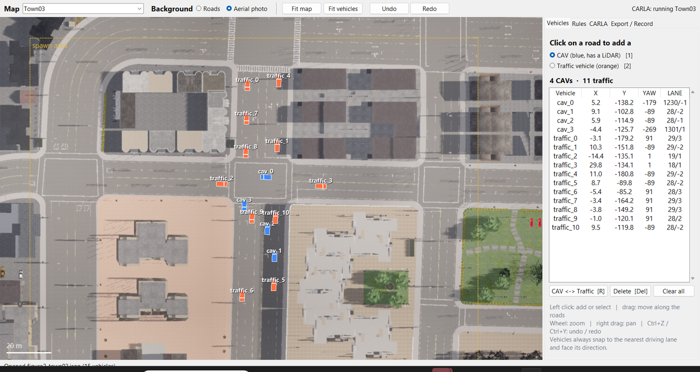
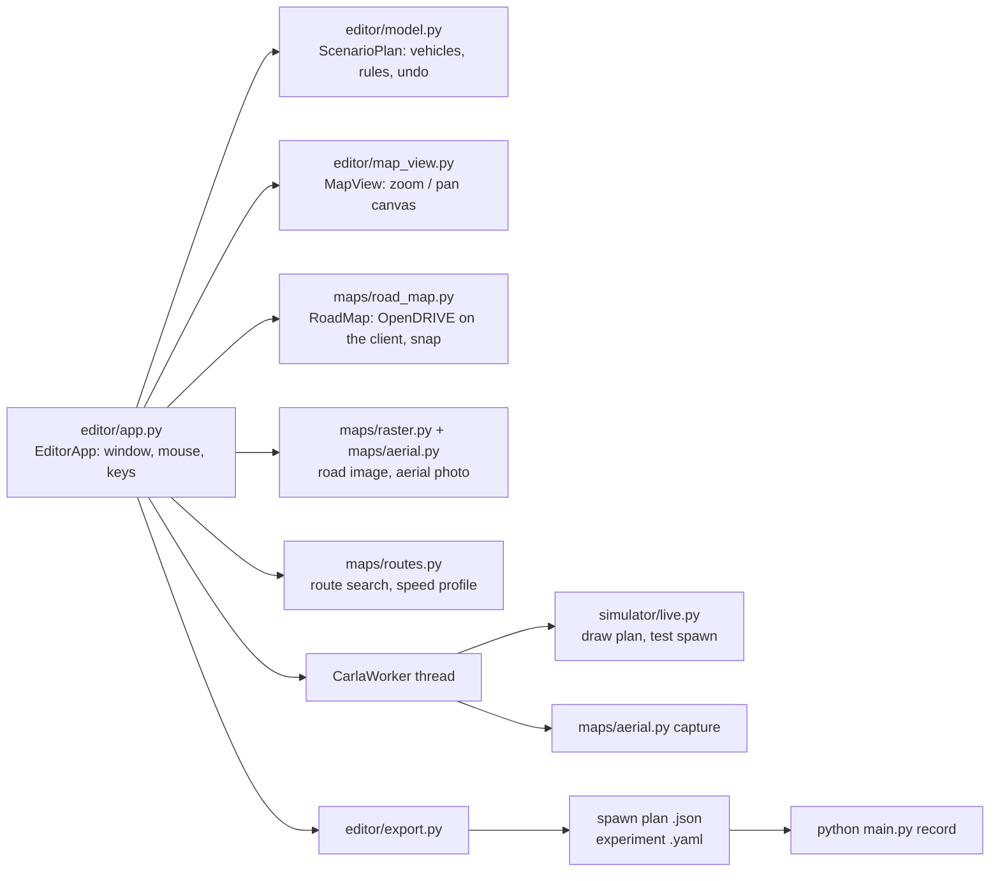

# Scenario editor

A window to place CAVs and traffic vehicles by hand, on **any CARLA map**, give them speeds and routes, check the plan
in the simulator and record it. The result is an ordinary spawn plan + experiment file, recorded and processed like
every other experiment ([GUIDE.md](GUIDE.md)).

```bash
python main.py editor                                            # last map used (Town03 the first time)
python main.py editor --map Town05
python main.py editor --plan config/spawn_plans/figure2_town03.json
```



| You need | For |
|---|---|
| Python env of the project (Tkinter and Pillow come with Python and matplotlib) | the window |
| the CARLA folder (asked once, or `server.carla_root`, or `$CARLA_ROOT`) | the list of maps and their road networks |
| CARLA **running** | only for *Show the plan*, *Test spawn*, the aerial photo and recording |

Placing vehicles works with CARLA closed, or while CARLA runs another map: the road network is read from the map's
OpenDRIVE file on your side.

## The window

```
+------------------------------------------------------------------------------------------+
| Map [Town03 v]  Background (o) Roads ( ) Aerial photo | Fit map  Fit vehicles | Undo Redo  CARLA: Town03 |
+-------------------------------------------------------------+----------------------------+
|                                                             | Vehicles | Rules | CARLA | Export / Record |
|                                                             |                            |
|                 map (zoom, pan, click)                      |  table of vehicles,        |
|                                                             |  speed and route box,      |
|                                                             |  buttons of the tab        |
+-------------------------------------------------------------+----------------------------+
| status: what happened / why a click was refused                  x 2.9  y -136.5  z 0.0 |
+------------------------------------------------------------------------------------------+
```

The status bar (bottom left) always says why a click was refused; the bottom right shows the world coordinates and
road height under the cursor.

---

## Tutorial: a scene from scratch

Goal: 3 CAVs and 4 traffic vehicles around the paper's junction (Town03, junction 1221, centre x 2.9, y −136.5), one
CAV turning right up the sloped leg at 30 km/h, recorded for 10 seconds.

### 1. Open the map

`python main.py editor --map Town03`. If the editor cannot find the CARLA folder (`server.carla_root`, then the
folder it remembers, then `$CARLA_ROOT`), it asks for it once: the folder containing `CarlaUE4.exe`, e.g.
`D:\CARLA\CARLA_0.9.12\WindowsNoEditor`. The roads are drawn once into `data/maps/` (a few seconds) and reused. Zoom with the mouse wheel towards the junction (watch the coordinates bottom right), pan with the right or
middle button. If an aerial photo of the map was taken, switch *Background* to *Aerial photo* to see the buildings.

### 2. Set the rules (tab *Rules*)

- *Only allow vehicles inside this box*: on by default for Town03, with the paper's spawn area (x −100…100,
  y −200…200). The box is drawn on the map and saved with the experiment.
- *Allow vehicles inside junctions*: on by default; switch it off to keep vehicles on the legs only.
- *Max distance to a lane (m)*: how far from a lane a click may be (6 m).

### 3. Place the CAVs

Press **1** (or pick *CAV* in the *Vehicles* tab) and move the mouse over a road: a dashed outline shows where the
vehicle would go, **green** if allowed, **red** if not (outside the box, in a junction, overlapping another vehicle, no
lane nearby; the reason is in the status bar). Left click to place it. The vehicle snaps to the centre of the nearest
driving lane and takes its heading, height and slope, so it always faces the driving direction. Place three CAVs:
`cav_0`, `cav_1`, `cav_2` (blue).

### 4. Place the traffic

Press **2** and click four times: `traffic_0` … `traffic_3` (orange). Vehicles may not overlap (footprint 4.8 × 2.1 m
plus 0.6 m of free space); on a bridge above another road they may.

### 5. Adjust

- Drag a vehicle with the left button: it slides along the lanes and keeps its speed and route.
- **R** switches the selected vehicle between CAV and traffic; **Del** removes it; **Ctrl+Z / Ctrl+Y** undo and redo
  (a whole drag is one step).
- Names follow the order within each role: deleting `cav_0` renames the others. The table on the right lists every
  vehicle with x, y, yaw, lane and its driving.

### 6. Make a CAV drive a route

Select `cav_1` (click it on the map or in the table). In *Speed and route of the selected vehicle*:

1. tick *Own speed* and set 30 km/h;
2. press **T** (or *Draw route*) and click points on the roads in driving order, e.g. one point at the start of the
   sloped +x leg. Each click snaps to the lane under the cursor (green circle and arrow); a point that cannot be reached
   along the lanes from the previous one (other side of the road, one-way street) is refused with the reason;
3. press **Enter** (or **Esc**) to finish; **Backspace** removes the last point;
4. choose *At the last point*: **stop** (it stays there) or **keep driving** (the Traffic Manager takes over).

The traced path is drawn in the vehicle's colour; a red dot marks a stop, an arrow marks "keep driving". The box under
the table gives the route length and its driving time without stops.

A vehicle with only *Own speed* is driven by the Traffic Manager at about that speed; a vehicle with neither is driven
by the Traffic Manager if autopilot is on, otherwise it stays parked (with brakes).


### 7. Save the plan

**Ctrl+S** saves `config/spawn_plans/<name>.json` (File → *Save plan as…* to choose the name). **Ctrl+O** opens a plan
again, **Ctrl+N** starts a new one.

### 8. Check it in CARLA (tab *CARLA*)

Start CARLA with the same map, then:

- *Check connection*: the top-right label shows the map CARLA has loaded;
- *Show the plan in the CARLA window*: boxes, heading arrows, names and routes drawn in the simulator for 60 s, the
  camera placed above them;
- *Test spawn (spawn, check, remove)*: spawns every planned vehicle and removes them at once; lists any vehicle whose
  pose is blocked (a building, a parked car, another vehicle). Fix those before recording.

### 9. Export and record (tab *Export / Record*)

| Field | Meaning (default) |
|---|---|
| Name | file name of the plan and the experiment (`my_scenario`) |
| Extra random traffic | vehicles added at random CARLA spawn points, inside the spawn box if it is on (0) |
| Frames to save | `recording.num_frames` (10) |
| Save every N ticks | `recording.save_every` (20 = one frame per simulated second) |
| Vehicles drive (autopilot) | `scenario.autopilot` (on) |

*Export experiment* writes two files:

```
config/spawn_plans/<name>.json               the vehicles (pose, lane, speed, route)
config/experiments/custom/<name>.yaml        the experiment that uses them
```

```yaml
# Made with the scenario editor (python main.py editor)
server:
  town: Town03
scenario:
  num_cavs: 3
  num_traffic: 4                 # planned traffic + extra random traffic
  spawn_center: [12.4, -130.8]   # mean position of the CAVs (top camera, random spawns)
  spawn_bbox: [-100.0, 100.0, -200.0, 200.0]
  spawn_plan: config/spawn_plans/<name>.json
  autopilot: true
recording:
  warmup_ticks: 100              # 20 when autopilot is off
  num_frames: 10
  save_every: 20
  camera: top
  camera_height: 70.0
```

Export refuses a plan without a CAV, a route that cannot be driven, or a vehicle outside the spawn box, and checks the
YAML exactly as the recorder will. *Export and record now* also starts

```bash
python main.py record --config config/experiments/custom/<name>.yaml --name <name>
```

in a new console window (CARLA must be running with the plan's map), which stays open to show the result.

### 10. Use the recording

The run lands in `data/runs/<date>_<time>_<name>/`. From there: `python main.py show …` to look at it and
`python -m cavlidar.backend.processing …` for the BEV ([GUIDE.md §6–7](GUIDE.md#6-step-3-look-at-a-recording)).

### On another map

1. Pick the map in the *Map* list and place the vehicles (CARLA can keep running Town03).
2. CARLA tab → *Start CARLA on this map next time* (writes CARLA's `DefaultEngine.ini`, keeps a backup), then close
   and reopen CARLA. This is safer than `load_world()`, which crashed CARLA on a 4 GB GPU.
3. Optional: *Take aerial photo of this map* (once; stored in `data/maps/`).
4. *Test spawn*, then *Export and record now*.

The exported YAML sets `server.town`, so `python main.py record` refuses to run if CARLA has another map loaded. Maps
whose level is not installed (Town06 and Town07 in the base 0.9.12 package) are marked *edit only*.


---

## Reference

### Controls

| Action | Mouse / key |
|---|---|
| Add a vehicle | left click on a road (role: **1** = CAV, **2** = traffic) |
| Select / move | left click on a vehicle / drag it (it slides along the lanes) |
| Switch CAV ↔ traffic | **R** |
| Delete | **Del** |
| Draw a route for the selected vehicle | **T**, then left clicks on the roads in driving order; **Enter** / **Esc** ends, **Backspace** removes the last point |
| Zoom / pan | mouse wheel / right or middle drag |
| Fit vehicles | **F** |
| Undo / redo | **Ctrl+Z** / **Ctrl+Y** (a whole drag is one step) |
| New / open / save plan | **Ctrl+N** / **Ctrl+O** / **Ctrl+S** |
| OpenSCENARIO | File → Import / Export OpenSCENARIO (.xosc), see [OPENSCENARIO.md](OPENSCENARIO.md) |

Keys are ignored while typing in a text field.

### Routes and speeds

CARLA 0.9.12's Traffic Manager can neither follow a given path nor hold a given speed, so the project drives routed
vehicles itself (`backend/actors/route_driver.py`).

| Vehicle has | How it drives |
|---|---|
| a route (+ speed, 30 km/h by default) | Follows the path through the clicked points along the lanes (any branch at junctions, lane changes where the markings allow). Holds the speed exactly (CARLA constant-velocity mode), slower in sharp turns (≤ 2.5 m/s² sideways), speeds up at 2.5 m/s², brakes at 3 m/s² for a red light on its route (stops 1 m before the line), for a vehicle on its path ahead (3 m gap) and at the last point. **Stop**: it stays at the last point. **Keep driving**: the Traffic Manager takes over there. |
| only a speed | The Traffic Manager drives it, choosing its own way, at about that speed (0.9.12 only takes a percentage of the road's limit, so the speed is exact on the start road). Drives even when autopilot is off. |
| neither | The Traffic Manager drives it if autopilot is on, else it is parked. |

**Timing.** Routed vehicles hold their planned pose during the recorder's warm-up and start, at their planned speed
(lower if a red light or the end is close), when the recording starts: the first saved frame is the scene you drew,
already moving. Traffic Manager vehicles drive during the warm-up as before.

**In the plan file** (optional keys of a vehicle):

```json
{"role": "cav", "index": 0, "pose": {...},
 "speed_kmh": 30, "route": [[-59.99, -139.56]], "route_end": "stop"}
```

`route_end` is `stop` or `autopilot`. The route is traced again on the server's map when recording; a route that cannot
be driven stops the run before anything is spawned.

**Checked in CARLA 0.9.12 (Town03, junction 1221):** speed within 0.6 km/h of the set speed while cruising; on the path
within 0.05 m on straight roads and 0.44 m in a 90° junction turn; stop at the last point 0.0 m from it; waits at red
(stop line 1 m ahead of the bumper) and goes on green; climbs the sloped +x leg at the set 40 km/h; brakes for a Traffic
Manager vehicle crossing its path; hands over to the Traffic Manager at the end of a "keep driving" route.

### Files

| Path | Content |
|---|---|
| `config/spawn_plans/*.json` | Spawn plans (`map`, `vehicles[role, index, pose, road_id, lane_id, speed_kmh?, route?, route_end?]`), the format read by `scenario.spawn_plan` |
| `config/experiments/custom/*.yaml` | Experiments exported by the editor |
| `data/maps/` | Cached road images, aerial photos, drivable-road rasters and OpenDRIVE files fetched from the server (not in git) |
| `data/editor_settings.json` | CARLA folder and last map (not in git) |

The CARLA folder is taken from `server.carla_root`, then from `data/editor_settings.json`, then `$CARLA_ROOT`;
otherwise the editor asks for it once (File → *CARLA folder…*). Without it, the editor still works on the map currently
loaded in CARLA (its OpenDRIVE is fetched from the server).

---

## Inside the editor (how it is built)

For whoever wants to change it. The editor is plain Tkinter (standard library) + Pillow for the images; it uses the
`carla` Python package only to read road networks and to talk to a running server.



| Module | Role |
|---|---|
| `editor/model.py` | `PlannedVehicle` (role, pose, lane, speed, route, route end) and `ScenarioPlan` (ordered list of vehicles, names, overlap and spawn-box checks, undo / redo, load / save). No window and no CARLA, so it is unit-tested (`tests/test_editor.py`). |
| `editor/map_view.py` | `MapView`, a Tk canvas showing a georeferenced image: `world_to_screen` / `screen_to_world`, zoom around the cursor, pan; the background is re-cropped only when the view changes, overlays are redrawn every time. |
| `editor/app.py` | `EditorApp`: builds the window (toolbar, map, the four tabs, menus, key bindings), turns mouse events into plan edits, draws vehicles, ghosts and routes over the map. |
| `editor/settings.py` | where the CARLA folder and the map cache are; remembers the last map. |
| `editor/export.py` | plan + experiment YAML, the record command, the new console. |
| `editor/openscenario_bridge.py` | `.xosc` ↔ `ScenarioPlan`. |
| `maps/catalog.py` | which maps exist: every `.xodr` in `CarlaUE4/Content/Carla/Maps/OpenDrive`, *installed* if its `.umap` level exists. |
| `maps/road_map.py` | `RoadMap`: `carla.Map(name, xodr_text)` built on the client, lane samples every 1 m, `snap(x, y)`, `road_height(x, y)`. |
| `maps/raster.py` | `Georef` (pixel = (world − min) × pixels per metre) and the road drawing: lanes, sidewalks, markings, direction arrows. |
| `maps/aerial.py` | the aerial photo: a camera 1000 m up looking down with a narrow field of view (nearly orthographic), 900-pixel tiles stitched with the same `Georef` as the road image, so both backgrounds line up. |
| `maps/routes.py` | `trace_route`: A* search over lane waypoints, `speed_profile`. |
| `simulator/live.py`, `simulator/startup_map.py` | drawing a plan in CARLA, test spawn, the start-up map in `DefaultEngine.ini`. |

### What happens on a click

1. `MapView.screen_to_world` turns the pixel into world (x, y).
2. If a vehicle is under the point (`ScenarioPlan.hit`), it is selected and a drag may start.
3. Otherwise `EditorApp._snap` asks `RoadMap.snap`: `get_waypoint(..., project_to_road=True, lane_type=Driving)` gives
   the nearest driving-lane centre. The height used for the query comes from the nearest lane sample, so the right
   level is picked where roads cross at different heights. The pose takes the lane's x, y, z, pitch and yaw.
4. The rules are checked in order: no lane within the max distance → in a junction while not allowed → outside the
   spawn box → overlap with another vehicle (`model.overlap`: separating-axis test of the two footprints grown by the
   gap, skipped when the heights differ by more than 3 m). The first failure becomes the status text and the ghost turns
   red.
5. If everything passes, `ScenarioPlan.add` stores a `PlannedVehicle`; the table and the map are refreshed.

Undo keeps deep copies of the vehicle list (up to 200). A drag calls `begin_change()` once and then
`replace(..., record=False)` for every mouse move, so the whole drag is one undo step.

### Routes

`routes.trace_route(carla_map, start_pose, points)` searches, for each pair of consecutive points, the shortest way
along the lanes with A*: from a waypoint the search may go 2 m ahead along its lane (any branch at a junction), or move
to the neighbouring lane in the same direction where the lane markings allow a change (8 m of driving plus 10 m of
penalty, so a change is used only when needed). A point that cannot be reached raises `RouteError` with the reason.
The same function runs on the editor's client-side map and on the server's map at recording time, so the path drawn
is the path driven. `speed_profile` then lowers the speed in sharp turns (≤ 2.5 m/s² sideways) and brakes to 0 at a
stop (3 m/s²).

### CARLA calls without freezing the window

Everything that talks to the server (status, *Show the plan*, *Test spawn*, aerial photo) is a job put in a queue and
run by one background thread (`CarlaWorker`). The thread puts the result, or the exception, in a result queue; the
window polls that queue every 100 ms (`_poll_worker`) and updates the labels, the progress bar or an error box. The
window therefore stays responsive even when CARLA is slow or closed.

### Extending it

| You want to… | Change |
|---|---|
| add a placement rule | a check in `EditorApp._snap` (return the reason text), and if it must hold for saved plans, in `ScenarioPlan` |
| store a new vehicle property | a field in `PlannedVehicle`, `ScenarioPlan.to_records` / `load`, and its parsing in `actors/spawn_plan.py` so the recorder uses it |
| add a button that uses CARLA | a `_job_…(worker, …)` function, `worker.submit("name", …)` from the button, and the result in `_on_worker_result` |
| add a tab | a `_build_…_tab` method and one `side.add(...)` line in `_build` |
| export more settings | `ExportOptions` and `experiment_dict` in `editor/export.py` (the YAML is validated by `load_config` before it is written) |
