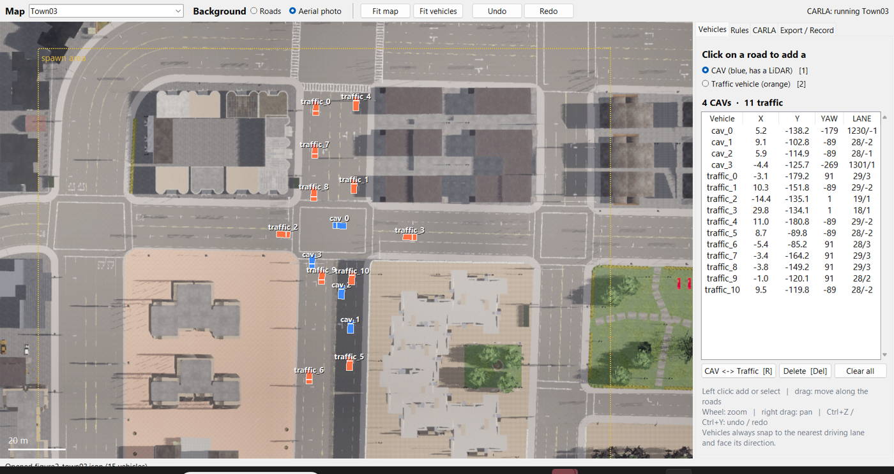
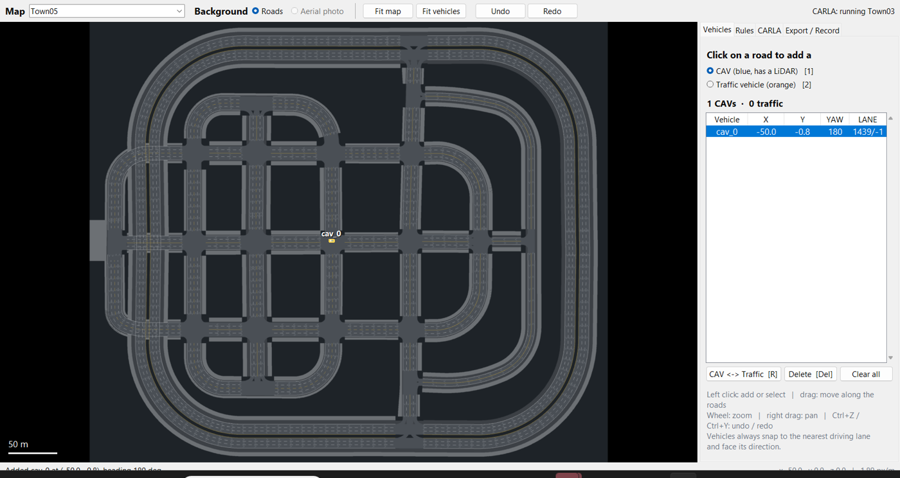

# Scenario editor

A window to place CAVs and traffic vehicles by hand, on **any CARLA map**, then record the scene.

```bash
python main.py editor                                            # last map used
python main.py editor --map Town05
python main.py editor --plan config/spawn_plans/figure2_town03.json
```



## How it works

| Part | What it does |
|---|---|
| **Map list** | Every map that has an OpenDRIVE file in the CARLA folder (`CarlaUE4/Content/Carla/Maps/OpenDrive/*.xodr`). The road network is read on the client (`carla.Map(name, xodr)`), so **any map can be edited while CARLA runs another one, or is closed**. Maps whose level is not installed (Town06 and Town07 in the base 0.9.12 package) are marked *edit only*. |
| **Roads background** | Lanes, sidewalks, lane markings and driving-direction arrows, drawn from OpenDRIVE. Rendered once per map into `data/maps/<Town>_roads.png`. |
| **Aerial photo background** | A near-orthographic photo taken from CARLA (camera 1000 m up, narrow field of view, tiles stitched). Needs that map loaded in CARLA; taken once and stored in `data/maps/<Town>_aerial.png`. Aligned with the roads image to the pixel. |
| **Placing** | A click snaps to the nearest driving lane (≤ 6 m) and takes the lane's heading, height and slope. A dashed outline under the cursor shows where the vehicle would go: green = allowed, red = not allowed (reason in the status bar). |
| **Rules** | Vehicles never overlap (4.8 × 2.1 m footprint + 0.6 m gap; different road levels are ignored). Optional spawn area (default: the paper's box on Town03). Optional ban on junctions. |
| **CARLA tab** | *Show the plan in the CARLA window* (boxes, arrows and names drawn for 60 s, camera moved above). *Test spawn* (spawns every vehicle, reports blocked ones, removes them). *Aerial photo*. *Start CARLA on this map next time* (writes `DefaultEngine.ini`, keeps a backup; restart CARLA afterwards). |
| **Export / Record** | Writes `config/spawn_plans/<name>.json` and `config/experiments/custom/<name>.yaml` (map, counts, spawn plan, spawn area, autopilot, frames), checks the YAML like the recorder does, and can start `python main.py record` in a new console. *Extra random traffic* adds vehicles at random CARLA spawn points on top of the planned ones. |

## Controls

| Action | Mouse / key |
|---|---|
| Add a vehicle | left click on a road (role: **1** = CAV, **2** = traffic) |
| Select / move | left click on a vehicle / drag it (it slides along the lanes) |
| Switch CAV ↔ traffic | **R** |
| Delete | **Del** |
| Zoom / pan | mouse wheel / right or middle drag |
| Fit vehicles | **F** |
| Undo / redo | **Ctrl+Z** / **Ctrl+Y** (a whole drag is one step) |
| New / open / save plan | **Ctrl+N** / **Ctrl+O** / **Ctrl+S** |
| OpenSCENARIO | File → Import / Export OpenSCENARIO (.xosc), see [OPENSCENARIO.md](OPENSCENARIO.md) |

## Recording on another map

1. Pick the map in the editor and place the vehicles (CARLA can keep running Town03).
2. CARLA tab → *Start CARLA on this map next time*, then close and reopen CARLA.
3. Optional: *Take aerial photo of this map* (once).
4. *Test spawn*, then Export / Record → *Export and record now*.

The exported YAML sets `server.town`, so `python main.py record` refuses to run if CARLA has another map loaded.



## Files

| Path | Content |
|---|---|
| `config/spawn_plans/*.json` | Spawn plans (`map`, `vehicles[role, index, pose, road_id, lane_id]`), the format read by `scenario.spawn_plan` |
| `config/experiments/custom/*.yaml` | Experiments exported by the editor |
| `data/maps/` | Cached road images, aerial photos and OpenDRIVE files fetched from the server (not in git) |
| `data/editor_settings.json` | CARLA folder and last map (not in git) |

The CARLA folder is taken from `server.carla_root`, then from `data/editor_settings.json`, then `$CARLA_ROOT`; otherwise the editor asks for it once (File → CARLA folder...). Without it, the editor still works on the map currently loaded in CARLA (its OpenDRIVE is fetched from the server).
