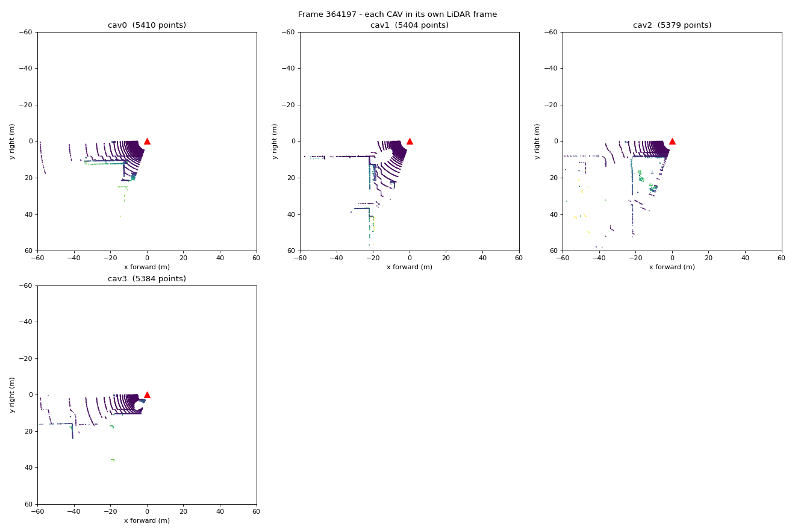
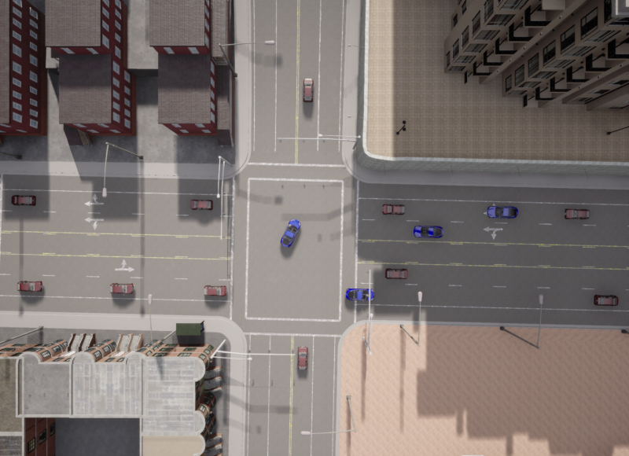

# Experiments

Each file in `config/experiments/` lists only the parameters it changes; everything else comes from `config/default.yaml`.

```bash
python main.py record --config config/experiments/<group>/<file>.yaml --name <short_name>
python main.py show data/runs/<run_folder> --view both
```

Compare runs by looking at the `Done: … points per CAV scan` and `Mean CAV speed` lines, the two preview images, `spawn.json` and `meta.json`.

## Ready-made experiments

### `scenario/` — who is on the road

| File | Changes | What to observe |
|---|---|---|
| `e01_baseline_4cavs.yaml` | 4 CAVs + 20 vehicles at random spawn points around the Figure 2 junction (2.9, −136.5), only inside the paper's spawn area x∈[−100, 100], y∈[−200, 200]; camera above the junction. | Reference run. In `preview_world.png`, walls seen by two CAVs must overlap exactly; blind areas behind buildings and cars are visible. |
| `e02_paper_10cavs.yaml` | 10 CAVs + 40 vehicles, radius 120 m, paper spawn area. | Densest paper setting. Time per tick ≈ 0.15 s. Much more overlap between CAVs → much more redundant data (what the paper's optimization removes). |
| `e08_chaotic_traffic.yaml` | 40 vehicles, up to 30 % over the limit, 0–100 % chance to run red lights. Not a paper baseline (paper: ±20 %). | More vehicles inside the junction at the same time; more occlusions. |
| `e11_figure2_exact.yaml` | The paper's Figure 2: 4 CAVs + 11 vehicles at the drawn positions, parked. | Same layout as the figure (image below). The reference scene for checking occlusions: e.g. CAV 0 in the junction hides part of the right arm from CAV 3. |
| `e12_figure2_driving.yaml` | Starts from Figure 2, adds 9 random vehicles (20 non-CAVs), everyone drives, 1 frame per second. | How the Figure 2 scene evolves; red lights run 0–100 %. |

### `lidar/` — the sensor

| File | Changes | What to observe |
|---|---|---|
| `e03_lidar_64ch.yaml` | 64 channels, 2.2M pts/s. | ≈ 2× points per scan, denser rings, bigger files. Small/far vehicles get more points. |
| `e04_short_range_50m.yaml` | Range 50 m. | Each CAV sees much less; vehicles far from all CAVs disappear. |
| `e05_ideal_lidar.yaml` | No drop-off. | ≈ 2× points vs. baseline — shows how much CARLA's default 45 % drop removes. |
| `e06_noisy_lidar.yaml` | 5 cm range noise. | Walls become thick bands; matters later for ground removal and clustering. |
| `e07_low_mount.yaml` | Sensor at 1.6 m instead of 2.4 m. | Bigger shadows behind nearby cars; fewer points far away. |

### `recording/` — how data is saved

| File | Changes | What to observe |
|---|---|---|
| `e09_partial_sweep_demo.yaml` | Tick of 0.01 s with a 20 Hz LiDAR. | A warning is printed and each scan covers only **72°** (~5,300 points). This is the bug of the first asynchronous `02_lidar_capture.py`. |
| `e10_export_ply.yaml` | 3 frames, saved as `.npy` **and** `.ply`. | Open `frames/<n>/cav0.ply` in MeshLab or CloudCompare. |





*`e11`: the vehicles of the paper's Figure 2 on Town03 junction 1221. To rebuild the plan: `python tools/make_figure2_plan.py` (CARLA running).*

## New cases to try

Write a new YAML (or use `--set`). Ideas, from easy to closer to the paper:

1. **Same scene, different seed** — `--set simulation.seed=1`, `=2`, `=3`: new vehicle positions; check the result changes but stays plausible.
2. **Reproducibility** — run `e01` twice: point counts must be identical frame by frame.
3. **Paper density sweep** — four runs with `scenario.num_cavs` = 4, 6, 8, 10 and `num_traffic` = 20, 27, 33, 40. Note the time per tick and the points per scan.
4. **One frame per second** — `--set recording.save_every=20 --set recording.num_frames=30`: 30 s of driving, less redundant frames.
5. **Trucks as occluders** — `--set scenario.traffic_blueprint=vehicle.carlamotors.carlacola`: big vehicles hide much more of the scene.
6. **Sensor on the bumper** — `--set lidar.mount_x=2.3 --set lidar.mount_z=0.7`: the car's own body hides everything behind it.
7. **Wide vertical field** — `--set lidar.upper_fov=15 --set lidar.lower_fov=-25`: more points on buildings, fewer on the road.
8. **10 Hz LiDAR** — `--set lidar.rotation_frequency=10 --set simulation.fixed_delta_seconds=0.1`: twice the points per sweep, half the frames per second.
9. **Another junction** — other large Town03 junctions: `[83.5, -134.7]` (top of the sloped leg), `[-82.4, -138.2]`, `[1.1, 133.7]`. Use `--set scenario.spawn_center=[x,y] --set recording.camera=top`.
10. **Fast dataset collection** — `--set simulation.no_rendering=true --set recording.preview=false --set recording.num_frames=100`.

When a case is useful, save it as a new file in the right group folder (`scenario/`, `lidar/`, `recording/`) with the next number (`e11_…`), and add a line to this page.
