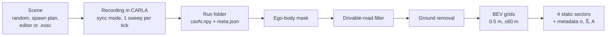
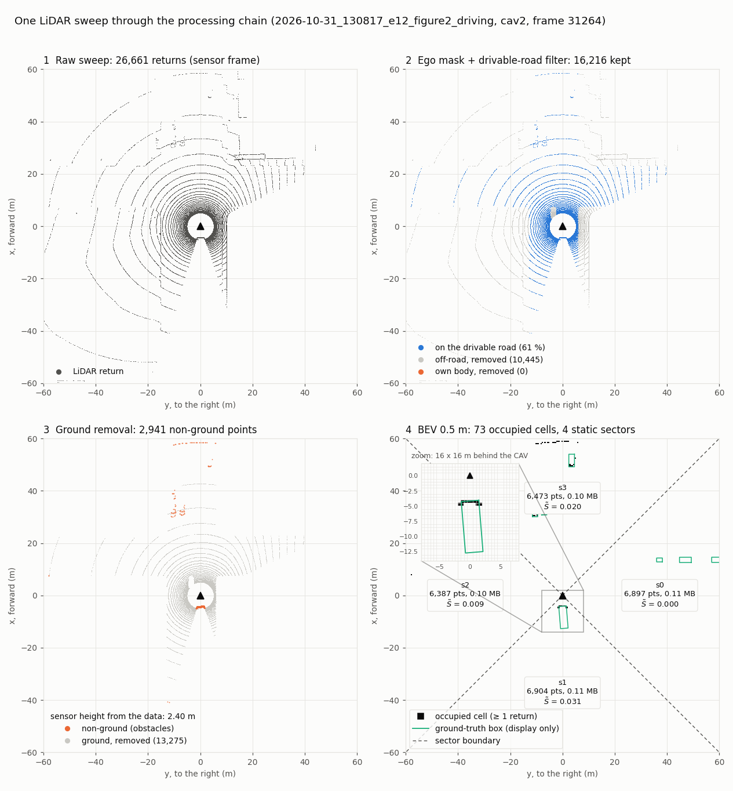
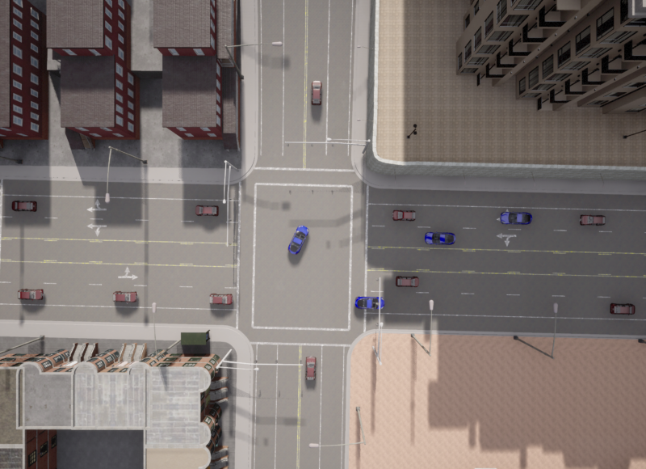
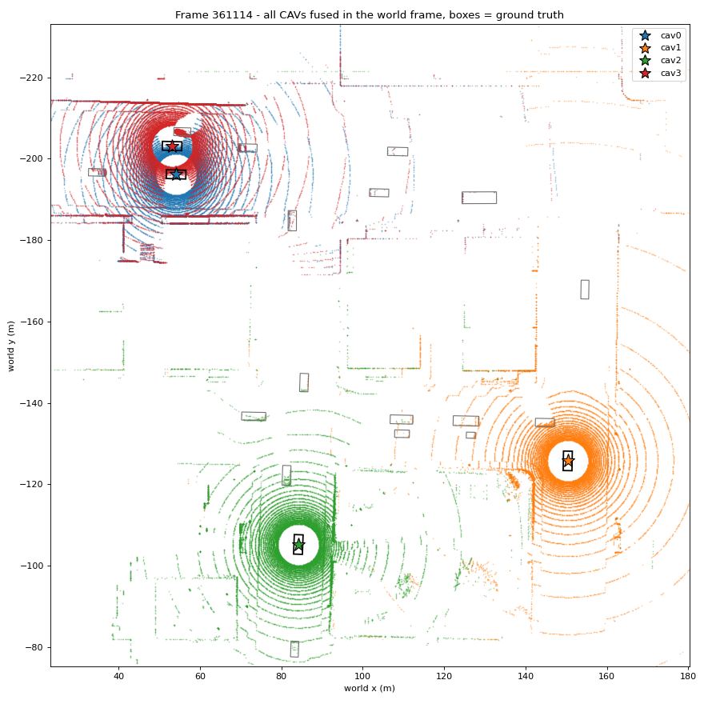
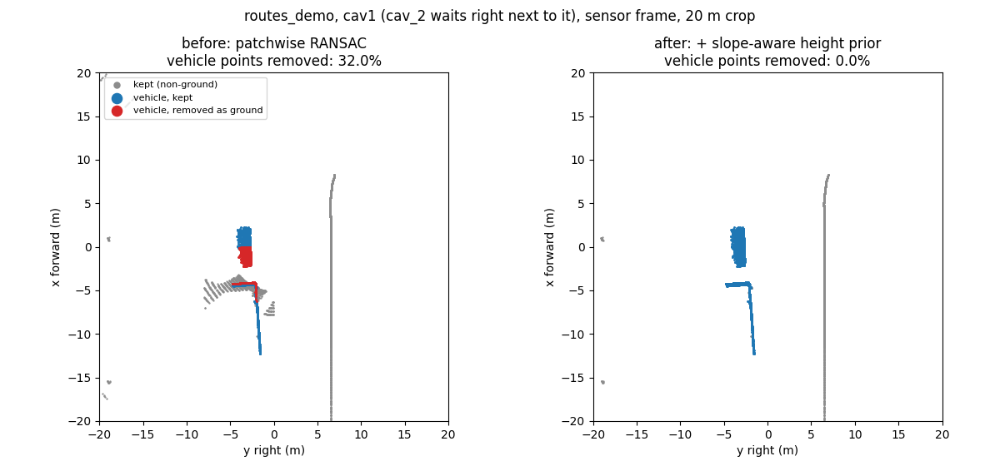

# From CARLA to the BEV: the complete guide

This guide follows one LiDAR sweep from the simulator to the bird's-eye-view (BEV) grid and its sector metadata. It
says what each step does, why it is done that way, which file does it, and what was measured. Read it from top to
bottom the first time; afterwards each section stands on its own.



Steps A–B need CARLA running. Everything from C onwards runs offline, on recorded files, without CARLA.



*One real sweep (e12, cav2): 26 661 returns → 16 216 on the drivable road → 2 941 non-ground points → 73 occupied
BEV cells in 4 sectors. Made with `tools/make_pipeline_figure.py`; the numbers equal the processing's own
`summary.json` for that frame.*

## Contents

1. [The ideas you need](#1-the-ideas-you-need)
2. [Install and first run](#2-install-and-first-run)
3. [Parameters: how a run is described](#3-parameters-how-a-run-is-described)
4. [Step 1: describe the scene](#4-step-1-describe-the-scene)
5. [Step 2: record](#5-step-2-record)
6. [Step 3: look at a recording](#6-step-3-look-at-a-recording)
7. [Step 4: from the point cloud to the BEV](#7-step-4-from-the-point-cloud-to-the-bev)
8. [Step 5: check against the ground truth](#8-step-5-check-against-the-ground-truth)
9. [Step 6: how robust is LiDAR → BEV (sensitivity benchmark)](#9-step-6-how-robust-is-lidar--bev)
10. [Worked example: e12 from zero to BEV](#10-worked-example-e12-from-zero-to-bev)
11. [Troubleshooting](#11-troubleshooting)
12. [Glossary](#12-glossary)

---

## 1. The ideas you need

### CAVs, traffic and ground truth

- A **CAV** (connected and autonomous vehicle) carries one LiDAR. In the files the CAVs are `cav_0`, `cav_1`, … (actor
  names) and their clouds are `cav0.npy`, `cav1.npy`, …
- A **traffic** vehicle has no sensor. It is an obstacle that the CAVs should see.
- The **ground truth** is what CARLA knows exactly: every vehicle's pose, box and speed at the frame of the sweep. It is
  saved with every frame and used **only to score** the processing, never by the processing itself.

### Frames and poses

CARLA (Unreal Engine) uses a **left-handed** frame: **x forward, y to the right, z up**, angles in degrees. Seen from
above, a positive yaw turns clockwise.

| Frame | Origin | Used for |
|---|---|---|
| world | the map's origin | vehicle poses, ground truth, the drivable-road map, sector footprints |
| sensor | the LiDAR, x along the car's heading | the recorded clouds, ground removal, BEV, sectors |
| vehicle | the car's origin on the ground | the body box of the ego mask, the LiDAR mount |

A pose is a dict `{x, y, z, roll, pitch, yaw}`. `geometry/transforms.py` turns it into the 4 × 4 sensor-to-world
matrix (`pose_to_matrix`, same formula as CARLA) and moves clouds into the world frame (`sensor_to_world`).

### One LiDAR sweep

The paper's LiDAR (Table 1): 32 channels (lasers stacked from −25° to +2°), 120 m range, 1 000 000 points per second,
20 rotations per second. One rotation therefore casts 50 000 rays. CARLA randomly drops 45 % of the returns by default
(`dropoff_general_rate`), and rays into the sky return nothing, so a recorded sweep holds about **27 000 points**. Each
point is `x, y, z, intensity` (float32) in the sensor frame.

### Why synchronous mode matters

In CARLA's default asynchronous mode the server runs as fast as it can (~140 frames per second here) and each LiDAR
measurement is only the slice the laser swept during one frame (~50° here, not 360°). In **synchronous mode** the server
waits for the client and advances by exactly `fixed_delta_seconds` per `tick()`. With
`fixed_delta_seconds = 1 / rotation_frequency = 0.05 s`, **every tick gives one full 360° sweep**, and the sweep, the
sensor pose and the vehicle boxes of that tick describe the same instant. The config checker warns when the two values
do not match (`e09_partial_sweep_demo` shows the 72° slices on purpose).

### BEV grid

A BEV grid is a top view of the scene cut into square cells (0.5 m here). A cell is **occupied** when at least one
non-ground return falls in it. An empty cell means "no return", **not** "free": the LiDAR may simply not see it
(occlusion, distance).

### Sectors and metadata

The paper divides each CAV's surroundings into angular **sectors** (here 4 fixed sectors starting at 45°) and describes
each one with three numbers: its size σ (bytes of its raw points), its quality S̃ (how much obstacle surface it holds)
and its footprint A (the wedge it covers, in the world frame). These are the inputs of the paper's sharing optimization,
which chooses which sectors to send to which CAV. This repository stops at the metadata.

---

## 2. Install and first run

| Need | Version / note |
|---|---|
| CARLA | 0.9.12 (Windows package `CARLA_0.9.12\WindowsNoEditor`) |
| Python | 3.7 or 3.8 (CARLA 0.9.12 client wheels exist only for these) |
| Packages | `carla==0.9.12`, `numpy`, `pyyaml`, `matplotlib` (brings Pillow, used by the editor) |
| GPU | tested on a GTX 1650 4 GB; close other programs that hold GPU memory |

```bash
conda create -n carla012 python=3.8 -y
conda activate carla012
pip install -r requirements.txt
```

**Start CARLA** and keep its window open:

```bash
CarlaUE4.exe -windowed -ResX=1280 -ResY=720
```

Do not add `-quality-level=Low`: on a 4 GB GPU CARLA 0.9.12 crashes with *"Shader compilation failures are Fatal"*.
Changing the map from Python (`load_world()`) also crashed the server, so the map CARLA opens at start is set in
`CarlaUE4/Config/DefaultEngine.ini` (the editor's CARLA tab has a button for it; restart CARLA afterwards). The default
map of every experiment is Town03, the paper's map.

**First commands:**

```bash
python main.py check                  # connection, versions, map, spawn points
python main.py drive --seconds 40     # spawn the default scene and watch it drive (saves nothing)
python -m unittest discover -s tests -t . -v   # 99 tests, no CARLA needed
```

`check` ends with `[SUCCESS] Connected to CARLA, map Town03 ready.` If it fails, see
[Troubleshooting](#11-troubleshooting).

---

## 3. Parameters: how a run is described

Every parameter lives in one YAML tree. Three layers, the later one wins:

```bash
config/default.yaml                                    # 1. every parameter with its default
config/experiments/<group>/<name>.yaml                 # 2. an experiment lists only what it changes
python main.py record --set lidar.channels=64          # 3. one-off overrides on the command line
```

| Section | What it controls | Key parameters (default) |
|---|---|---|
| `server` | connection and map | `town` (Town03), `allow_map_change` (false), `carla_root` (null) |
| `simulation` | time step and randomness | `fixed_delta_seconds` (0.05), `no_rendering` (false), `seed` (7) |
| `scenario` | who is on the road | `num_cavs` (4), `num_traffic` (20), `spawn_center`, `spawn_radius`, `spawn_bbox`, `spawn_plan`, `autopilot` (true), `speed_difference_range` ([−20, 20] %), `ignore_lights_range` |
| `lidar` | the sensor (paper's Table 1) | `channels` (32), `range` (120), `points_per_second` (1 000 000), `rotation_frequency` (20), `upper_fov` / `lower_fov` (2 / −25), `mount_z` (2.4), `dropoff_general_rate` (0.45), `noise_stddev` (0) |
| `recording` | what is saved | `warmup_ticks` (100), `num_frames` (10), `save_every` (1), `formats` ([npy]), `save_ground_truth` (true), `camera`, `preview` |

Every key is explained with its effect in [PARAMETERS.md](PARAMETERS.md). `core/config.py` checks the whole tree before
CARLA is touched: an impossible value (negative range, unknown camera mode, a typo in a key) stops with `ConfigError`
and the reason; a doubtful one (partial sweeps, a warm-up shorter than the 3 s the Traffic Manager needs to start the
cars) is logged as a warning.

Example, the main 4-CAV dataset (`config/experiments/scenario/e12_figure2_driving.yaml`):

```yaml
scenario:
  num_cavs: 4
  num_traffic: 20
  spawn_center: [2.9, -136.5]          # junction 1221, the paper's Figure 2
  spawn_radius: 80.0
  spawn_bbox: [-100, 100, -200, 200]   # the paper's spawn area (Table 1)
  spawn_plan: config/spawn_plans/figure2_town03.json
  ignore_lights_range: [0, 100]
recording:
  warmup_ticks: 100                    # 5 s before the first saved frame
  num_frames: 10
  save_every: 20                       # one frame per simulated second
  camera: top
  camera_height: 70.0
```

The same from Python:

```python
from cavlidar import load_config, record_lidar
cfg = load_config("config/experiments/scenario/e12_figure2_driving.yaml", overrides=["recording.num_frames=3"])
run_dir = record_lidar(cfg, name="e12_short")
```

---

## 4. Step 1: describe the scene

There are four ways to say where the vehicles start. They can be combined: a plan fixes some vehicles and the rest are
added at random.

| Way | How | When to use it |
|---|---|---|
| **Random** | `scenario.num_cavs`, `num_traffic`; CARLA's road spawn points, nearest to `spawn_center` first (within `spawn_radius`), never outside `spawn_bbox`; `simulation.seed` makes it repeatable | many scenes quickly |
| **Spawn plan** | a JSON file of exact poses, `scenario.spawn_plan` | a fixed scene, e.g. the paper's Figure 2 (`config/spawn_plans/figure2_town03.json`) |
| **Scenario editor** | `python main.py editor`: click the vehicles on a map, draw routes, export | a scene designed by hand, on any map. Tutorial: [EDITOR.md](EDITOR.md) |
| **OpenSCENARIO** | `python main.py xosc-import scene.xosc --name my_scene` | a scene from CARLA's QGIS editor or ScenarioRunner. See [OPENSCENARIO.md](OPENSCENARIO.md) |

A spawn plan entry:

```json
{"role": "cav", "index": 0,
 "pose": {"x": 5.21, "y": -138.16, "z": 0.0, "roll": 0.0, "pitch": 0.0, "yaw": -178.8},
 "road_id": 1230, "lane_id": -1,
 "speed_kmh": 30, "route": [[-59.99, -139.56]], "route_end": "stop"}
```

`speed_kmh`, `route` and `route_end` are optional. Who drives what:

| A vehicle has | It is driven by |
|---|---|
| a route | our route driver (`actors/route_driver.py`): follows the lanes through the route points at the set speed, brakes for red lights and vehicles ahead, stops at the end or hands over to the Traffic Manager |
| only a speed | the Traffic Manager, at about that speed |
| neither | the Traffic Manager if `scenario.autopilot` is true, else it is **parked** with the brake and hand brake on (without them, parked cars rolled down Town03's 12° slope) |

**The paper's Figure 2.** Its junction is Town03 junction 1221 (centre 2.9, −136.5), found by comparing a top-down
photo of each of the 25 Town03 junctions with the figure; its +x leg climbs 8 m (12°). The vehicles drawn in the figure
were converted to world positions and snapped to lanes by `tools/make_figure2_plan.py` (within 1.2 m of the figure).



---

## 5. Step 2: record

```bash
python main.py record --config config/experiments/scenario/e12_figure2_driving.yaml --name e12
```

What happens, in order (`api.record_lidar` → `simulator/session.py` → `recording/recorder.py`):

| # | Step | Code | Detail |
|---|---|---|---|
| 1 | Load and check the parameters | `core/config.py` | errors stop here, before CARLA |
| 2 | Connect, check the map | `simulator/connection.py` | `MapMismatch` if CARLA has another map loaded and `allow_map_change` is false |
| 3 | Synchronous mode | `simulator/sync.py` | `synchronous_mode = True`, `fixed_delta_seconds = 0.05`, Traffic Manager in sync mode with the run's seed |
| 4 | Trace the planned routes | `maps/routes.py` | a route that cannot be driven stops the run before anything is spawned |
| 5 | Spawn the vehicles | `actors/vehicles.py` | planned vehicles first, at their exact pose (all must spawn); then random ones; `SpawnError` if fewer than asked |
| 6 | Decide who drives | `session.spawn_fleet` | route driver / Traffic Manager / parked with brakes (table above) |
| 7 | Mount one LiDAR per CAV | `actors/lidar.py` | ray-cast LiDAR with the `lidar.*` attributes, attached at `mount_x/y/z` |
| 8 | Save the start poses | `spawn.json` | every vehicle, right after spawning |
| 9 | Warm-up | `recorder.record` | `warmup_ticks` ticks (5 s): the Traffic Manager holds new cars for about 2 s; routed vehicles wait at their planned pose and start when the recording starts |
| 10 | Record | `recorder.record` | each tick: `world.tick()` returns the frame number; each LiDAR's measurement **of that frame** is taken (older ones are discarded, a newer one is an error, 30 s timeout); every `save_every`-th tick is written |
| 11 | Write a frame | `recording/storage.py` | `cavN.npy` per CAV and `meta.json` with the sensor poses and the ground truth read in the same tick |
| 12 | Check motion | `recorder._check_motion` | warns if every CAV stayed below 1 km/h while they should drive |
| 13 | Clean up | `SimulationSession.__exit__` | sensors and vehicles destroyed, asynchronous settings restored, even after an error or Ctrl+C |

**Are the boxes of moving vehicles taken at the same instant as the sweep?** Yes. A controlled diagnostic with CARLA's
semantic LiDAR (which labels each return with the vehicle it hit) measured a time offset of +0.0005 s
[−0.0024, +0.0036] between boxes and returns, where a box one tick late would give −0.05 s. See
[LABEL_ALIGNMENT.md](LABEL_ALIGNMENT.md).

### The run folder

```
data/runs/2026-10-31_130817_e12_figure2_driving/
├── config.yaml            every parameter actually used (re-run it with --config)
├── spawn.json             every vehicle's pose right after spawning
├── preview_sensor.png     last frame, each CAV in its own frame
├── preview_world.png      last frame, all CAVs in the world frame + ground-truth boxes
└── frames/031264/
    ├── cav0.npy … cav3.npy    (N, 4) float32: x, y, z, intensity, sensor frame
    └── meta.json
```

`meta.json` (real values from e12, shortened):

```json
{"frame": 31264, "timestamp": 336.19, "town": "Town03",
 "cavs": {"cav2": {"vehicle_id": 124, "mount_z": 2.4, "num_points": 26661,
                   "sensor_pose": {"x": 6.013, "y": -121.205, "z": 2.402,
                                   "roll": 0.0002, "pitch": 0.0062, "yaw": -88.59}}},
 "vehicles": [{"id": 129, "type_id": "vehicle.audi.tt", "role": "traffic", "name": "traffic_3",
               "pose": {"x": 65.50, "y": -133.37, "z": 7.52, "roll": 0.0, "pitch": 4.40, "yaw": 1.23},
               "extent": [2.091, 0.997, 0.693], "center_offset": [0.0, 0.0, 0.693], "speed_mps": 0.0}]}
```

`extent` holds the box half-sizes (m) and `center_offset` the box centre in the vehicle frame. The pitch of 4.4° in the
example is a car on the sloped leg.

Recording speed on the test machine: 0.06 s per tick with 4 CAVs + 20 vehicles, 0.15 s with 10 CAVs + 40.

---

## 6. Step 3: look at a recording

```bash
python main.py show data/runs/<run> --view both      # last frame; --frame N for another one
```

writes `preview_sensor.png` and `preview_world.png` into the run folder (no CARLA needed). The world view is a quick
check that the poses are right: walls seen by two CAVs must lie on top of each other.



In Python:

```python
from cavlidar.backend.recording import storage
frames = storage.list_frames(run_dir)
meta, clouds = storage.load_frame(run_dir, frames[-1])   # clouds = {"cav0": (N, 4) array, ...}
```

---

## 7. Step 4: from the point cloud to the BEV

```bash
python -m cavlidar.backend.processing data/runs/<run>                  # last frame
python -m cavlidar.backend.processing data/runs/<run> --frame 31264
```

For every CAV of the frame: **ego-body mask → drivable-road filter → ground removal → BEV → static sectors → metadata**.
The raw files in `frames/` are never changed; everything goes to `data/runs/<run>/processed/<frame>/`.

| Option | Default | Meaning |
|---|---|---|
| `--frame` | last | CARLA frame number |
| `--no-ego-mask`, `--ego-margin` | on, 0.1 m | remove the CAV's own body |
| `--no-road-filter`, `--road-margin` | on, 0.5 m | keep only the drivable road |
| `--patch-size`, `--threshold`, `--iterations` | 8 m, 0.18 m, 70 | ground removal |
| `--max-step`, `--max-slope` | 0.5 m, 15° | ground removal |
| `--resolution`, `--range` | 0.5 m, 60 m | BEV cell size and half side |
| `--sectors`, `--sector-start`, `--downsample` | 4, 45°, 0.2 m | sectors and quality |
| `--no-preview` | previews on | skip the PNGs |

The road filter needs the map's OpenDRIVE file. It is found through `server.carla_root`, the CARLA folder remembered by
the editor, or the `CARLA_ROOT` environment variable.

### 7.1 Ego-body mask (`processing/ego_mask.py`)

**Why.** Below about 2 m the LiDAR hits its own car: at a 1.6 m mount, 9 244 returns per scan (35 % of it) were the
CAV's roof and hood. They are not obstacles and would inflate the BEV and the sector quality.

**How.** Two fixed things are used, nothing per frame: the LiDAR mount in the vehicle frame (`lidar.mount_*` of the
run) and the CAV model's body box, measured once from CARLA (`EGO_MODELS`; Tesla Model 3: half sizes
2.396 × 1.082 × 0.744 m, centre 0.029 / 0 / 0.736 m). Each point is moved from the sensor frame to the vehicle frame;
it is removed if it lies inside the box grown by 0.1 m on every side. Because the sensor is rigidly attached, the box is
fixed in the sensor frame and does not change when the car pitches on a slope.

**Invalid mount.** If the sensor itself lies inside the body box (e.g. 1.2 m on a Model 3, whose roof is at 1.48 m),
the recording is physically impossible: `summary.json` reports `mount_valid: false` and a warning is printed.

**Measured.** Own points left 9 244 → 0 (1.6 m) and 917 → 0 (1.9 m); points of other vehicles removed: 0 in 240 runs; at
the default 2.4 m nothing changes.

### 7.2 Drivable-road filter (`processing/road_filter.py`)

**Why.** The paper isolates "the drivable road region" before ground removal, to drop buildings, sidewalks, poles and
vegetation. It does not say how.

**How.** The region comes from the map's OpenDRIVE lanes (an HD map, as in OpenCDA / OpenCOOD):

1. sample every Driving lane each 1 m (`carla.Map.generate_waypoints`), plus the Parking and Bidirectional lanes next to
   them;
2. fill each sample's rectangle (1 m long, lane-width wide, along the lane heading) with points;
3. rasterise them on a 0.25 m grid in the world frame and grow the result by 0.5 m (curbs, wheels over the line);
4. cache the raster in `data/maps/Town03_drivable_0.25m_margin0.5m.npz` (built in 1.8 s, loaded in 0.05 s).

For each scan, the points are moved to the world frame with the sensor pose, and a point is kept when its (x, y) falls
in a road cell, **at any height**: no road elevation and no vehicle box is used, so vehicles stay whole.

**Measured.** It removes 42 % of the returns and no vehicle point (260 scans); 7–35 ms per CAV.

### 7.3 Ground removal (`processing/ground.py`)

**Why it is not a single plane.** Junction 1221 has a 12° leg, so one plane cannot fit the road. A plain per-patch
RANSAC, on the other hand, sometimes fits a plane on a car roof or along a car's side and removes the car. The first
prototype did exactly that: 11 % of vehicle points removed, and 22–37 % of a car parked a few metres from a CAV.

**How.** The scan (sensor frame) is cut into **8 × 8 m patches**. Each patch may get its own plane `z = ax + by + c`,
but a plane is accepted only if the LiDAR data around it agrees that it is the ground:

1. **Seed.** First, the ground right around the sensor is fitted: RANSAC on the lowest 30 % of the returns 2.5–15 m
   away. It gives the sensor height and tilt from the data alone (2.37–2.40 m found for a 2.4 m mount).
2. **From the sensor outwards.** Patches are processed by distance from the sensor. For each one, 70 random planes are
   drawn from its lowest 45 % of points (steeper than 15° is discarded).
3. **Three tests for each candidate plane:**
   - *continuity*: at the corners of the side facing each already accepted neighbour, the plane must be within 0.5 m
     (`max_step`) of that neighbour's plane, for the majority of neighbours (the seed plays the neighbour for the first
     patches). The ground may bend with a slope, but cannot jump 1.45 m onto a roof or tilt up a car's side;
   - *lowest surface*: at most 3 % of the patch's points may lie 0.45 m or more below the plane (a plane on a roof has
     the road around the car under it);
   - *evidence*: at least 15 % of the patch's points within 0.18 m of the plane.
4. Among the planes that pass, the one with the most points within 0.18 m wins; it is refined by least squares, and
   those points are labelled ground.
5. **Sparse or rejected patches** (fewer than 18 points, or no plane passed): only points within 0.18 m of the plane
   predicted by the accepted neighbours become ground; with no accepted neighbour, every point is kept. A sparse patch
   with at least 3 points on the prediction passes it on to the next patch outwards.

Unknown is kept, never guessed: a wrong guess on a slope would remove vehicle points. Nothing but the points is used: no
map height, no boxes.

**Measured** (200 scans of 5 runs, ground truth for scoring only): vehicle points removed **11.0 % → 0.26 %**; ground
left in the cloud 2.6 % → 1.5 %; the five close pairs 22–37 % → **0 %**; vehicles on the slope 13.2 % → 0.05 %. With the
road filter in front (260 scans): 0.20 % of vehicle points removed, 0.77 % of the ground left. **Known limit:** far
slope ground seen with nothing observed in between (93–119 m away) is kept: 15 % of it in two runs.



### 7.4 BEV grids (`processing/bev_grid.py`)

`bev_from_points(non_ground, resolution=0.5, xy_bounds=(-60, 60, -60, 60))` → three 240 × 240 arrays in the sensor
frame:

| Array | Content |
|---|---|
| `occupancy` (uint8) | 1 if at least one non-ground return falls in the cell |
| `counts` (int32) | number of returns in the cell |
| `mean_intensity` (float32) | mean LiDAR intensity of those returns |

Layout: row 0 is the forward-most strip (x from 59.5 to 60 m), columns grow with +y (to the right), so the array
printed as an image looks like the scene from above with the car facing up. A point at (x, y) goes to row
`239 − floor((x + 60) / 0.5)` and column `floor((y + 60) / 0.5)`; bounds are half-open (x = 60 is outside). Again: 0
means "no return", not "free".

### 7.5 Static sectors and metadata (`processing/sectors.py`)

**Sectors.** The paper's example: 4 sectors starting at π/4. The azimuth of a point is `atan2(y, x)`, measured from
forward (+x) towards the right (+y). Sector k covers `[45° + k·90°, 45° + (k+1)·90°)`:

| Sector | Azimuths | Side of the CAV |
|---|---|---|
| s0 | 45°–135° | right |
| s1 | 135°–225° | rear |
| s2 | 225°–315° | left |
| s3 | 315°–45° | front |

Every point and every BEV cell (`cavN_bev_sector.npy`) gets its sector.

**Metadata of each sector** (`metadata.json`, the only data a CAV would send to the central node):

| Field | Paper | Here |
|---|---|---|
| size σ (`size_bytes`, `size_mb`) | volume of the sector's points, compared with the budget B (MB) | raw points of the sector (the full original scan, what would be sent) × 16 bytes |
| quality S̃ (`quality`) | non-ground points after averaging points that are too close, divided by all points of the sector | non-ground = after road filter + ground removal; averaging = one point per 0.2 m voxel (radius not given by the paper) |
| footprint A (`start_rad`, `end_rad`, `range_m`, `footprint`) | start and end angles + sensing range, in a common frame | sensor-frame and world-frame angles (+ yaw), apex = sensor position, world-frame wedge polygon at the LiDAR range (120 m) |

Example (e12, cav2, sector s1 = rear, shortened):

```json
{"index": 1, "start_rad": 2.356, "end_rad": 3.927, "range_m": 120.0, "farthest_return_m": 104.3,
 "points": 6904, "size_bytes": 110464, "size_mb": 0.110,
 "non_ground_points": 2750, "downsampled_points": 217, "quality": 0.0314,
 "world_start_rad": 0.810, "world_end_rad": 2.381, "apex": [6.013, -121.205],
 "footprint": [[6.013, -121.205], [88.752, -34.29], [85.669, -31.455], "..."]}
```

The 2 750 non-ground points of s1 are mostly one vehicle right behind cav2; after the 0.2 m averaging only 217 remain,
so S̃ measures the obstacle **surface** seen rather than how many returns hit it.

### 7.6 What is written

`data/runs/<run>/processed/<frame>/`, for each CAV `cavN`:

| File | Content |
|---|---|
| `cavN_ego.npy`, `cavN_offroad.npy` | points removed by the ego mask and by the road filter |
| `cavN_ground.npy`, `cavN_nonground.npy` | the two halves of the ground removal, (N, 4), sensor frame |
| `cavN_bev_occupancy.npy`, `_count.npy`, `_intensity.npy` | the BEV grids |
| `cavN_bev_sector.npy` | sector index of every BEV cell |
| `cavN_preview.png` | raw cloud, non-ground cloud, BEV with sectors |
| `summary.json` | point counts per stage, sensor height found, settings, limitations |
| `metadata.json` | the sector metadata of every CAV |

**Time.** About **0.1 s per CAV** (median 99 ms on e12 with the machine idle; ground removal is most of it) on one CPU
core in Python. The LiDAR sweeps every 50 ms, so this is **not real-time**.

---

## 8. Step 5: check against the ground truth

The processing never reads the ground truth; separate tools do, to score it.

```bash
python tools/eval_ground.py data/runs/<run> [<run> ...]      # ground removal: vehicle loss, ground kept
```

- *vehicle point*: inside another vehicle's box (in its own, possibly pitched frame), more than 0.3 m above the box
  bottom; **vehicle loss** = % of them removed as ground.
- *ground point*: away from vehicles, within 0.3 m of the road height and 7 m of a lane centre; **ground kept** = % of
  them left in the non-ground cloud.

`tools/label_alignment.py` measures where moving vehicles' boxes sit relative to their returns (at the end of the box
facing the sensor); `tools/diagnose_label_alignment.py` runs the controlled CARLA diagnostic. Results and the
reasoning: [LABEL_ALIGNMENT.md](LABEL_ALIGNMENT.md).

---

## 9. Step 6: how robust is LiDAR → BEV

The sensitivity benchmark changes **one** sensor setting at a time on fixed scenes and scores the BEV against the ground
truth: 15 scenes (5 flat, 5 on the slope, 3 with 4–10 CAVs, 2 with moving traffic), 240 scored runs.

| Factor | Values | Main effect (paired with each scene's baseline) |
|---|---|---|
| points per second | 0.5M / 1M / 2M | 0.5M: −21 points of vehicle visibility; 2M: +12 to +14, fewer false cells, +33 to +42 ms |
| noise | 0 / 2 / 5 / 10 cm | 2 cm already adds 16 false BEV cells per scan |
| mount height | 1.6 / 1.9 / 2.4 / 2.8 m | 1.6 m: −35 % observed road (and the own-body problem of §7.1) |
| channels | 16 / 32 / 64 | observed road −40 % / +37 %; no consistent best for false cells |
| range | 50 / 80 / 120 m | no difference inside the common 0–50 m region |
| CAV count | 4 / 6 / 8 / 10 | road observed together +58 %; false cells per observed road cell +31 % |

Two properties of CARLA shaped the design: parked scenes are bit-identical between runs and sessions (one recording per
setting is enough), while Traffic Manager traffic is not reproducible (up to 3.6 m apart), so every value of a factor
is recorded on the same CAVs in one simulation. Details: [SENSITIVITY.md](SENSITIVITY.md); the scientific summary of
everything up to the BEV: [SUMMARY_BEV.md](SUMMARY_BEV.md).

```bash
python tools/make_sensitivity_scenes.py ...      # seeded scenes -> config/spawn_plans/sensitivity/
python tools/run_ablation.py                     # parked scenes (CARLA running Town03)
python tools/record_moving_sensors.py --scenes moving1 moving2
python tools/eval_ablation.py --timing-repeats 3 # offline scoring, aggregation, plots
python tools/audit_sensitivity.py
```

---

## 10. Worked example: e12 from zero to BEV

```bash
# CARLA 0.9.12 running Town03
python main.py check
python main.py record --config config/experiments/scenario/e12_figure2_driving.yaml --name e12
#   -> data/runs/<date>_<time>_e12/  (10 frames, one per simulated second, 4 CAVs)
python main.py show data/runs/<date>_<time>_e12 --view both
python -m cavlidar.backend.processing data/runs/<date>_<time>_e12
#   cav0: raw=..., ego=0, off-road=..., ground=..., non-ground=..., occupied BEV cells=...
#   -> processed/<frame>/ : grids, sectors, metadata.json, previews
python tools/eval_ground.py data/runs/<date>_<time>_e12
python tools/make_pipeline_figure.py data/runs/<date>_<time>_e12 --cav cav2 --out my_figure.png
```

Moving traffic is not reproducible in CARLA, so a new e12 recording has the same start but not the same frames as ours.

---

## 11. Troubleshooting

| Message / symptom | Cause | Fix |
|---|---|---|
| CARLA closes with *"Shader compilation failures are Fatal"* | `-quality-level=Low` on a small GPU | start without it |
| CARLA crashes when the map changes | `load_world()` on a 4 GB GPU | keep `allow_map_change: false`; set the map in `DefaultEngine.ini` (editor: CARLA tab) and restart CARLA |
| `ServerUnavailable` | CARLA not started, still loading, or another port | wait for the map to appear; check `server.port` |
| `MapMismatch` | the experiment's `server.town` is not the loaded map | load that map at start (above) |
| `SensorTimeout` | the server is too slow, often out of GPU memory | close other GPU programs; `simulation.no_rendering: true`; fewer vehicles |
| `SpawnError` | a planned pose is blocked, or not enough free spawn points | editor → *Test spawn*; lower `num_traffic` or enlarge `spawn_bbox` |
| `RouteError` | a route point cannot be reached along the lanes (wrong side, one-way) | redraw the route in the editor |
| warning *"Each LiDAR scan covers N degrees"* | `fixed_delta_seconds` ≠ 1 / `rotation_frequency` | set them to match (0.05 s for 20 Hz) |
| warning *"Every CAV stayed below 1 km/h"* | warm-up too short, or every CAV waits at a red light | more `warmup_ticks`, record longer |
| processing: *"No OpenDRIVE file for map"* | the CARLA folder is unknown | set `server.carla_root` or `CARLA_ROOT`, or open the editor once; or `--no-road-filter` |
| processing: *"no body box for this CAV model"* | a CAV model not in `EGO_MODELS` | add its box (from `actor.bounding_box`) or `--no-ego-mask` |
| `pip install carla==0.9.12` finds nothing | Python ≥ 3.9 | use Python 3.7 or 3.8 |

---

## 12. Glossary

| Term | Meaning |
|---|---|
| sweep, scan | one full 360° LiDAR rotation (one tick here) |
| tick, frame | one step of the synchronous simulation (0.05 s); the frame number identifies it |
| return | one LiDAR point |
| ground truth | CARLA's exact vehicle poses and boxes, for scoring only |
| ego mask | removal of the returns on the CAV's own body |
| drivable road | the OpenDRIVE Driving / Parking / Bidirectional lanes + 0.5 m |
| patch | an 8 × 8 m square of the scan used by the ground removal |
| seed plane | the ground plane fitted around the sensor first |
| BEV | bird's-eye view: top-view grid of 0.5 m cells |
| occupied cell | a BEV cell with at least one non-ground return |
| false cell | an occupied BEV cell whose returns are all ground: road surface the ground removal left (should be empty) |
| sector | an angular slice of a CAV's surroundings (here 4 × 90°) |
| σ, S̃, A | sector size (bytes), quality (downsampled non-ground / all points), footprint (world wedge) |
| spawn plan | JSON file of exact start poses (+ optional speed and route) |
| Traffic Manager (TM) | CARLA's autopilot for many vehicles |
