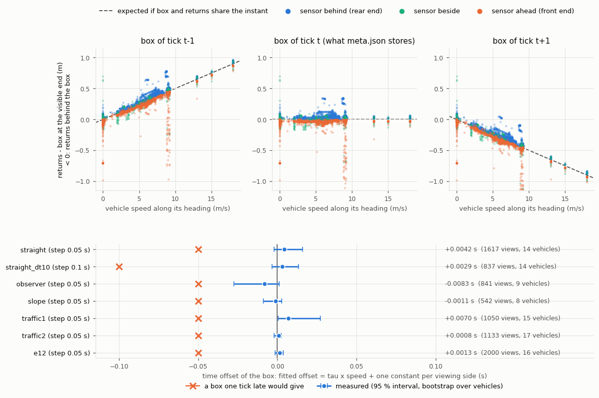
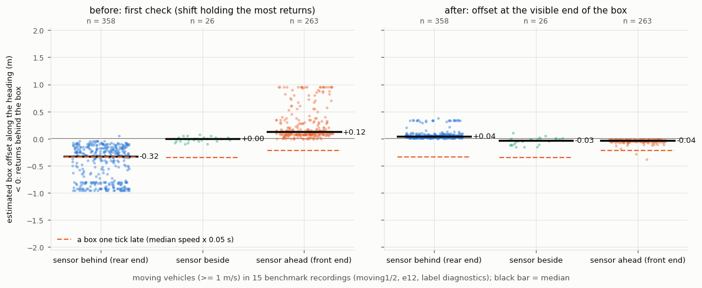
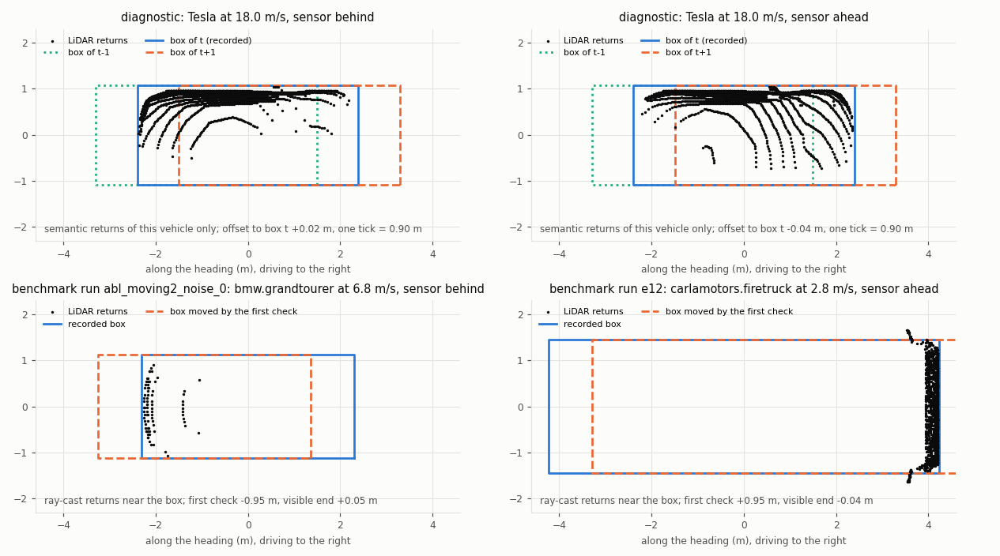

# Ground-truth boxes of moving vehicles: alignment check

The sensitivity benchmark reported that some moving vehicles' ground-truth boxes sat ahead of their LiDAR returns
(moving2 and the Milestone 3 recording e12: median −0.25 m, up to ~0.9 m for single vehicles). At 18 m/s one
0.05 s tick is 0.9 m, so a box from the wrong simulation step was the obvious suspect. This page records how that was
tested.

**Result: the recorded boxes are frame-matched and aligned with the returns, at every speed tested (up to 18 m/s), on
turns, on the slope and from a moving sensor. The "offset" came from the estimator of the first label check, not
from the data.** The recorder and the recorded metadata are unchanged, no box was moved, and the raw recordings are
untouched. The label check was replaced and all affected recordings were re-checked.

```bash
python tools/diagnose_label_alignment.py record     # CARLA running Town03: 7 controlled cases, every tick saved
python tools/diagnose_label_alignment.py analyse    # -> results/label_alignment/diagnostic.json, views_<case>.csv
python tools/eval_ablation.py --out data/ablation/labels --check-labels abl_moving1_noise_0 ... e12_figure2_driving
python tools/diagnose_label_alignment.py figures    # the three figures below
python -m unittest tests.test_label_alignment       # 16 regression tests, no CARLA needed
```

## How the recorder collects LiDAR frames, sensor poses and boxes

Synchronous mode, `fixed_delta_seconds` 0.05 s, one full sweep per tick. In every loop of `recording/recorder.py`:

1. `world.tick()` returns frame *f*. It returns only once the client holds the snapshot of *f*.
2. Every LiDAR is read with `Lidar.get(f)`, which discards older measurements and raises on a newer one. The sensor
   pose stored is the measurement's own `transform`.
3. `ground_truth.collect_vehicles` reads `actor.get_transform()`, `bounding_box` and `get_velocity()` for every
   vehicle. These come from the client's cached snapshot (no server call). meta.json stores the frame number, not
   the snapshot it read.

In sync mode nothing can advance the server between steps 1 and 3, so the boxes should be those of frame *f*. Two
mismatches were still possible: a cache that was not the snapshot of *f*, or a ray-cast done on a different physics
state than the snapshot's. The diagnostic tests both directly.

## The controlled diagnostic

`tools/diagnose_label_alignment.py` reuses the project's `SimulationSession`, `Lidar` and `ground_truth` unchanged.
Each observer carries two sensors: the recorder's ray-cast LiDAR (benchmark baseline: 32 ch, 120 m, 1M pts/s, drop-off
0.45) and a **semantic LiDAR with the same rays**. The semantic LiDAR tags every return with the id of the actor it
hit, so no box is needed to decide which returns belong to which vehicle. Every tick is saved, with:
- the WorldSnapshot right after the tick and again after reading the sensors;
- every snapshot the client received (`world.on_tick`);
- every vehicle's ActorSnapshot (transform, velocity, angular velocity, acceleration);
- the recorder's own ground truth;
- every measurement's frame, timestamp and transform;
- the sensor actors' snapshots.

| Case | What it tests | Vehicles |
|---|---|---|
| straight | straight flat road 28: constant-velocity targets at 0, 2, 5, 9, 13, 18 m/s passing 3 parked observers (seen from behind, beside, ahead); 4 models, including the three that showed −0.85 to −0.95 m in the first check | 15 |
| straight_dt10 | the same with a 0.1 s step (LiDAR at 10 Hz): a frame error would double | 15 |
| observer | an observer driving at 15 m/s past parked vehicles: is the sensor pose of the right instant? | 9 |
| slope | road 18 (12°): targets up and down the slope at 3.5 and 7 m/s, observers at the top, bottom and below | 9 |
| traffic1, traffic2 | the benchmark's moving1 / moving2 scenes: Traffic Manager, random models, turns | 24 |
| e12 | the Milestone 3 e12 configuration (Traffic Manager, figure-2 plan) | 24 |

The traffic cases are new simulations of those configurations, not replays: moving traffic is not reproducible in
CARLA 0.9.12. As in the benchmark, a traffic recording counts only if ≥ 50 % of the vehicle states move. The first
traffic2 recording had 4 % (traffic at red lights) and was recorded again. The rejected attempt is kept
(`cases/traffic2_rejected_1.json`).

**The measurement.** Returns can only show where the end of the vehicle that faces the sensor is. With *a* the
coordinate along the heading in the box frame and *e* the half length:

- sensor behind the vehicle: offset = min(*a*) + *e* (rear end);
- sensor ahead of it: offset = max(*a*) − *e* (front end);
- sensor beside it: the mean of the two.

Offset < 0 means the returns lie behind the box. A box *k* ticks late gives −*k*·*v*·dt **in every view**. The
sampling gap has opposite signs at the two ends: the extreme return lies slightly inside the true end, so the rear
reads > 0 and the front < 0. Per view, the offset was computed against the boxes of ticks t−2 … t+2 and fitted as
offset = τ·*v* + one constant per viewing side. The constants absorb the sampling gap. τ = 0 means the box is of the
same instant as the returns, τ = −dt means one tick late. 95 % intervals come from a bootstrap over vehicles.

## Results

### Frames, timestamps, poses

| case | step (s) | ticks | moving states | frame / time violations | recorder box vs ActorSnapshot (m) | sensor pose vs parent + mount (m) | ray-cast returns found in the semantic cloud | τ (s), 95 % interval | moving observer: τ_obs (s) |
|---|---|---|---|---|---|---|---|---|---|
| straight | 0.05 | 60 | 53 % | 0 | 0 | 1.4e-07 | 100 % | +0.0042 [−0.0019, +0.0158] | – |
| straight_dt10 | 0.1 | 30 | 53 % | 0 | 0 | 1.0e-07 | 100 % | +0.0029 [−0.0035, +0.0134] | – |
| observer | 0.05 | 60 | 22 % | 0 | 0 | 1.0e-05 | 100 % | −0.0083 [−0.0273, +0.0012] | −0.0001 [−0.0006, +0.0008] |
| slope | 0.05 | 50 | 44 % | 0 | 0 | 8.5e-06 | 100 % | −0.0011 [−0.0088, +0.0026] | – |
| traffic1 | 0.05 | 60 | 73 % | 0 | 0 | 1.5e-05 | 100 % | +0.0070 [+0.0006, +0.0271] | −0.0020 [−0.0041, −0.0006] |
| traffic2 | 0.05 | 60 | 71 % | 0 | 0 | 1.8e-05 | 100 % | +0.0008 [−0.0020, +0.0024] | +0.0008 [−0.0009, +0.0038] |
| e12 | 0.05 | 60 | 84 % | 0 | 0 | 1.5e-05 | 100 % | +0.0013 [−0.0015, +0.0038] | +0.0016 [−0.0008, +0.0112] |
| **all 0.05 s cases** | | | | | | | | **+0.0005 [−0.0024, +0.0036]** (7 183 views, 79 vehicles) | **−0.0002 [−0.0016, +0.0013]** |

**Frame and time checks (0 violations):**
- every measurement and the WorldSnapshot carry the frame `world.tick()` returned;
- they all carry the same simulation time;
- the delta is the fixed step;
- the client received exactly one snapshot per tick, and none arrived while the sensors were read.

**Recorder ground truth:** the box the recorder writes (`actor.get_transform()`) equals the ActorSnapshot of that
frame exactly. The speed is identical too.

**Ray-cast vs semantic LiDAR:**
- every return of the recorder's ray-cast LiDAR is found bit for bit among the semantic LiDAR's returns, so both
  sensors cast the same rays at the same instant;
- the ray-cast sensor's pose equals its parent's snapshot plus the mount within 18 µm;
- the bounding-box rotation is 0 for every model.

**Time offset:**
- one tick late would be τ = −0.05 s, and −0.10 s for the 0.1 s step. Every interval excludes it by a wide margin;
- the largest |τ| is 0.008 s, i.e. 0.14 m at 18 m/s, against 0.9 m for one tick;
- the moving observer's own speed has no effect (τ_obs ≈ 0), so the sensor pose is of the right instant.

### Boxes of t−1, t, t+1 by motion class (0.05 s cases)

Median offset (m) to the box of t−1 / **t** / t+1. The last column counts the moving views (≥ 1 m/s) whose best box
(closest to the stationary sampling gap of the same model and view) is the one of tick t.

| class | views | vehicles | median speed (m/s) | rear end | front end | side | best box = t |
|---|---|---|---|---|---|---|---|
| stationary (< 0.1 m/s) | 2 605 | 31 | 0.0 | +0.03 / **+0.031** / +0.03 | −0.03 / **−0.026** / −0.03 | +0.00 / **+0.003** / +0.00 | – |
| slow (0.1–5 m/s) | 1 135 | 23 | 3.2 | +0.20 / **+0.024** / −0.15 | +0.12 / **−0.035** / −0.18 | +0.12 / **−0.029** / −0.20 | 1 057 / 1 095 |
| medium (5–12 m/s) | 3 100 | 46 | 7.2 | +0.40 / **+0.035** / −0.32 | +0.33 / **−0.030** / −0.40 | +0.32 / **−0.011** / −0.35 | 2 964 / 3 100 |
| fast (≥ 12 m/s) | 343 | 3 | 15.0 | +0.92 / **+0.029** / −0.84 | +0.72 / **−0.028** / −0.78 | +0.70 / **+0.010** / −0.76 | 343 / 343 |
| turning (\|yaw rate\| ≥ 5°/s) | 687 | 18 | 5.9 | +0.37 / **+0.034** / −0.25 | +0.23 / **−0.036** / −0.31 | +0.31 / **−0.012** / −0.29 | 670 / 687 |
| accelerating / braking (\|a\| ≥ 1 m/s²) | 2 825 | 46 | 6.5 | +0.38 / **+0.032** / −0.30 | +0.23 / **−0.030** / −0.34 | +0.29 / **−0.015** / −0.31 | 2 720 / 2 825 |
| on the slope (moving and parked) | 669 | 12 | 3.5 | +0.32 / **+0.026** / −0.26 | −0.03 / **−0.026** / −0.03 | +0.08 / **−0.093** / −0.27 | 419 / 426 |
| parked, seen by an observer driving ≥ 5 m/s | 1 036 | 20 | 0.0 | +0.03 / **+0.029** / +0.03 | −0.03 / **−0.026** / −0.03 | +0.00 / **+0.002** / +0.00 | – |

At tick t, moving vehicles show the stationary sampling gap: about +0.03 m at the rear and −0.03 m at the front, at
every speed. The boxes of t−1 and t+1 are off by about ±*v*·dt. The 18 m/s target in the straight case is 0.85–0.92 m
off at t±1 and +0.03 / −0.03 m at t.



### Models and box conventions

Moving and parked views of the same model give the same offset at tick t:

| model | parked rear end | moving rear end | parked front end | moving front end |
|---|---|---|---|---|
| BMW Grandtourer | +0.048 | +0.053 | −0.015 | −0.023 |
| Lincoln MKZ 2017 | +0.028 | +0.028 | −0.026 | −0.031 |
| Mercedes Coupé 2020 | +0.033 | +0.040 | −0.002 | −0.005 |
| Tesla Model 3 | +0.031 | +0.032 | −0.027 | −0.028 |

These include the three models the first check reported at −0.85 to −0.95 m. A few models' boxes are larger than the
body the LiDAR sees: the **Jeep Wrangler Rubicon's** box ends about 0.33 m behind its rearmost return, and the
**Carlacola's** about 0.12 m. Both were seen only while moving, so there is no parked reference. The effect is constant
and has the sign of the sampling gap, not of a lag. It is a property of those CARLA models, and the recorder stores the
boxes as CARLA defines them.

214 of 8 020 views (2.7 %) have |offset| > 0.3 m:
- **Jeep rear ends** (48 views): the box convention above.
- **Front ends** (158 views): concentrated at 20–30 m, where they are 13 % of the front views (0–6 % at other
  distances). Parked vehicles are affected as often as moving ones (92 vs 66 views). No other vehicle's returns lie
  near these ends, so another vehicle is not blocking them. At that distance the 32-channel pattern can miss the low
  front bumper and hit the hood, which sits further back. This is a sampling effect, not timing.
- **Side views** (8): the remaining few.

### Why the first check reported an offset

The first check slid the box along its heading by −2 … +2 m. It kept the shift holding the most returns, taking the
median when several shifts tie.

From behind, a vehicle shows only its rear face, and every backward shift keeps those returns inside the box. The
maximum is then tied from −2 m up to +0.1 m (the box margin), and the median is about −0.95 m, whatever the true
alignment. From ahead it is about +0.95 m. CAVs mostly follow traffic, so moving targets are mostly seen from behind,
which gives the negative "offset" that looked like a lag.

On the benchmark recordings, every view from behind had its upper tied bound at exactly +0.10 m. That means the
rearmost return lay 0–0.05 m inside the box's rear face: aligned. On the semantic diagnostic, where the boxes are
verified, the first estimator still gives −0.32 m (behind), +0.28 m (ahead) and −0.03 m (beside).
`tests/test_label_alignment.py` reproduces the bias on synthetic data.

### Corrected check on the benchmark recordings (before → after)

`eval_ablation.py --check-labels` now attributes returns by the box (up to 1.5 m beyond its ends) and reads the offset
at the visible end, using the 2 % quantile so that a few stray returns don't count. On the diagnostic, this unlabelled
measurement agrees with the semantic one (median difference 0.000 m, 5–95 % −0.08 … +0.05 m).

Median offset of moving vehicles (first estimator in brackets) [views]:

| run | moving views | sensor behind: rear end | sensor ahead: front end | within 0.15 m | a box one tick late would give |
|---|---|---|---|---|---|
| moving1, 6 simulations | 50–54 each | +0.02 … +0.07 (−0.15 … −0.36) | −0.04 (+0.10 … +0.15) | 89–94 % | −0.41 … −0.19 |
| moving2, 6 simulations | 32–36 each | +0.04 … +0.05 (−0.32 … −0.46) | −0.03 … −0.06 (+0.09 … +0.30) | 100 % | −0.36 … −0.27 |
| e12_figure2_driving | 80 | +0.04 (−0.32) [55] | −0.04 (+0.10) [19] | 97 % | −0.32 … −0.15 |
| diag_targets_moving | 45 | +0.05 (−0.17) [19] | −0.04 (+0.21) [18] | 89 % | −0.34 … −0.22 |
| diag_cavs_moving | 10 | +0.03 (−0.55) [5] | −0.03 (+0.35) [5] | 100 % | −0.30 … −0.14 |

The views beyond 0.15 m in moving1 are the Jeep (+0.33 m at its rear). Per-run, per-view values are in
`results/label_alignment/benchmark_check/`.





## Consequences for the benchmark

- **Recorder, metadata, raw data:** unchanged. There was no frame mismatch to fix, and no spatial correction was
  applied to any box.
- **Moving-scene metrics:** vehicle loss, coverage and the other metrics of the moving scenes and e12 were computed
  with correct boxes and stand as reported. They are no longer "less reliable" than those of parked scenes.
- **Parked label check:** the protocol table's "method spread ±0.35 m" was the same estimator bias.

## Remaining limitations

- The visible-end offset measures the box along the heading only. Across the heading and in yaw, the check is the
  share of semantic returns inside the box: a median of 98.5–100 % on turns.
- The sampling gap (±0.03–0.05 m) and model-specific box sizes (Jeep +0.33 m, Carlacola +0.12 m) remain. They are
  CARLA's definitions and are used as such.
- The traffic cases are new simulations, so they show that this configuration records aligned boxes, not that one
  particular earlier tick was aligned. The benchmark recordings themselves were checked with the unlabelled
  measurement, which agrees with the semantic one on the diagnostic.
- One TM vehicle (a Cybertruck in the rejected traffic2 attempt) could not climb the 12° slope and rolled back down at
  11 m/s. Its box still matched at tick t. This is a CARLA physics behaviour to keep in mind for slope scenes with
  autopilot traffic.
- The semantic LiDAR is used only by this diagnostic. The ground truth is used only for evaluation, never by the
  processing.
