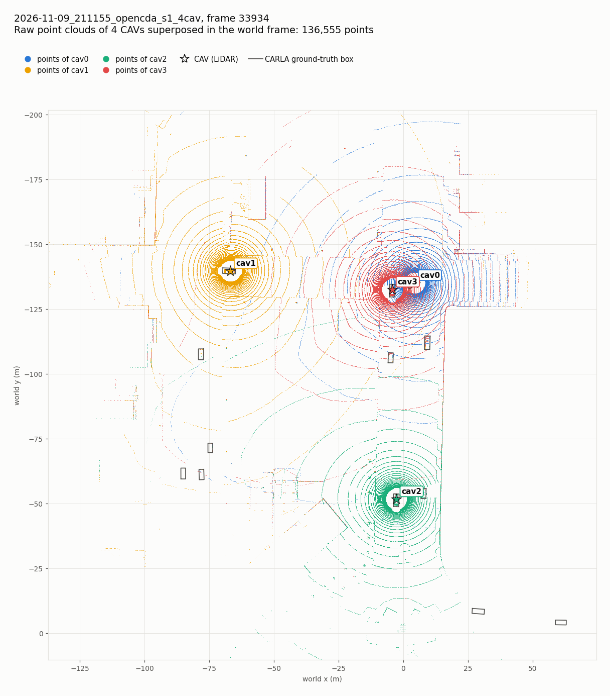
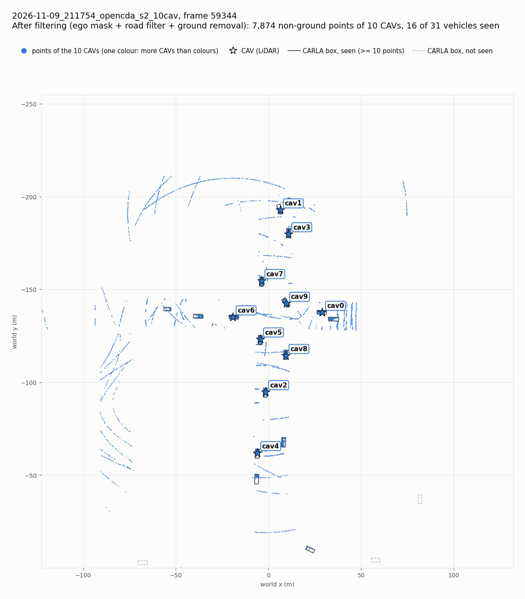

# Scenarios with OpenCDA, the paper's tool

The paper evaluates its system on *"228 simulated driving scenarios generated in CARLA's Town 3 using the OpenCDA
framework"*: 57 for each CAV count (4, 6, 8, 10), each a random moment at a four-leg intersection with 20–40 other
vehicles. `tools/opencda_scenario.py` builds such a scenario with OpenCDA and saves it in this repository's run
format, so `python main.py process`, `tools/compare_cavs.py` and the editor's BEV tab work on it unchanged.



*Seed 1, 4 CAVs and 24 other vehicles, 5 s after the start: the raw sweeps of the 4 CAVs in the world frame, one
colour per CAV. The grey rectangles are CARLA's boxes.*

## Install

OpenCDA 0.1.3 runs on Python 3.7 with its own requirements, so it gets its own conda environment. The project's own
environment does not change.

```bash
mkdir -p ../external && cd ../external          # from carla-lidar-to-bev: ../external/OpenCDA, or set OPENCDA_ROOT
git clone --depth 1 https://github.com/ucla-mobility/OpenCDA.git
cd OpenCDA
conda create -n opencda python=3.7.10 pip=21.1.2 -y
conda run -n opencda python -m pip install -r requirements.txt carla==0.9.12
```

Tested with OpenCDA 0.1.3 (commit 72b17e7), numpy 1.20.0, open3d 0.17.0, omegaconf 2.3.1 and carla 0.9.12. OpenCDA
is not installed as a package: the script adds the folder to `sys.path`. Its source files are not modified.

## Run

CARLA 0.9.12 must already be running on Town03. The script never reloads the world, because `load_world` crashed
CARLA on a 4 GB GPU.

```bash
conda activate opencda
python tools/opencda_scenario.py --cavs 4 --seed 1 --frames 10      # data/runs/<date>_<time>_opencda_s1_4cav
conda activate cav
python main.py process data/runs/<date>_<time>_opencda_s1_4cav
python tools/compare_cavs.py data/runs/<date>_<time>_opencda_s1_4cav --frame <frame>
```

| Option | Default | Meaning |
|---|---|---|
| `--cavs` | 4 | CAVs: 4, 6, 8 or 10 in the paper |
| `--traffic` | 20–40 at random | other vehicles |
| `--seed` | 1 | draws the whole scenario: CAV positions, destinations and speeds, traffic positions and settings |
| `--frames` | 10 | frames to save |
| `--every` | 20 | ticks between saved frames (20 = one per simulated second) |
| `--warmup` | 100 | ticks before the first frame (5 s: vehicles stand still for about 2 s after they spawn) |

The paper's 228 scenarios are one frame for each of 57 seeds × 4 CAV counts:

```bash
for n in 4 6 8 10; do for s in $(seq 1 57); do
  python tools/opencda_scenario.py --cavs $n --seed $s --frames 1
done; done
```

This set has not been run yet.

## What the script sets up

The parameters are in `config/opencda/paper_town03.yaml`, merged on top of OpenCDA's `default.yaml`. The seed then
fills in the scenario.

| Item | Paper (Table 1) | Here |
|---|---|---|
| Map, intersection | Town 3, four-leg intersection | Town03, junction 1221 at (2.9, −136.5) (Figure 2) |
| CAVs | 4, 6, 8, 10 | `--cavs`. Each spawns on a driving lane 12–60 m from the junction, at least 12 m from the others, and gets a destination about 120 m further along the lanes, taking a random branch at every split, so it crosses the junction |
| CAV driving | max speed 20–50 km/h, tailgate speed 30–60 km/h | OpenCDA's behaviour agent. Each CAV draws its max speed from 20–50 km/h and its tailgate speed from max(30, max speed)–60 km/h |
| Other vehicles | 20–40, spawn area x ∈ [−100, 100], y ∈ [−200, 200] | `create_traffic_carla` with that range; CARLA's Traffic Manager drives them |
| Speed, red lights | −20 % to +20 %, 0–100 % ignored | drawn for each vehicle: speed difference −20 to +20 %, red lights ignored 0–100 % |
| LiDAR | 32 channels, 120 m, 1,000,000 points/s, 20 Hz | the same, mounted by OpenCDA at x −0.5 m, z 1.9 m on a Lincoln MKZ 2017 |
| LiDAR settings the paper does not give | — | OpenCDA's V2X data-collection values: field of view +2° / −25°, drop-off 0.3 / 0.7 / 0.4, noise 0.02 m |
| Time step | — | synchronous mode, 0.05 s: one full sweep per tick |

Every saved frame holds each CAV's sweep from one tick and every vehicle's pose, box and speed from the same tick,
as in the project's own recorder. `config.yaml` stores each CAV's speeds and destination and each vehicle's Traffic
Manager settings.

## What the script changes around OpenCDA

OpenCDA's code is not edited. The script changes these behaviours when it calls OpenCDA:

| OpenCDA | Here | Why |
|---|---|---|
| Shows the LiDAR in an Open3D window and the cameras with OpenCV | windows disabled | no window may open on the screen |
| Mounts the LiDAR only when the LiDAR window or perception is on | `lidar.visualize: true`, with the window disabled | the LiDAR without OpenCDA's detector |
| The agent calls `sys.exit(0)` as soon as one CAV reaches its destination | that CAV gets a new destination about 120 m further on and keeps driving; the events go to `reroutes.json` | the other CAVs and the recording go on |
| `VehicleManager.destroy()` leaves the IMU and collision sensors | they are destroyed too | no stray sensors left in CARLA |
| Restores the world settings after the Traffic Manager | world first, then the Traffic Manager | the other order aborted Python inside `world.apply_settings` (Windows, carla 0.9.12) |

## Results of two scenarios

| Scenario | Seed 1: 4 CAVs, 24 vehicles, 10 frames | Seed 2: 10 CAVs, 21 vehicles, 3 frames |
|---|---|---|
| Points per sweep | 33,836 – 34,508 | 33,670 – 35,120 |
| CAV speeds | 25 – 45 km/h | 18 – 40 km/h |
| Vehicles seen in the first frame (≥ 10 points after filtering, by at least one CAV) | 6 of 28 | 16 of 31 |
| Vehicles with no LiDAR point at all | 17 | 15 |
| CAVs that reached their destination | 3, between 12.2 and 13 s | none (3 s recorded) |

A sweep holds about 34,000 points, against about 27,000 with the project's recorder. The difference is mostly
OpenCDA's lower drop-off rate: 0.3 of the 50,000 points per sweep against CARLA's default 0.45 (50,000 × 0.7 ≈ 35,000
and 50,000 × 0.55 ≈ 27,500).

The other vehicles start anywhere in the 200 m × 400 m spawn area, as in the paper, so many of them are far from the
CAVs and no LiDAR reaches them. With 10 CAVs, half of the vehicles are seen. With more than four CAVs, the world-frame
figures use one colour for every CAV, because the four CAV colours are the most that stay distinguishable. Each CAV
is named next to its marker, and `cavN_before_after.png` shows each one alone.



*Seed 2, 10 CAVs: the points left after the ego mask, the road filter and the ground removal. Solid boxes are
vehicles that at least one CAV sees.*

## Not reproduced

- The paper's random yaw from −180° to 180°. Like OpenCDA, the script spawns every vehicle along its lane.
- The paper's random timestamp. The script saves frames after a fixed warm-up; with `--frames 1` the moment changes
  only with the seed.
- The paper's 228 scenarios: the command above produces them, but they have not been run.
