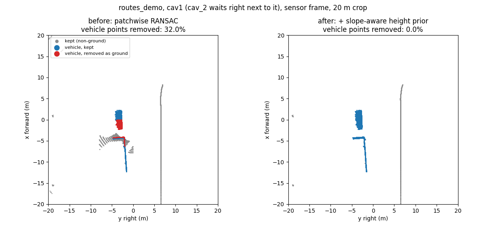

# LiDAR processing (offline)

Runs on recorded frames, without CARLA. The raw clouds in `frames/` are never modified.

```
python -m cavlidar.backend.processing data/runs/<run>                 # last frame
python -m cavlidar.backend.processing data/runs/<run> --frame 1936662
```

Output in `data/runs/<run>/processed/<frame>/`, per CAV: `cavN_ground.npy`, `cavN_nonground.npy` (N × 4 points,
sensor frame), `cavN_bev_occupancy.npy` / `_intensity.npy` / `_count.npy` (BEV grids) and `cavN_preview.png`;
`summary.json` holds the counts, the settings and the sensor height estimated from the data.

**Status: prototype.** The paper first keeps the drivable-road region, then removes the ground with Patchwork RANSAC.
The road filter is not implemented yet, and the settings below are our engineering choices, not the paper's.

## Ground removal (`processing/ground.py`)

The scan is cut into 8 × 8 m patches (sensor frame); each patch gets its own plane `z = ax + by + c`, so slopes
are handled. A RANSAC plane is accepted as the ground only if the LiDAR data agrees with it there:

| Rule | Why |
|---|---|
| **Seed**: the ground right around the sensor is fitted first, on the lowest 30 % of the returns 2.5–15 m away | gives the sensor height and tilt from the data (2.37–2.39 m estimated vs 2.4 m mounted) |
| **Continuity**: patches are processed from the sensor outwards; a plane must meet each accepted neighbour's plane along their shared side, at both ends, within `max_step` = 0.5 m (the majority of neighbours must agree) | the ground can bend with a slope, but cannot jump onto a car roof 1.45 m higher, nor tilt up a car's side |
| **Lowest surface**: a plane with more than 3 % of the patch's returns 0.45 m or more below it is rejected | a plane on a roof has the road around the car under it |
| **Grade** ≤ 15° (`max_slope`) | Town03's sloped leg is at most 12.4° |
| **Sparse or rejected patches** (< 18 returns, or no acceptable plane): only points within 0.18 m of the ground predicted by accepted neighbour patches are ground; with no accepted neighbour, every point is kept | conservative: unknown is kept, never removed |

Nothing but the points is used: no map, no road height, no vehicle boxes.

| Setting (CLI) | Default | Meaning |
|---|---|---|
| `--patch-size` | 8.0 m | patch side |
| `--threshold` | 0.18 m | distance to the plane that counts as ground |
| `--iterations` | 70 | RANSAC planes tried per patch |
| `--max-step` | 0.5 m | height step allowed between neighbouring patch planes |
| `--max-slope` | 15° | steepest ground plane |

## Validation against CARLA's ground truth

`python tools/eval_ground.py <runs...> --baseline <old ground.py>` scores a ground mask with labels taken from the
recording (ground truth is used there only):

- **vehicle point**: inside another vehicle's box (in the vehicle's own, possibly pitched frame), more than 0.3 m above
  the box bottom; *vehicle loss* = % of them removed as ground;
- **ground point**: not near a vehicle, within 0.3 m of the road / sidewalk height and within 7 m of a lane centre
  (height from the OpenDRIVE lane samples); *ground kept* = % of them left in the non-ground cloud.

Before = the first prototype (patchwise RANSAC, 25° grade, no prior); after = with the height prior. Every frame of
five Town03 runs, 4 CAVs each (200 scans):

| Run | Vehicle loss before → after | Ground kept before → after | ms per CAV before → after |
|---|---|---|---|
| e11 (Figure 2, parked) | 0.3 % → 0.1 % | 2.3 % → 1.6 % | 800 → 257 |
| e12 (Figure 2, driving) | 4.6 % → 0.5 % | 2.6 % → 1.6 % | 952 → 350 |
| qgis_e2e | 9.8 % → 0.4 % | 2.7 % → 1.7 % | 1664 → 602 |
| routes_demo | 15.1 % → 0.3 % | 3.6 % → 1.8 % | 1680 → 614 |
| slope_check (CAVs on the sloped leg) | 13.0 % → 0.0 % | 1.9 % → 0.9 % | 1302 → 726 |
| **All 200 scans** | **11.0 % → 0.26 %** (369 k points) | **2.6 % → 1.5 %** (3.4 M points) | **1365 → 571** (median 549, p95 1056) |

Close pairs (vehicles a few metres apart; % of the second vehicle's body removed by the first CAV):

| Pair | Before | After |
|---|---|---|
| routes_demo cav1 → cav_2 | 36.5 % (58 % in the last frame) | 0.0 % |
| routes_demo cav2 → cav_1 | 26.9 % (41 % in the last frame) | 0.0 % |
| e12 cav2 → cav_1 | 27.8 % | 0.0 % |
| qgis_e2e cav3 → traffic_9 | 31.7 % | 0.0 % |
| slope_check cav1 → traffic_1 (both on the slope) | 22.1 % | 0.0 % |

Sloped leg (x 15–85 m, z > 0.5 m), all runs: ground kept 1.8 % → 0.5 % of 307 k points; vehicles on the slope
13.2 % → 0.05 % of 87 k points. slope_check has CAVs driving on the 12° slope: 0.0 % of 291 k slope ground points
kept, 0.0 % vehicle loss.



**Known limit.** The slope seen from far away (60–120 m, sparse rings) is partly kept: 14.6 % (qgis_e2e) and 15.9 %
(routes_demo) of about 3 k points each. Those patches have no accepted neighbour, so they are kept on purpose.

`slope_check` (`config/experiments/custom/slope_check.yaml`) was recorded for this validation. Its parked vehicles
rolled down the slope (parked vehicles are not braked yet: a known bug, not fixed in this change); the scans are still
valid for ground removal: CAVs on and below the slope, vehicles stopped on it.

## BEV grids (`processing/bev_grid.py`)

`bev_from_points(non_ground, resolution=0.5, xy_bounds=(-60, 60, -60, 60))` → occupancy (0/1), return count and
mean intensity per cell, sensor frame, row 0 = +x (forward), columns increase with +y (right). Occupancy 0 means
"no return", not "free".

## Tests

`tests/test_processing.py` (no CARLA): synthetic slope with a car on it, sparse patches, the seed height, BEV grids,
and a real close-pair scan (`tests/data/close_pair_cav1.npz`, routes_demo cav1 cropped to 20 m, labels from CARLA's
boxes used only for scoring): before the prior 32 % of the neighbour's points were removed, now 0 %.
