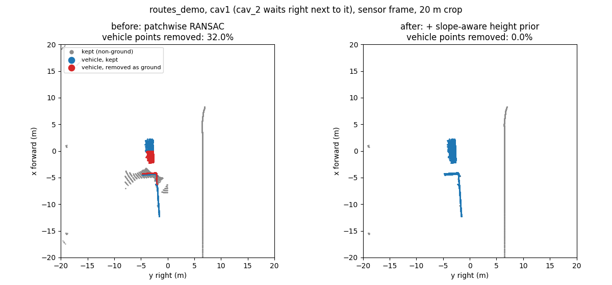

# LiDAR processing (offline)

Runs on recorded frames, without CARLA. The raw clouds in `frames/` are never modified.

```
python -m cavlidar.backend.processing data/runs/<run>                 # last frame
python -m cavlidar.backend.processing data/runs/<run> --frame 1936662
```

Pipeline per CAV, as in the paper (Sec. III-A), after removing the CAV's own body: **ego-body mask →
drivable-road filter → ground removal → BEV → static sectorization → sector metadata**.

Output in `data/runs/<run>/processed/<frame>/`, per CAV: `cavN_ego.npy`, `cavN_offroad.npy`, `cavN_ground.npy`, `cavN_nonground.npy`
(N × 4 points, sensor frame), `cavN_bev_occupancy.npy` / `_intensity.npy` / `_count.npy` (BEV grids),
`cavN_bev_sector.npy` (sector of each BEV cell) and `cavN_preview.png`; `summary.json` (counts, settings, sensor
height estimated from the data) and `metadata.json` (the sector metadata, the only data sent to the central node).

**Status: prototype.** The settings below are our engineering choices where the paper gives none; each such choice is
listed.

## Ego-body mask (`processing/ego_mask.py`)

Below about 2 m the LiDAR sees its own car: in the sensitivity analysis ([SENSITIVITY.md](SENSITIVITY.md)) 9 244
returns per scan (35 % of the scan) hit the CAV's roof and hood at a 1.6 m mount, 917 at 1.9 m, none at 2.4 m. These
are not obstacles; they are removed first, before the road filter and the ground removal.

- **Inputs**: the sensor-to-vehicle calibration (the run's `lidar.mount_x/y/z`, and a mount rotation if one is
  configured) and the static body box of the CAV model (`EGO_MODELS`, measured once from CARLA's `bounding_box`:
  Tesla Model 3 half extents 2.396 × 1.082 × 0.744 m, centre 0.029 / 0 / 0.736 m). No pose, no per-frame annotation,
  no other vehicle. The sensor is rigidly attached, so the box is fixed in the sensor frame and the vehicle's pitch on
  a slope does not change the mask.
- **Rule**: a return inside the body box grown by `--ego-margin` (0.1 m) is removed. On by default for every sensor
  configuration (A, B, C); `--no-ego-mask` switches it off.
- **Invalid mount**: if the sensor origin lies inside the body box, the mount is physically impossible;
  `summary.json` reports `mount_valid: false` (and the roof clearance) and a warning is printed. Masking cannot make
  such a recording valid. The Model 3 roof is at 1.48 m: 1.6 m is valid (0.12 m clearance), 1.2 m is not.
- **Sector payload σ is unchanged**: σ stays the sector's full original scan (what a selected sector would send); the ego points are
  only kept out of the ground removal, the BEV and the quality S̃.

Checked on the 22 sensitivity runs (`tools/eval_ablation.py --ego-mask off|on`, ground truth for scoring only):
own-body points left in the non-ground cloud 9 244 → 0 (1.6 m) and 917 → 0 (1.9 m); BEV cells holding own points
26 → 0 and 12 → 0; other vehicles' points removed by the mask: 0 in every run; at 2.4 m and 2.8 m, and for every
noise, channel and range run, every metric is identical with and without the mask. Unit tests cover an x offset,
mount heights, a rotated mount, a CAV pitched 12° on a slope, the invalid-mount flag and the real close-pair scan
(none of the neighbouring car's 4 108 points is masked).

## Drivable-road filter (`processing/road_filter.py`)

Paper: "an additional filtering step is introduced to isolate the drivable road region ... removes points outside the
road surface, such as off-road structures and irrelevant background elements". The paper does not say how; here the
region comes from the map's OpenDRIVE lanes (an HD map, as in OpenCDA / OpenCOOD), placed with the CAV pose:

- 2D outline of the Driving, Parking and Bidirectional lanes, grown by `--road-margin` (0.5 m, curb), rasterised at
  0.25 m and cached in `data/maps/` (Town03: built in 1.8 s, loaded in 0.05 s);
- a point is kept when its world (x, y) is inside the outline, at any height: no road elevation is used, vehicles stay
  whole. 7–35 ms per CAV.

`--no-road-filter` switches it off.

## Ground removal (`processing/ground.py`)

The scan is cut into 8 × 8 m patches (sensor frame); each patch gets its own plane `z = ax + by + c`, so slopes
are handled. A RANSAC plane is accepted as the ground only if the LiDAR data agrees with it there:

| Rule | Why |
|---|---|
| **Seed**: the ground right around the sensor is fitted first, on the lowest 30 % of the returns 2.5–15 m away | gives the sensor height and tilt from the data (2.37–2.39 m estimated vs 2.4 m mounted) |
| **Continuity**: patches are processed from the sensor outwards; a plane must meet each accepted neighbour's plane along their shared side, at both ends, within `max_step` = 0.5 m (the majority of neighbours must agree) | the ground can bend with a slope, but cannot jump onto a car roof 1.45 m higher, nor tilt up a car's side |
| **Lowest surface**: a plane with more than 3 % of the patch's returns 0.45 m or more below it is rejected | a plane on a roof has the road around the car under it |
| **Grade** ≤ 15° (`max_slope`) | Town03's sloped leg is at most 12.4° |
| **Sparse or rejected patches** (< 18 returns, or no acceptable plane): only points within 0.18 m of the ground predicted by accepted neighbour patches are ground; with no accepted neighbour, every point is kept. A sparse patch with ≥ 3 points on the prediction passes it on to the next patch outwards | conservative: unknown is kept, never removed; a roof never confirms the prediction, so it never passes it on |

Nothing but the points is used: no map, no road height, no vehicle boxes.

| Setting (CLI) | Default | Meaning |
|---|---|---|
| `--patch-size` | 8.0 m | patch side |
| `--threshold` | 0.18 m | distance to the plane that counts as ground |
| `--iterations` | 70 | RANSAC planes tried per patch |
| `--max-step` | 0.5 m | height step allowed between neighbouring patch planes |
| `--max-slope` | 15° | steepest ground plane |

## Validation against CARLA's ground truth

`python tools/eval_ground.py <runs...> --baseline <old ground.py>` scores a ground mask with labels taken from the
recording (ground truth is used there only):

- **vehicle point**: inside another vehicle's box (in the vehicle's own, possibly pitched frame), more than 0.3 m above
  the box bottom; *vehicle loss* = % of them removed as ground;
- **ground point**: not near a vehicle, within 0.3 m of the road / sidewalk height and within 7 m of a lane centre
  (height from the OpenDRIVE lane samples); *ground kept* = % of them left in the non-ground cloud.

Before = the first prototype (patchwise RANSAC, 25° grade, no prior); after = with the height prior. Every frame of
five Town03 runs, 4 CAVs each (200 scans):

| Run | Vehicle loss before → after | Ground kept before → after | ms per CAV before → after |
|---|---|---|---|
| e11 (Figure 2, parked) | 0.3 % → 0.1 % | 2.3 % → 1.6 % | 800 → 257 |
| e12 (Figure 2, driving) | 4.6 % → 0.5 % | 2.6 % → 1.6 % | 952 → 350 |
| qgis_e2e | 9.8 % → 0.4 % | 2.7 % → 1.7 % | 1664 → 602 |
| routes_demo | 15.1 % → 0.3 % | 3.6 % → 1.8 % | 1680 → 614 |
| slope_check (CAVs on the sloped leg) | 13.0 % → 0.0 % | 1.9 % → 0.9 % | 1302 → 726 |
| **All 200 scans** | **11.0 % → 0.26 %** (369 k points) | **2.6 % → 1.5 %** (3.4 M points) | **1365 → 571** (median 549, p95 1056) |

Close pairs (vehicles a few metres apart; % of the second vehicle's body removed by the first CAV):

| Pair | Before | After |
|---|---|---|
| routes_demo cav1 → cav_2 | 36.5 % (58 % in the last frame) | 0.0 % |
| routes_demo cav2 → cav_1 | 26.9 % (41 % in the last frame) | 0.0 % |
| e12 cav2 → cav_1 | 27.8 % | 0.0 % |
| qgis_e2e cav3 → traffic_9 | 31.7 % | 0.0 % |
| slope_check cav1 → traffic_1 (both on the slope) | 22.1 % | 0.0 % |

Sloped leg (x 15–85 m, z > 0.5 m), all runs: ground kept 1.8 % → 0.5 % of 307 k points; vehicles on the slope
13.2 % → 0.05 % of 87 k points. slope_check has CAVs driving on the 12° slope: 0.0 % of 291 k slope ground points
kept, 0.0 % vehicle loss.



### Whole cleaning step: road filter + ground removal

Same scoring, both methods behind the road filter (`--road-filter`), six runs incl. `slope_check_parked`
(260 scans). "Removed" = off-road or ground.

| | First prototype | Height prior (current) |
|---|---|---|
| vehicle points removed | 11.27 % | **0.20 %** |
| … of them by the road filter | 0.00 % | **0.00 %** |
| ground points left | 1.95 % | **0.77 %** |
| slope ground left | 1.46 % | **0.25 %** |
| vehicles on the slope removed | 12.36 % | **0.04 %** |
| points left for BEV / sectors | 7.4 % (1 979 per scan) | 7.3 % (1 949 per scan) |

The road filter removes 42 % of the returns (buildings, sidewalks, poles, vegetation) and no vehicle point.

Time per CAV, median of 16 scans (machine busy with another job): road filter 10 ms, ground removal 431 ms, BEV
6 ms, sectors + metadata 20 ms, total 472 ms (max 770 ms). **Re-measured 2026-11-07 with CARLA and other jobs closed**
(e12, all 40 scans, same code): ego mask + road filter + ground removal + BEV take a median of 99 ms per CAV on the
first pass (p95 153 ms, max 249 ms), 89 ms as the fastest of 3. The sensitivity benchmark gives 77 ± 5 ms on its flat
scenes ([SENSITIVITY.md](SENSITIVITY.md#processing-time)). The 472 ms above reflected the busy machine.

**Not real-time yet.** The LiDAR sweeps at 20 Hz (50 ms per scan); this processing takes about 0.1 s per CAV, on one
CPU core, in Python. No end-to-end real-time claim can be made: the processing would have to become at least twice as
fast, before any sharing step is added after it.

**Known limit.** The slope seen from far away is partly kept: 15 % of the slope ground in qgis_e2e and routes_demo,
i.e. 16–43 points per scan, 93–119 m from cav0. Nothing is observed between them and the sensor (occlusion), so no
accepted patch can pass the ground on; labelling them would mean guessing a ground height 100 m away (on a slope a
wrong guess removes vehicle points), so they are kept on purpose. Passing the ground on through sparse patches did
not change this (15.0 % / 15.3 %) but lowered the ground kept overall (1.7 → 1.5 %, 1.8 → 1.6 %).

`slope_check` (`config/experiments/custom/slope_check.yaml`) was recorded for this validation. In that recording the
parked vehicles rolled down the slope (parked vehicles were not braked); the scans are still valid for ground
removal. Parked vehicles now get the brake and hand brake at spawn: `slope_check_parked` is the same scenario
recorded after the fix (parked vehicles moved ≤ 0.03 m in 15 frames).

## BEV grids (`processing/bev_grid.py`)

`bev_from_points(non_ground, resolution=0.5, xy_bounds=(-60, 60, -60, 60))` → occupancy (0/1), return count and
mean intensity per cell, sensor frame, row 0 = +x (forward), columns increase with +y (right). Occupancy 0 means
"no return", not "free".

## Static sectorization and sector metadata (`processing/sectors.py`)

Paper: "the perception space around the ego-CAV is divided into a predefined number of sectors with fixed angular
boundaries. The starting angle and the number of sectors are specified in advance (e.g., 4 sectors starting at π/4),
and the BEV grid is partitioned accordingly."

- `--sectors 4 --sector-start 45`: sector k covers azimuths [start + k·w, start + (k+1)·w), w = 360°/count, measured in
  the sensor frame from forward (+x) towards the right (+y). With the defaults: s0 right, s1 rear, s2 left, s3 front.
- Every point and every BEV cell (`cavN_bev_sector.npy`) gets its sector.

Metadata of sector s of CAV i (`metadata.json`), the input of the paper's ILP
`max Σ x·S̃·U  s.t.  Σ x·σ ≤ B` (B in MB):

| Field | Paper | Here |
|---|---|---|
| size σ_{i,s} (`size_bytes`, `size_mb`) | "the volume covered by the sector", the cost compared with the data budget B (MB) | data volume of the sector's **raw** points (the paper transmits "the corresponding 3D LiDAR points ... from the original point cloud"): points × 16 bytes |
| quality S̃_{i,s} (`quality`) | non-ground points of the sector, downsampled by "averaging points that are within a specified radius and are too close to each other"; S̃ = downsampled / all points of the sector | non-ground = after road filter + ground removal; downsampling = average of the points in each `--downsample` voxel (0.2 m, radius not given by the paper) |
| footprint A_{i,s} (`start_rad`, `end_rad`, `range_m`, `footprint`) | start and end angles + sensing range, put in a common frame with the CAV pose for the sector IoU | sensor-frame angles, world-frame angles (+ yaw), apex, and the world-frame wedge polygon; range = the run's `lidar.range` (120 m, paper Table 1); `farthest_return_m` is stored too |

Observation on e12 (4 sectors): each sector holds about 6.5 k points (0.10–0.11 MB), S̃ from 0 (empty) to 0.04. A car
right behind cav2 gives 2 750 non-ground points but 217 after the 0.2 m averaging, so S̃ measures the obstacle surface
seen rather than its point count, as the paper's definition implies.

The sector IoU, complementarity, ILP and Greedy–Swap that use this metadata are not part of this repository.
Not yet: dynamic sectorization (sectors formed around obstacle clusters).

## Tests

`tests/test_processing.py` (no CARLA needed; the Town03 road test runs when CARLA's OpenDRIVE files are present):
synthetic slope with a car on it, sparse patches, the seed height, BEV grids, the road filter (pose handling, Town03
junction 1221), static sectors (360° partition, orientation, BEV cells, downsampling, σ / S̃ / footprint), and a real
close-pair scan (`tests/data/close_pair_cav1.npz`, routes_demo cav1 cropped to 20 m, labels from CARLA's
boxes used only for scoring): before the prior 32 % of the neighbour's points were removed, now 0 %.
