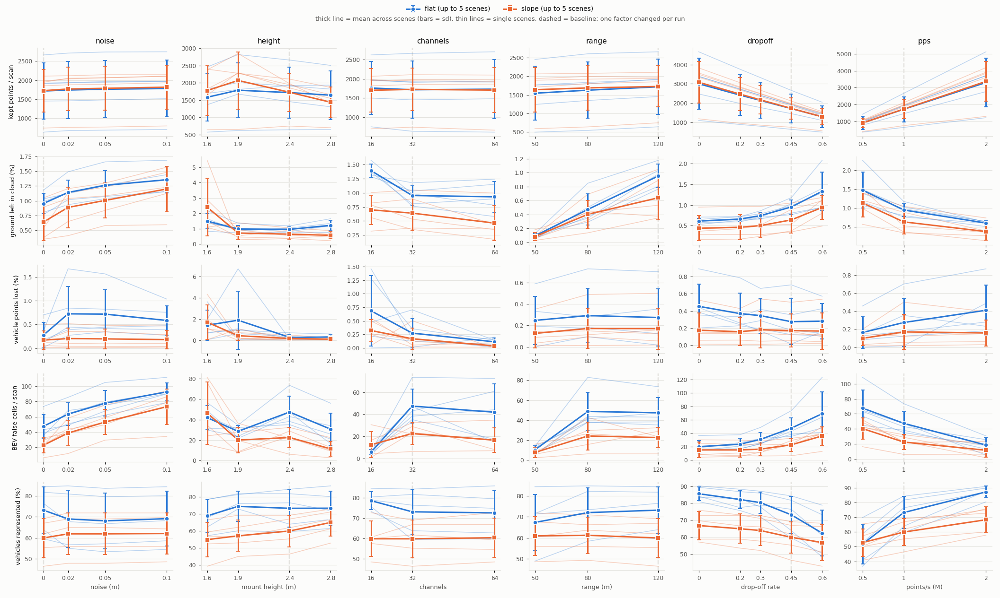
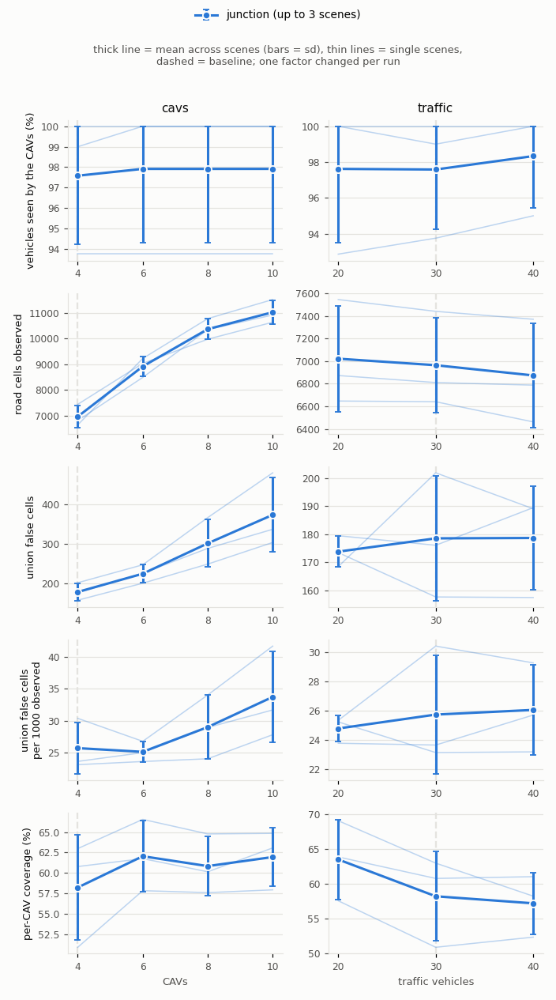
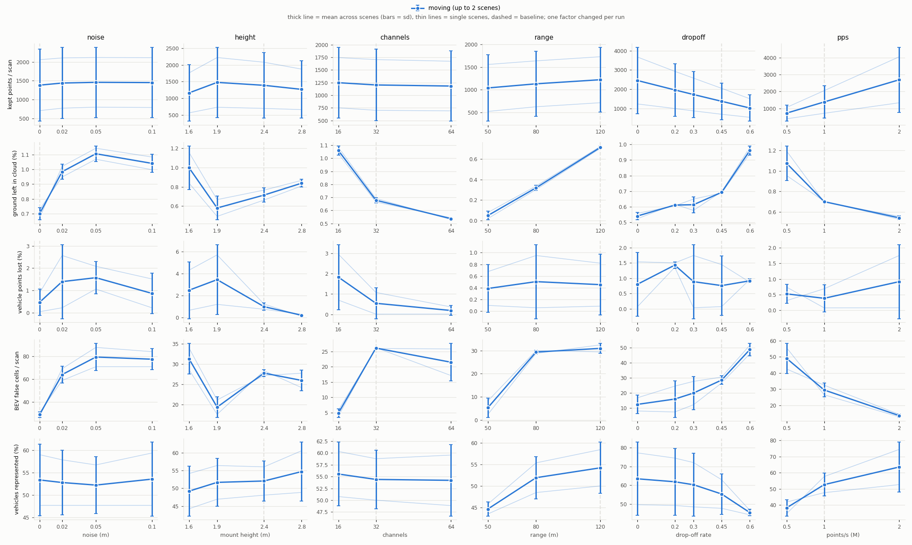

# LiDAR sensitivity benchmark (LiDAR → BEV robustness)

How the LiDAR settings and the vehicle population change the point cloud, the ground removal and the BEV, measured
with **one factor changed per run** on **fixed scenes**, over **several independently positioned scenes** so that every
effect comes with its spread. These are our own tests, not the paper's: only the sensor baseline (32 channels, 120 m,
1 000 000 pts/s, 20 Hz) comes from the paper's Table 1. Ground truth is used to score, never by the processing, and no
processing parameter was changed or tuned on these scenes.

All numbers below are in [results/sensitivity/](../results/sensitivity/) (metrics, checks, audits, plots); the raw
recordings stay in `data/runs/` (not in git).

```bash
# scenes: placed on lane waypoints around junction 1221 from a seed, frozen in a spawn plan (CARLA running Town03)
python tools/make_sensitivity_scenes.py flat2 --kind flat --seed 2101      # also: slope, population, moving
# parked scenes: one run per factor value; existing runs are skipped; geometry checked after recording
python tools/run_ablation.py --scenes flat2 slope2 --checks repeat invalid_mount
# moving traffic: every value of a factor in ONE simulation (see "Moving traffic")
python tools/record_moving_sensors.py --scenes moving1 moving2
# offline (CARLA closed for the timing): score, aggregate across scenes, plots
python tools/eval_ablation.py --timing-repeats 3
python tools/eval_ablation.py --check-processing abl_flat2_base           # evaluation == processing CLI
python tools/eval_ablation.py --check-labels abl_moving1_noise_0          # ground-truth boxes vs moving vehicles
python tools/diagnose_label_alignment.py record                          # controlled label diagnostic (LABEL_ALIGNMENT.md)
python tools/audit_sensitivity.py                                         # height / channel / min-points audits
```

## Protocol, and how it was verified

A small pilot (one new flat and one new slope scene, 12 runs) was recorded and checked before the campaign; every check
below was then repeated on the whole campaign.

| Check | Result |
|---|---|
| Scenes reproducible from their seed | regenerating a scene gives a byte-identical spawn plan |
| Same scene in every run of a parked scene | 13 scenes × all their runs: every planned vehicle spawned; largest position difference to the baseline **0.0000 m**, rotation **0.0000°**; parked vehicles move ≤ 1 mm between sweeps (`checks/<scene>.json`) |
| Recording reproducible | the baseline recorded again is **bit-identical in 20 of 20 scans**, both in the same session (flat2, slope2) and across sessions (flat, slope: recordings of the previous session vs today). One recording per setting is therefore enough; nothing was recorded twice |
| Evaluation = the project's processing | the processing CLI and the evaluation give identical non-ground clouds in 20 of 20 scans for each of 6 pilot runs (incl. 2M pts/s and an invalid mount) |
| Ego-body mask | in all 240 runs: other vehicles' points removed by the mask **0**, own-body points left in the cloud **0**; it removes 9 210–9 244 returns per scan at a 1.6 m mount and 899–917 at 1.9 m |
| Invalid mount (LiDAR at 1.2 m, inside the body) | CARLA records ~2 800 returns per scan on the body from inside. The processing warns and writes `mount_valid: false`; the evaluation scores the run but **excludes it** from every table and plot |
| New factors behave as designed | drop-off 0 → 1.82× the points (= 1 / (1 − 0.45)); 2M pts/s → 2.00× |
| Ground-truth labels | boxes are frame-matched and aligned with the returns, parked and moving (up to 18 m/s, turns, slope, moving sensor): offset at the visible end +0.03 m (rear) / −0.03 m (front), the sampling gap; a box one tick late would be −0.9 m at 18 m/s. See [LABEL_ALIGNMENT.md](LABEL_ALIGNMENT.md) |
| Timing | measured with CARLA closed, each scan processed 3 times and the fastest kept, median over scans |

## Scenes

| Scenes | Kind | Content (all around junction 1221) |
|---|---|---|
| flat (the paper's Figure 2), flat2–flat5 (seeds 2101–2104) | parked | 4 CAVs 3–40 m from the centre + 11 vehicles within 70 m, all on flat lanes; mixed vehicle models |
| slope (from the slope check), slope2–slope5 (seeds 2201–2204) | parked | 4 CAVs, 3–4 of them on the 12° +x leg, + 3 to 6 vehicles, 6–8 vehicles on the leg in total |
| pop1–pop3 (seeds 2301–2303) | parked, population | a pool of 44 Tesla Model 3 positions (CAV candidates within 40 m, the rest within 90 m) |
| moving1, moving2 (seeds 2401–2402) | Traffic Manager | 4 CAVs + 20 vehicles, all driving; mixed models |

The slope scenes all use the same 50 m sloped leg (one lane each way), so their positions overlap more than those of
the flat scenes. Baseline settings: 32 ch, 120 m, 1 000 000 pts/s, 20 Hz, noise 0, mount 2.4 m, drop-off 0.45,
`fixed_delta_seconds` 0.05 (one full sweep per tick); 4 CAVs × 5 sweeps per run.

Factors (one per run): noise 0 / 0.02 / 0.05 / 0.10 m · mount height 1.6 / 1.9 / 2.4 / 2.8 m · channels 16 / 32 / 64
(points/s kept) · range 50 / 80 / 120 m · drop-off 0 / 0.2 / 0.3 / 0.45 / 0.6 · points/s 0.5M / 1M / 2M · CAVs 4 / 6 /
8 / 10 · traffic 20 / 30 / 40 vehicles. 17 runs per parked scene, 6 per population scene, 22 LiDAR settings per moving
scene: 240 scored runs.

## Metrics

| Metric | Definition (per scan, pooled over the scans of a run) |
|---|---|
| kept points | returns left in the non-ground cloud after ego mask, road filter and ground removal (what the BEV is built from) |
| ego removed | returns removed by the ego-body mask |
| ground left % | ground returns (road / sidewalk height, labels of `tools/eval_ground.py`) still in the non-ground cloud |
| vehicle loss % | other vehicles' body returns (> 0.3 m above the box bottom) removed by the processing |
| false cells | occupied 0.5 m BEV cells (±60 m) whose returns are **all** ground: cells that should be empty |
| observed cells | 0.5 m BEV cells receiving at least one road return, ground or not: how much of the road the sensor observes (BEV coverage) |
| coverage % | other vehicles in the BEV window with ≥ 10 body returns kept (vehicle visibility) |
| ms/scan | ego mask + road filter + ground removal + BEV, fastest of 3, median over scans (this laptop, single process) |
| … < 50 m | the same restricted to the 0–50 m region every range setting covers |
| coop … | all CAVs of a frame together (union of their non-ground clouds, 60 m disc around the junction): vehicles seen with ≥ 10 returns in total, observed and false world cells |
| … per 1000 observed | false cells ÷ observed road cells × 1000, pooled over the run's frames (per CAV, and for the union as "coop false / 1000 observed"): an error rate that does not grow just because more road is observed |

**How to read the effect tables**: mean paired change to each scene's own baseline ± standard deviation across scenes,
and in brackets the number of scenes whose change has the same sign. An effect that is large compared to its sd and
holds in 5/5 scenes is robust; 3/5 means the scenes disagree. With 5, 3 and 2 scenes the sd are rough; no significance
test is claimed.



## Parked scenes: flat (5 scenes)

Baseline (mean ± sd across scenes): ground left 0.95 ± 0.17 %, vehicle loss 0.27 ± 0.27 %, false cells 47.4 ± 15.3,
observed cells 2 243 ± 161, coverage 73.2 ± 11.0 %, 77 ± 5 ms.

| factor | value | ground left % | vehicle loss % | false cells | observed cells | coverage % | ms/scan |
|---|---|---|---|---|---|---|---|
| noise | 0.02 | +0.19 ± 0.09 [5/5] | +0.45 ± 0.49 [5/5] | +16.0 ± 10.2 [5/5] | +18 ± 4 [5/5] | −4.2 ± 4.4 [4/5] | −2 ± 3 [3/5] |
| noise | 0.05 | +0.31 ± 0.10 [5/5] | +0.45 ± 0.44 [5/5] | +30.4 ± 6.5 [5/5] | +101 ± 9 [5/5] | −5.1 ± 4.6 [5/5] | −2 ± 2 [4/5] |
| noise | 0.1 | +0.40 ± 0.06 [5/5] | +0.31 ± 0.23 [5/5] | +45.2 ± 6.6 [5/5] | +281 ± 25 [5/5] | −4.1 ± 4.4 [4/5] | −3 ± 4 [4/5] |
| height | 1.6 | +0.54 ± 0.34 [5/5] | +1.15 ± 1.61 [4/5] | −5.5 ± 11.4 [3/5] | −791 ± 49 [5/5] | −4.4 ± 2.9 [5/5] | −19 ± 3 [5/5] |
| height | 1.9 | +0.02 ± 0.17 [2/5] | +1.62 ± 2.82 [5/5] | −18.8 ± 14.1 [5/5] | −289 ± 41 [5/5] | +1.1 ± 4.6 [2/5] | −2 ± 2 [4/5] |
| height | 2.8 | +0.26 ± 0.19 [4/5] | +0.03 ± 0.21 [3/5] | −16.8 ± 8.4 [5/5] | +119 ± 28 [5/5] | +0.1 ± 3.1 [3/5] | −4 ± 3 [5/5] |
| channels | 16 | +0.44 ± 0.23 [5/5] | +0.41 ± 0.65 [3/5] | −41.8 ± 15.1 [5/5] | −905 ± 77 [5/5] | +5.5 ± 7.3 [4/5] | −5 ± 2 [5/5] |
| channels | 64 | −0.02 ± 0.16 [2/5] | −0.16 ± 0.27 [4/5] | −5.5 ± 19.9 [3/5] | +823 ± 69 [5/5] | −0.5 ± 1.5 [3/5] | −1 ± 3 [4/5] |
| range | 50 | −0.86 ± 0.17 [5/5] | −0.03 ± 0.05 [4/5] | −37.2 ± 14.1 [5/5] | −118 ± 38 [5/5] | −5.9 ± 6.8 [3/5] | −5 ± 5 [4/5] |
| range | 80 | −0.48 ± 0.11 [5/5] | +0.02 ± 0.06 [3/5] | +1.3 ± 5.5 [3/5] | −1 ± 3 [2/5] | −1.2 ± 3.1 [2/5] | −2 ± 2 [4/5] |
| drop-off | 0 | −0.34 ± 0.15 [5/5] | +0.18 ± 0.16 [4/5] | −27.6 ± 7.7 [5/5] | +176 ± 23 [5/5] | +12.4 ± 7.4 [5/5] | +33 ± 4 [5/5] |
| drop-off | 0.2 | −0.29 ± 0.15 [5/5] | +0.09 ± 0.10 [4/5] | −24.0 ± 10.5 [5/5] | +124 ± 16 [5/5] | +9.0 ± 8.0 [5/5] | +22 ± 3 [5/5] |
| drop-off | 0.3 | −0.21 ± 0.12 [5/5] | +0.07 ± 0.07 [4/5] | −16.8 ± 8.8 [5/5] | +86 ± 13 [5/5] | +7.2 ± 5.5 [5/5] | +15 ± 8 [5/5] |
| drop-off | 0.6 | +0.38 ± 0.31 [5/5] | +0.01 ± 0.10 [2/5] | +21.6 ± 17.5 [5/5] | −141 ± 13 [5/5] | −10.8 ± 4.5 [5/5] | −14 ± 4 [5/5] |
| points/s | 0.5M | +0.52 ± 0.32 [5/5] | −0.11 ± 0.10 [5/5] | +20.2 ± 10.2 [5/5] | −265 ± 24 [5/5] | −21.4 ± 4.9 [5/5] | −26 ± 4 [5/5] |
| points/s | 2M | −0.34 ± 0.14 [5/5] | +0.14 ± 0.22 [4/5] | −28.8 ± 12.7 [5/5] | +142 ± 16 [5/5] | +14.1 ± 7.8 [5/5] | +42 ± 7 [5/5] |

## Parked scenes: slope (5 scenes)

Baseline: ground left 0.64 ± 0.31 %, vehicle loss 0.17 ± 0.19 %, false cells 22.6 ± 10.0, observed cells 1 903 ± 192,
coverage 59.9 ± 9.2 %, 72 ± 8 ms.

| factor | value | ground left % | vehicle loss % | false cells | observed cells | coverage % | ms/scan |
|---|---|---|---|---|---|---|---|
| noise | 0.02 | +0.25 ± 0.21 [5/5] | +0.03 ± 0.09 [2/5] | +16.1 ± 12.6 [5/5] | +23 ± 4 [5/5] | +2.0 ± 1.0 [5/5] | −3 ± 2 [5/5] |
| noise | 0.05 | +0.37 ± 0.21 [5/5] | +0.03 ± 0.09 [1/5] | +30.5 ± 14.3 [5/5] | +95 ± 16 [5/5] | +2.0 ± 1.0 [5/5] | −2 ± 4 [4/5] |
| noise | 0.1 | +0.56 ± 0.29 [5/5] | +0.01 ± 0.07 [2/5] | +50.7 ± 17.2 [5/5] | +235 ± 32 [5/5] | +2.1 ± 0.9 [5/5] | −4 ± 4 [5/5] |
| height | 1.6 | +1.76 ± 2.09 [5/5] | +1.53 ± 1.70 [4/5] | +23.8 ± 38.6 [3/5] | −710 ± 65 [5/5] | −5.0 ± 2.3 [5/5] | −18 ± 6 [5/5] |
| height | 1.9 | +0.07 ± 0.31 [3/5] | +0.26 ± 0.45 [4/5] | −2.5 ± 16.0 [3/5] | −232 ± 29 [5/5] | −2.8 ± 2.3 [4/5] | −3 ± 3 [4/5] |
| height | 2.8 | −0.08 ± 0.18 [3/5] | −0.07 ± 0.15 [3/5] | −11.1 ± 4.8 [5/5] | +122 ± 18 [5/5] | +5.0 ± 1.2 [5/5] | −7 ± 3 [5/5] |
| channels | 16 | +0.06 ± 0.16 [2/5] | +0.15 ± 0.37 [4/5] | −10.2 ± 13.1 [4/5] | −696 ± 81 [5/5] | +0.0 ± 4.0 [3/5] | −5 ± 4 [4/5] |
| channels | 64 | −0.18 ± 0.17 [5/5] | −0.13 ± 0.22 [4/5] | −6.0 ± 9.2 [3/5] | +657 ± 117 [5/5] | +0.6 ± 2.4 [2/5] | −4 ± 3 [5/5] |
| range | 50 | −0.56 ± 0.31 [5/5] | −0.04 ± 0.07 [4/5] | −15.0 ± 9.4 [5/5] | −60 ± 16 [5/5] | +1.0 ± 1.5 [4/5] | −5 ± 5 [5/5] |
| range | 80 | −0.24 ± 0.24 [4/5] | +0.00 ± 0.03 [2/5] | +1.6 ± 11.9 [2/5] | +1 ± 3 [3/5] | +1.3 ± 1.4 [4/5] | −3 ± 3 [4/5] |
| drop-off | 0 | −0.20 ± 0.16 [5/5] | +0.01 ± 0.02 [3/5] | −7.6 ± 11.6 [3/5] | +129 ± 22 [5/5] | +6.9 ± 3.2 [5/5] | +30 ± 4 [5/5] |
| drop-off | 0.2 | −0.18 ± 0.16 [5/5] | −0.01 ± 0.04 [3/5] | −7.7 ± 9.8 [3/5] | +91 ± 16 [5/5] | +5.1 ± 1.6 [5/5] | +13 ± 4 [5/5] |
| drop-off | 0.3 | −0.14 ± 0.14 [5/5] | +0.01 ± 0.02 [3/5] | −6.4 ± 8.0 [4/5] | +63 ± 11 [5/5] | +4.0 ± 1.2 [5/5] | +7 ± 6 [4/5] |
| drop-off | 0.6 | +0.30 ± 0.20 [5/5] | −0.01 ± 0.03 [2/5] | +13.3 ± 8.6 [5/5] | −101 ± 15 [5/5] | −3.1 ± 2.3 [5/5] | −15 ± 8 [5/5] |
| points/s | 0.5M | +0.50 ± 0.30 [5/5] | −0.07 ± 0.13 [4/5] | +17.9 ± 9.2 [5/5] | −193 ± 24 [5/5] | −7.2 ± 3.3 [5/5] | −25 ± 8 [5/5] |
| points/s | 2M | −0.26 ± 0.16 [5/5] | −0.01 ± 0.05 [2/5] | −10.8 ± 11.2 [3/5] | +104 ± 19 [5/5] | +8.4 ± 4.4 [5/5] | +41 ± 9 [5/5] |

### Range on the common 0–50 m region

The range tables above use the full ±60 m window, where a shorter range simply has no far returns. Restricted to the
0–50 m every setting covers, the changes vanish: flat 50 m vs 120 m: ground left −0.01 ± 0.01 %, false cells
−0.9 ± 1.5, coverage −0.3 ± 2.5 % (signs mixed across scenes); slope: +0.01 ± 0.03 %, +0.5 ± 2.8, +1.4 ± 1.7 %;
80 m likewise. **Range differences are truncation, not a change in processing quality.**

## CAV count and traffic density (3 population scenes)

The two population factors are kept apart from the sensor factors, and they do not mean the same thing:

- **CAV count (4 / 6 / 8 / 10)** changes **only the roles**: the same 34 parked Tesla Model 3 in every run, k of them
  carrying a LiDAR. Checked: CAVs 0–3 give identical points, kept points, ground and false cells whatever k is (adding
  LiDARs to other cars does not change existing scans), so the effect is purely the extra viewpoints.
- **Traffic (20 / 30 / 40 vehicles, 4 CAVs)** **changes the scene**: vehicles are added (nested: the 20 are part of the
  30, the 30 of the 40), with new occlusions and new targets. Its effects are scene effects, not sensor effects.

Baseline (4 CAVs, 30 traffic): vehicles seen by the CAVs together 97.6 ± 3.4 %, road cells observed together 6 964 ± 422,
union false cells 178.5 ± 22.2, i.e. 25.7 ± 4.0 per 1 000 observed road cells, per-CAV coverage 58.2 ± 6.4 %.

| factor | value | coop coverage % | coop observed cells | coop false cells | coop false / 1000 observed | per-CAV coverage % | kept/scan |
|---|---|---|---|---|---|---|---|
| CAVs | 6 | +0.3 ± 0.6 [1/3] | +1 951 ± 551 [3/3] | +46.1 ± 3.6 [3/3] | −0.6 ± 2.6 [1/3] | +3.8 ± 3.0 [3/3] | +257 ± 205 [3/3] |
| CAVs | 8 | +0.3 ± 0.6 [1/3] | +3 401 ± 809 [3/3] | +123.1 ± 37.9 [3/3] | +3.3 ± 2.2 [3/3] | +2.6 ± 3.7 [2/3] | +275 ± 246 [3/3] |
| CAVs | 10 | +0.3 ± 0.6 [1/3] | +4 059 ± 842 [3/3] | +195.3 ± 72.4 [3/3] | +8.0 ± 3.3 [3/3] | +3.7 ± 2.9 [3/3] | +432 ± 212 [3/3] |
| traffic | 20 | +0.0 ± 0.9 [1/3] | +58 ± 49 [3/3] | −4.7 ± 25.6 [1/3] | −0.9 ± 3.7 [1/3] | +5.3 ± 1.9 [3/3] | −248 ± 165 [3/3] |
| traffic | 40 | +0.8 ± 0.7 [2/3] | −90 ± 80 [3/3] | +0.1 ± 13.1 [1/3] | +0.3 ± 1.6 [2/3] | −1.0 ± 3.3 [1/3] | +635 ± 460 [3/3] |

(The per-CAV coverage of the CAV runs includes the new CAVs' own scans, i.e. new viewpoints.)

**Normalised by the observed road**, the union's false-cell rate is 25.7 ± 4.0 (4 CAVs), 25.2 ± 1.6 (6), 29.0 ± 5.0 (8)
and 33.7 ± 7.2 (10) per 1 000 observed road cells. Most of the doubling of the raw count from 4 to 10 CAVs is more road
observed (+58 %). The rate itself is unchanged at 6 CAVs and rises at 8 and 10 (+31 % at 10, 3/3 scenes). Per CAV the
rate does not rise (−3.7 ± 4.8 per 1 000 at 10 CAVs). The union's rate rises because the CAVs' observed road overlaps
(counted once in the union) more than their leftover-ground cells do. The mechanism behind that was not measured
separately.



## Moving traffic (2 scenes, analysed separately)

**Moving traffic is not reproducible in CARLA 0.9.12**: two recordings of the same configuration (same seeds,
synchronous Traffic Manager) diverge by up to 3.56 m (moving1) and 0.63 m (moving2), and none of their scans match
(`checks/moving1.json`). One run per sensor value would therefore compare different traffic. Instead,
`tools/record_moving_sensors.py` mounts **every value of a factor on the same CAVs in one simulation** (ray-cast
LiDARs do not see each other): all variants see exactly the same vehicles at the same ticks (checked: 0.0000 m), and the
factor's baseline is recorded in that same simulation. Each factor is a different simulation, with its own baseline.
A simulation counts as moving traffic only if ≥ 50 % of the vehicle states move faster than 1 m/s (rule fixed before
looking at any metric); 2 of 12 simulations, where the traffic waited at red lights, were recorded again. In the kept
simulations 76–82 % of the vehicle states move (median 6.7–6.9 m/s); the CAVs drive too (e.g. 17–29 km/h in moving1).

| factor | value | ground left % | vehicle loss % | false cells | observed cells | coverage % | ms/scan |
|---|---|---|---|---|---|---|---|
| noise | 0.02 | +0.29 ± 0.09 [2/2] | +0.93 ± 1.06 [2/2] | +35.0 ± 9.6 [2/2] | +22 ± 3 [2/2] | −0.6 ± 0.8 [1/2] | +0 ± 0 [2/2] |
| noise | 0.1 | +0.34 ± 0.10 [2/2] | +0.40 ± 0.32 [2/2] | +48.4 ± 11.6 [2/2] | +314 ± 24 [2/2] | +0.2 ± 0.3 [1/2] | −1 ± 1 [2/2] |
| height | 1.6 | +0.28 ± 0.15 [2/2] | +1.49 ± 2.25 [1/2] | +3.6 ± 4.6 [2/2] | −773 ± 36 [2/2] | −2.9 ± 1.4 [2/2] | −12 ± 2 [2/2] |
| height | 2.8 | +0.12 ± 0.03 [2/2] | −0.78 ± 0.45 [2/2] | −1.8 ± 3.3 [1/2] | +144 ± 45 [2/2] | +2.7 ± 2.7 [2/2] | −3 ± 2 [2/2] |
| channels | 16 | +0.38 ± 0.02 [2/2] | +1.28 ± 0.84 [2/2] | −21.2 ± 1.6 [2/2] | −935 ± 69 [2/2] | +1.1 ± 0.5 [2/2] | −5 ± 0 [2/2] |
| channels | 64 | −0.14 ± 0.03 [2/2] | −0.35 ± 0.50 [1/2] | −4.6 ± 6.3 [2/2] | +887 ± 139 [2/2] | −0.2 ± 1.3 [1/2] | −2 ± 2 [2/2] |
| range | 50 | −0.66 ± 0.03 [2/2] | −0.07 ± 0.11 [1/2] | −25.7 ± 6.3 [2/2] | −103 ± 24 [2/2] | −9.5 ± 4.3 [2/2] | −4 ± 1 [2/2] |
| drop-off | 0 | −0.15 ± 0.03 [2/2] | +0.04 ± 0.07 [1/2] | −16.1 ± 3.4 [2/2] | +159 ± 37 [2/2] | +8.1 ± 8.8 [2/2] | +34 ± 2 [2/2] |
| drop-off | 0.6 | +0.27 ± 0.02 [2/2] | +0.16 ± 1.03 [1/2] | +20.2 ± 1.3 [2/2] | −136 ± 21 [2/2] | −9.9 ± 9.1 [2/2] | −10 ± 3 [2/2] |
| points/s | 0.5M | +0.37 ± 0.17 [2/2] | +0.14 ± 0.74 [1/2] | +19.5 ± 13.5 [2/2] | −249 ± 37 [2/2] | −14.3 ± 12.1 [2/2] | −20 ± 1 [2/2] |
| points/s | 2M | −0.16 ± 0.02 [2/2] | +0.53 ± 0.75 [2/2] | −15.9 ± 3.1 [2/2] | +127 ± 29 [2/2] | +10.9 ± 8.3 [2/2] | +41 ± 2 [2/2] |

All rows in `results/sensitivity/benchmark/summary.md`; within 0–50 m the range changes vanish here too (ground left
+0.00 %, false cells +0.45, coverage −1.1 %).

**Labels of moving vehicles are aligned.** An earlier version of this page reported that some moving vehicles' boxes
sat ahead of their returns (moving2 and e12, median −0.25 m, up to ~0.9 m). A controlled CARLA diagnostic (semantic
LiDAR, every tick saved, speeds up to 18 m/s, turns, slope, a moving sensor, a 0.1 s step) found:
- frame-matched boxes: the recorder's box is the ActorSnapshot of the LiDAR's frame;
- a time offset of +0.0005 s [−0.0024, +0.0036], where one tick would be −0.05 s.

The reported offset was produced by the first check's estimator. Seen from behind, the shift "holding the most returns"
is tied over half the search window and its median is about −1 m, whatever the alignment. The corrected check, which
reads the offset at the visible end of the box, gives +0.02 … +0.07 m (rear) and −0.03 … −0.06 m (front) on all moving
recordings, the same sampling gap as parked vehicles. Details, figures and before/after tables:
[LABEL_ALIGNMENT.md](LABEL_ALIGNMENT.md). The moving-scene metrics above were computed with these correct boxes and
stand as reported.



## Audits (10 parked scenes, `results/sensitivity/audit/audit.json`)

- **The sensor height is inferred from the points.** `estimate_seed_plane` takes only the points and its fit settings;
  shifting every point's z by +0.30 / −0.50 m moves the estimate by exactly that (residual 0.00005 mm). Error against
  the recorded mount: ≤ 5.4 mm on flat scenes; up to 0.29 m on slope scenes at grade changes (foot or crest), where the
  plane fitted on the 2.5–15 m ring is not the ground under the car.
- **False cells come from the sparse-patch rule, not from the metric or the grid.** In all 10 scenes the leftover
  "ground" is real road surface (median height above the road 0.00 m), the count is the same on a grid shifted by half
  a cell, and for 32 and 64 channels 70–100 % of it lies in 8 m patches with < 18 returns, which the ground removal keeps
  on purpose. Lowering that minimum to 8 (audit only) cuts the false cells for every channel count in every scene
  (e.g. flat5: 32 ch 73.5 → 19.7, 64 ch 72.5 → 41.9), but raises vehicle loss in some (16 ch on flat3: 0.00 → 1.51 %).
  It is a trade-off, and choosing it on these evaluation scenes would be tuning, so the processing keeps 18.
- **The 32-channel "peak" of the first two scenes was scene-specific.** 64 channels has as many or more false cells than
  32 in flat3, flat4, flat5 and slope2; per observed cell, the flat means are 0.4 % (16 ch), 2.1 % (32 ch) and 1.4 %
  (64 ch). 16 channels has few false cells mainly because it observes ~40 % fewer road cells.

## Processing time

Median per scan (fastest of 3, CARLA closed): 77 ± 5 ms (flat) and 72 ± 8 ms (slope) at the baseline. It scales with
the number of returns: 51 / 77 / 119 ms at 0.5M / 1M / 2M pts/s (flat); drop-off 0 costs +33 ms. Noise, range and
channels barely change it; a 1.6 m mount saves ~19 ms (fewer road returns). The ego mask itself takes 2.2 ms. These are
this laptop's timings (Python, one process), for comparing settings, not real-time claims.

## What we conclude

1. **Point density is the strongest sensor factor, through points per sweep.** Points/s and drop-off act alike:
   0.5M pts/s loses 21.4 ± 4.9 points of vehicle coverage on flat scenes (5/5) and adds false cells and leftover ground;
   2M pts/s or drop-off 0 (≈ twice the returns) gains 12–14 points of coverage on flat scenes (+7 to +8 on slopes,
   5/5 everywhere) and removes about 28 false cells per scan on flat scenes, at +33 to +42 ms. Higher density also reduces the leftover ground (the sparse patches get dense enough).
2. **Noise hurts the BEV, not vehicle visibility.** Each step adds false cells (+16 per scan at 2 cm, +45 to +51 at
   10 cm, 5/5 on both terrains, and similar in moving traffic) and leftover ground; coverage does not move consistently.
   For sensor profiles B and C (2 cm), expect roughly +16 false cells per scan.
3. **Low mounts cost observed road and visibility; the ego mask is required below ~2 m.** At 1.6 m, 35 % fewer road
   cells are observed (5/5), ground left rises (flat +0.54 %, slope +1.76 % with a large spread) and coverage drops
   4–5 points (5/5). 2.8 m reduces false cells (5/5) and helps on slopes (+5.0 points coverage, 5/5). The mask removes
   exactly the own body (0 other-vehicle points in 240 runs) but cannot restore the view the body hides.
4. **No channel optimum.** What is robust: observed road cells scale with channels (flat: 16 ch −40 %, 64 ch +37 %, 5/5),
   16 channels leaves more ground on flat scenes (+0.44 %, 5/5), and 64 channels loses slightly fewer vehicle points
   (4/5 on both terrains). The false-cell ranking of 32 vs 64 channels changes from scene to scene.
5. **Range differences are truncation**: within 0–50 m all settings are equal (all three sets of scenes).
6. **More CAVs observe much more road; their error rate grows more slowly than the raw count.** From 4 to 10 CAVs
   (same vehicles), the road observed together grows by 58 % and the union false cells double (+195, 3/3). Per
   observed road cell, the union's rate is unchanged at 6 CAVs and rises by 31 % at 10 (25.7 → 33.7 per 1 000, 3/3),
   while each CAV's own rate does not rise. Every CAV adds its own leftover ground to a fused BEV, so a fused BEV
   needs the per-CAV ground removal to be clean. Vehicle
   visibility is already saturated with 4 CAVs in these scenes (97.6 %), so this benchmark cannot show a visibility
   gain from more CAVs.
7. **Denser traffic is a scene change**: from 20 to 30 vehicles the per-CAV coverage drops 5.3 points (3/3, more
   occlusion and more targets), from 30 to 40 by 1.0 (1/3); vehicles seen by all CAVs together stay ~98 %.
8. **Moving traffic shows the same sensor effects** (2/2 scenes, same direction for ground left, false cells and
   observed cells). Its ground-truth boxes are aligned ([LABEL_ALIGNMENT.md](LABEL_ALIGNMENT.md)).

## Limits

- All scenes are at one junction of Town03; the slope scenes share one 50 m sloped leg. Five scenes per terrain,
  three population and two moving scenes: the sd are rough, and effects marked 3/5 (or 1/2, 2/3) are not established.
- Population scenes use one vehicle model so that roles can change without changing the scene; real traffic is mixed.
- Moving traffic: each factor is a different simulation; only 2 scenes.
- Ground-truth boxes are CARLA's: a few models' boxes are larger than their visible body (Jeep Wrangler Rubicon
  +0.33 m at the rear, Carlacola +0.12 m), which slightly favours coverage and vehicle-loss scores of those models.
- The values tested are proposals for the analysis, not the paper's parameters; the processing parameters were never
  changed for, or tuned on, these scenes.

## First study: the ego-body mask before / after (2 scenes)

The first version of this analysis (scenes flat and slope only) found that below ~2 m the LiDAR hits its own car and
that nothing removed those returns. The ego-body mask ([PROCESSING.md](PROCESSING.md#ego-body-mask-processingego_maskpy))
was added and the same recordings re-scored (`results/sensitivity/first_study/before|after`):

| scene, mount | own pts in cloud | ego cells | vehicle loss % | ground left % | false cells | coverage % | BEV cells | mean S̃ |
|---|---|---|---|---|---|---|---|---|
| flat 1.6 | 9 244 → **0** | 26 → **0** | 0.93 → 0.67 | 1.43 → 1.43 | 29.9 → 29.9 | 78.4 → 78.4 | 228 → 202 | 0.0366 → 0.0322 |
| flat 1.9 | 917 → **0** | 12 → **0** | 1.11 → 1.08 | 0.92 → 0.93 | 22.4 → 23.8 | 81.6 → 81.2 | 213 → 203 | 0.0364 → 0.0349 |
| slope 1.6 | 9 235 → **0** | 26 → **0** | 1.14 → 1.08 | 1.63 → 1.08 | 26.6 → 15.7 | 66.4 → 66.4 | 113 → 76 | 0.0191 → 0.0141 |
| slope 1.9 | 911 → **0** | 12 → **0** | 0.78 → 0.72 | 0.60 → 0.53 | 12.3 → 8.6 | 69.1 → 69.1 | 97 → 80 | 0.0159 → 0.0139 |
| every other run | 0 → 0 | 0 → 0 | identical | identical | identical | identical | identical | identical |

The CAV's own roof had inflated the sector quality S̃ by 12 % (flat) and 26 % (slope) at 1.6 m. Statements of that
first version that the larger benchmark corrects: the sensor-height estimate is not exact at slope transitions; the
32-channel false-cell peak is not general; a shorter range does not improve the ground removal (truncation).
