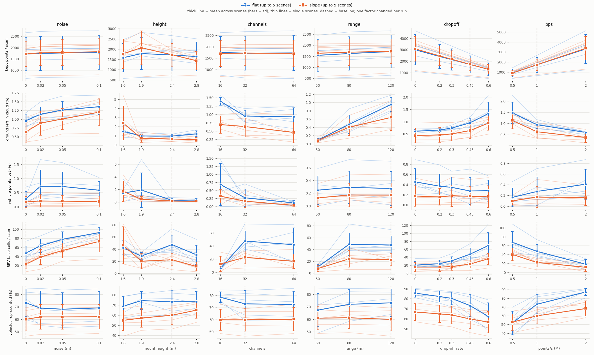

# From CARLA LiDAR to BEV: scientific summary

Scope: the per-CAV chain of our reproduction of BEV-guided cooperative point-cloud sharing, from the simulated LiDAR to
the BEV grid and its sector metadata. It covers how the data are produced, the processing choices, how both were
validated, and how robust the LiDAR → BEV step is to the sensor and the vehicle population. The sharing optimization,
the fusion and the detection build on this chain; they are not part of this repository. Nothing here reproduces the
paper's results yet, and nothing claims real-time operation or a real network.

## 1. Setting

| Item | Value | Source |
|---|---|---|
| Simulator | CARLA 0.9.12, synchronous mode, 0.05 s step (one full 360° sweep per tick), physics substepping 0.01 s | ours |
| Map, site | Town03, junction 1221 (centre 2.9, −136.5): the paper's Figure 2 junction, with a 12° sloped leg | identified by comparing all 25 Town03 junctions with Figure 2 |
| LiDAR | 32 channels, 120 m, 1 000 000 pts/s, 20 Hz | paper, Table 1 |
| LiDAR, unspecified | FOV +2° / −25°, mount 2.4 m, drop-off 0.45 (CARLA default), noise 0 | ours |
| Population | 4–10 CAVs, 20–40 other vehicles, spawn area x ∈ [−100, 100], y ∈ [−200, 200], speed offset ±20 % | paper, Table 1 |
| Figure 2 scene | 4 CAVs + 11 vehicles, within 1.2 m of the figure's positions | our spawn plan |

## 2. Pipeline and implementation choices

Per CAV and per sweep: **ego-body mask → drivable-road filter → ground removal → BEV → static sectors → metadata**.
The paper specifies the road filter, the ground removal, the BEV and the static sectors, but not how. Every choice
below is ours unless marked.

| Stage | Choice | Why |
|---|---|---|
| Recording | Each LiDAR is read for the frame `world.tick()` returned (older measurements discarded, a newer one is an error). The ground truth comes from the same frame's actor states, the initial poses (`spawn.json`) are saved, and parked vehicles are braked | the sweep, the sensor pose and the boxes describe one instant; parked cars do not roll down the slope |
| Ego-body mask | Removes returns inside the CAV's body box (CARLA's model box, fixed in the sensor frame by the mount calibration, +0.1 m). A sensor origin inside the body is flagged `mount_valid: false` | below ~2 m the LiDAR hits its own roof (9 244 returns per scan at 1.6 m, 35 % of the scan) |
| Drivable-road filter | Points kept if their world (x, y) lies in the Driving / Parking / Bidirectional lanes of the OpenDRIVE map, +0.5 m, any height | the paper isolates "the drivable road region" without saying how; an HD-map region as in OpenCDA / OpenCOOD |
| Ground removal | 8 × 8 m patches, one RANSAC plane each (0.18 m). A plane is accepted only if it continues its accepted neighbours (≤ 0.5 m step), has no surface below it, and is at most 15° steep. A seed plane near the sensor gives the height from the data. Sparse patches (< 18 returns) are judged against their neighbours' prediction, and unknown is kept | slopes are followed, while car roofs and sides cannot be taken for ground; only the points are used (no map height, no boxes) |
| BEV | 0.5 m cells over ±60 m, sensor frame: occupancy, count, mean intensity. Occupancy 0 means "no return", not "free" | |
| Sectors, metadata | 4 static sectors from π/4 (paper's example). σ = bytes of the sector's raw points; S̃ = share of non-ground points left after 0.2 m voxel averaging; footprint = wedge in the world frame | the inputs of the paper's ILP |

## 3. Improvements made and validated

| Problem found | Fix | Effect (ground truth for scoring only) |
|---|---|---|
| First ground removal ate vehicles, especially close pairs and on the slope | slope-aware height prior: seed, continuity, lowest surface | vehicle points removed 11.0 % → **0.26 %** and ground left 2.6 % → 1.5 % (200 scans, 5 runs); close pairs 22–37 % → **0 %**; vehicles on the slope 13.2 % → 0.05 % |
| Whole cleaning step (road filter + ground) | — | vehicle points removed **0.20 %** (none by the road filter); ground left 0.77 %; the road filter removes 42 % of the returns |
| Low mounts hit their own car | ego-body mask | own returns in the cloud 9 244 → **0** (1.6 m) and 917 → 0 (1.9 m); 0 other-vehicle points removed in 240 runs; the roof had inflated S̃ by 12–26 % at 1.6 m |
| Parked vehicles rolled down the 12° slope | brake and hand brake at spawn | ≤ 0.03 m in 15 frames |
| Spawns outside the paper's area; static first frames | hard spawn box; 5 s warm-up; motion check | |
| Moving-vehicle boxes appeared up to 0.9 m off | the label **check** was biased; check corrected; recorder unchanged | boxes frame-matched: time offset +0.0005 s [−0.0024, +0.0036] vs −0.05 s for one tick ([LABEL_ALIGNMENT.md](LABEL_ALIGNMENT.md)) |

## 4. Measurement protocol

- **Ground truth for evaluation only.** No processing step reads boxes, labels or the semantic LiDAR. Processing
  parameters were fixed before the sensitivity scenes and never tuned on them. A better trade-off (sparse-patch minimum
  8 instead of 18) was found in an audit and deliberately not adopted.
- **The evaluation is the processing.** The evaluation's non-ground clouds equal the processing CLI's, scan by scan.
- **One factor per run, fixed scenes.** Scenes are seeded spawn plans around junction 1221; regenerating one gives a
  byte-identical plan.
  - Parked scenes are bit-identical across runs and CARLA sessions (positions 0.0000 m, 20/20 scans), so one recording
    per setting suffices.
  - Moving Traffic-Manager traffic is not reproducible (up to 3.6 m divergence). Every value of a factor is therefore
    mounted on the same CAVs in one simulation, and a simulation counts only if ≥ 50 % of the vehicle states move (rule
    fixed before any metric).
- **Sensor effects kept apart from scene changes.** The CAV count changes only roles among the same 34 parked cars.
  Traffic density changes the scene (nested 20 ⊂ 30 ⊂ 40) and is reported as such.
- **Ground-truth boxes verified**, parked and moving: the recorder's box is the ActorSnapshot of the LiDAR's frame, and
  the box of tick t fits the returns at 0–18 m/s, on turns, on the slope and from a moving sensor.
- **Invalid configurations excluded.** A mount inside the body is scored, flagged and excluded from every comparison.
- **Statistics.** Effects are paired differences to each scene's own baseline: mean ± sd across independent scenes, and
  how many scenes agree in sign. Range comparisons are also made on the common 0–50 m region. No significance test is
  claimed with 2–5 scenes.

## 5. Sensitivity of the LiDAR → BEV step

240 scored runs:
- 5 flat and 5 slope parked scenes, 17 runs each;
- 3 population scenes;
- 2 moving-traffic scenes.

Baselines (flat, mean ± sd over 5 scenes):

| ground left | vehicle points lost | BEV false cells / scan | observed road cells | vehicles represented | time / scan |
|---|---|---|---|---|---|
| 0.95 ± 0.17 % | 0.27 ± 0.27 % | 47.4 ± 15.3 | 2 243 ± 161 | 73.2 ± 11.0 % | 77 ± 5 ms |

Findings, in order of robustness ([k/n] = scenes agreeing in sign):

1. **Point density dominates.** 0.5M pts/s loses 21.4 ± 4.9 points of vehicle visibility on flat scenes [5/5].
   Doubling the returns (2M pts/s, or drop-off 0) gains 12–14 points [5/5] and removes ~28 false cells per scan, at
   +33 to +42 ms.
2. **Noise corrupts the BEV, not visibility.** False cells grow +16 per scan at 2 cm and +45 to +51 at 10 cm [5/5 on both
   terrains, same in moving traffic]. Visibility does not move consistently.
3. **Mount height trades observed road.** At 1.6 m: −35 % observed road cells [5/5], −4 to −5 points of visibility
   [5/5], more leftover ground. 2.8 m: fewer false cells [5/5], +5.0 points of visibility on slopes [5/5]. Below ~2 m
   the ego mask is required.
4. **No channel optimum.** Observed road scales with channels (16 ch −40 %, 64 ch +37 % [5/5]). The false-cell ranking
   of 32 vs 64 channels changes between scenes. At 32 and 64 channels, 70–100 % of the false cells come from the
   conservative sparse-patch rule.
5. **Range differences are truncation.** On the common 0–50 m region every range setting gives the same results.
6. **More CAVs, more road, slowly rising union error rate.** From 4 to 10 CAVs (same vehicles), the road observed
   together grows +58 %:
   - the raw union false cells double (+195 [3/3]);
   - per 1 000 observed road cells the union rate goes 25.7 → 33.7 (+31 % [3/3]), unchanged at 6 CAVs;
   - each CAV's own rate does not rise.

   Vehicle visibility is already saturated with 4 CAVs (97.6 %), so these scenes cannot show a visibility gain.
7. **Denser traffic is a scene change.** From 20 to 30 vehicles, per-CAV visibility drops 5.3 points [3/3] (more
   occlusion, more targets).
8. **Moving traffic reproduces the sensor effects** [2/2], with verified boxes.
9. **Time.** About 0.1 s per CAV scan in single-threaded Python (77 ms flat baseline, 51 / 119 ms at 0.5M / 2M pts/s)
   against a 50 ms sweep: not real-time.

## 6. Limitations

- **Site.** One junction of one town. The 5 slope scenes share a single 50 m sloped leg. The spreads are rough (5, 3
  and 2 scenes), and effects at 3/5 or below are not established.
- **Values tested.** They are proposals, not the paper's parameters. LiDAR FOV, mount, drop-off and noise are not in
  the paper.
- **Population scenes** use one vehicle model so that only roles change; real traffic is mixed.
- **Moving traffic.** Each factor is a different simulation, and there are only 2 moving scenes.
- **Model boxes.** CARLA's boxes for a few models are larger than the visible body (Jeep Wrangler +0.33 m at the rear,
  Carlacola +0.12 m). Visible ends are sampled within ±0.03–0.05 m, and 32-channel scans at 20–30 m can miss a front
  bumper.
- **Ground removal on the far slope.** It keeps far slope ground on purpose (15 % of it at 93–119 m in two runs):
  unknown ground is kept rather than guessed.
- **Sensor height.** The sensor height inferred by the ground removal is exact on flat ground (≤ 5.4 mm) but off by up
  to 0.29 m at slope transitions.
- **Simulation only.** No sensor model beyond CARLA's ray-cast LiDAR, no real data, no real network.

## 7. Reproducing

```bash
python tools/make_sensitivity_scenes.py ...            # seeded scenes -> config/spawn_plans/sensitivity/
python tools/run_ablation.py                           # parked scenes (CARLA running Town03)
python tools/record_moving_sensors.py --scenes moving1 moving2
python tools/eval_ablation.py --timing-repeats 3       # CARLA closed for timing
python tools/audit_sensitivity.py
python tools/diagnose_label_alignment.py record && python tools/diagnose_label_alignment.py analyse
python -m unittest discover -s tests -t .             # 99 tests, no CARLA needed
```

| Figure | File | Source data |
|---|---|---|
| Ground removal on a close pair, before / after | [images/ground_close_pair.png](images/ground_close_pair.png) | [PROCESSING.md](PROCESSING.md) |
| Parked scenes, 6 sensor factors | [images/sensitivity.png](images/sensitivity.png) | `results/sensitivity/benchmark/` |
| CAV count and traffic density (incl. false cells per observed road) | [images/sensitivity_population.png](images/sensitivity_population.png) | same |
| Moving traffic | [images/sensitivity_moving.png](images/sensitivity_moving.png) | same |
| Box alignment at t−1 / t / t+1 and per case | [images/label_alignment_ticks.png](images/label_alignment_ticks.png) | `results/label_alignment/` |
| Label check before / after on the benchmark recordings | [images/label_alignment_before_after.png](images/label_alignment_before_after.png) | same |

Detailed reports: [PROCESSING.md](PROCESSING.md), [SENSITIVITY.md](SENSITIVITY.md),
[LABEL_ALIGNMENT.md](LABEL_ALIGNMENT.md), [PAPER_FIDELITY.md](PAPER_FIDELITY.md).


