# Experiments and results

Every experiment of the CARLA → LiDAR → BEV part of the project on one page: what was tested, on which scenes, and
what came out. The pages linked in each section have the full tables and the method.

- **Simulation only.** CARLA 0.9.12, Town03, synchronous mode with a 0.05 s step (one full LiDAR sweep per tick).
  CARLA's ray-cast LiDAR, no real sensor data, no network.
- **The paper's LiDAR** (Table 1) is the baseline everywhere: 32 channels, 120 m, 1,000,000 points/s, 20 Hz.
- **Ground truth scores, it never helps.** CARLA's boxes and labels are used to measure the results. No processing step
  reads them, and no processing parameter was tuned on the evaluation scenes.
- **What is in git.** Raw recordings (`data/runs/`, 264+ folders) are not in git. Metrics and plots are in this folder
  and in [docs/images/](../docs/images/).

## Index

| # | Experiment | Scenes / runs | Main result | Section |
|---|---|---|---|---|
| 1 | Asynchronous vs synchronous capture | Phase 1 scripts, e09 | asynchronous: ~50–72° slices, not sweeps → synchronous mode only | [1](#1-data-collection) |
| 2 | First baselines e01 (4 CAVs) and e02 (10 CAVs) | e01, e01_fixed, e02_fixed | CAVs standing still, vehicles outside the paper's area → 5 s warm-up, strict spawn box | [1](#1-data-collection) |
| 3 | Finding the paper's Figure 2 junction | 25 Town03 junctions | junction 1221; Figure 2 re-created within 1.2 m | [1](#1-data-collection) |
| 4 | Parked cars on the 12° slope | slope_check, slope_check_parked | cars rolled down → brakes at spawn: ≤ 0.03 m in 15 frames | [1](#1-data-collection) |
| 5 | Ground removal: first prototype vs slope-aware | 200 scans, 5 runs | vehicle points removed 11.0 % → **0.26 %** | [2](#2-processing-quality) |
| 6 | Whole cleaning step (road filter + ground removal) | 260 scans, 6 runs | **0.20 %** of vehicle points removed, 0.77 % of ground left | [2](#2-processing-quality) |
| 7 | Ego-body mask | 2 scenes, then all 240 benchmark runs | own-roof returns 9,244 → **0** per scan at 1.6 m; 0 other-vehicle points removed | [2](#2-processing-quality) |
| 8 | Every CAV before and after filtering | e12, e01 | filtering keeps 99.3–99.7 % of vehicle points; 1 CAV sees 3–7 cars, 4 CAVs see 12–17 of 24 | [3](#3-what-each-cav-sees-before-and-after-filtering) |
| 9 | LiDAR sensitivity: noise, mount, channels, range, drop-off, points/s | 10 parked scenes, 170 runs | point density is the strongest factor; noise → false BEV cells; no channel optimum; range = truncation | [4](#4-lidar-sensitivity-benchmark) |
| 10 | CAV count and traffic density | 3 population scenes, 18 runs | 4 → 10 CAVs: +58 % road observed; false cells ×2 raw, +31 % per observed cell | [5](#5-cav-count-and-traffic-density) |
| 11 | Same factors in moving traffic | 2 scenes, 44 settings | same directions as parked (2/2) | [4](#4-lidar-sensitivity-benchmark) |
| 12 | Reproducibility of CARLA | repeats, across sessions | parked: bit-identical; moving: diverges up to 3.56 m | [6](#6-reproducibility-of-carla) |
| 13 | Ground-truth boxes of moving vehicles | 7 controlled cases, 8,020 views | boxes frame-matched: offset +0.0005 s (one tick late = −0.05 s) | [7](#7-ground-truth-boxes-of-moving-vehicles) |
| 14 | Scenarios generated with OpenCDA (the paper's tool) | seed 1: 4 CAVs; seed 2: 10 CAVs | 6 of 28 / 16 of 31 vehicles seen; ~34,000 points per sweep | [8](#8-scenarios-generated-with-opencda) |
| 15 | Processing time and simulation speed | e12, 40 scans; e01, e02 | ~0.1 s per CAV: **not real-time** | [9](#9-time) |

---

## 1. Data collection

| Test | Result | Change made |
|---|---|---|
| Asynchronous capture | the server ran at ~140 FPS; each LiDAR measurement was a ~50° slice of a sweep | synchronous mode, `fixed_delta_seconds` = 1 / rotation frequency |
| e09: a 0.01 s step with a 20 Hz LiDAR (on purpose) | 72° per scan, 5,327 points = 1/5 of a sweep, as predicted | a warning when the step is shorter than one sweep |
| e01, first baseline: 4 CAVs + 20 vehicles | every CAV at 0 km/h (the Traffic Manager holds cars ~2 s after spawning; frames were saved at 1.05–1.55 s); 11 of 24 vehicles outside the paper's spawn area | 100 warm-up ticks (5 s), speed check, hard `spawn_bbox`, error if a vehicle fails to spawn, `spawn.json` saved |
| e01_fixed | 3 of 4 CAVs moving, 4 of 4 inside the area | |
| e02_fixed: 10 CAVs + 40 vehicles (densest paper setting) | 10 of 10 CAVs inside the area | |
| e10: export to `.ply` | same point counts as `.npy` | |
| Figure 2 junction | photos of all 25 Town03 junctions compared with the paper's figure: junction 1221 (2.9, −136.5), with the 12° sloped leg, matches | `config/spawn_plans/figure2_town03.json`: the figure's vehicles within 1.2 m |
| slope_check: parked cars on the slope | parked cars rolled down the 12° leg | brake and hand brake at spawn; slope_check_parked: ≤ 0.03 m in 15 frames |

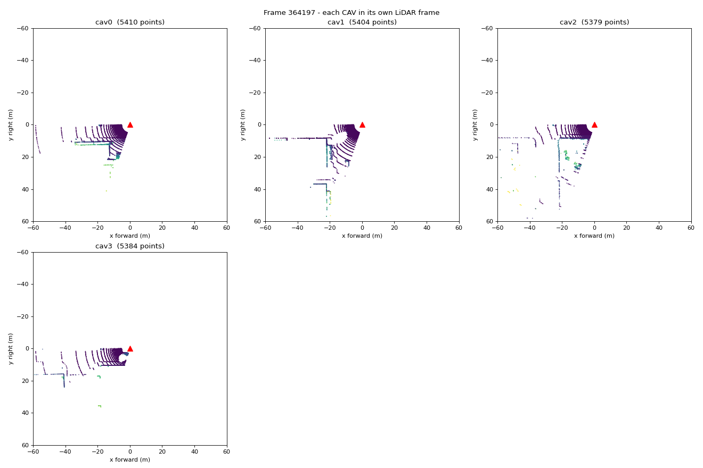

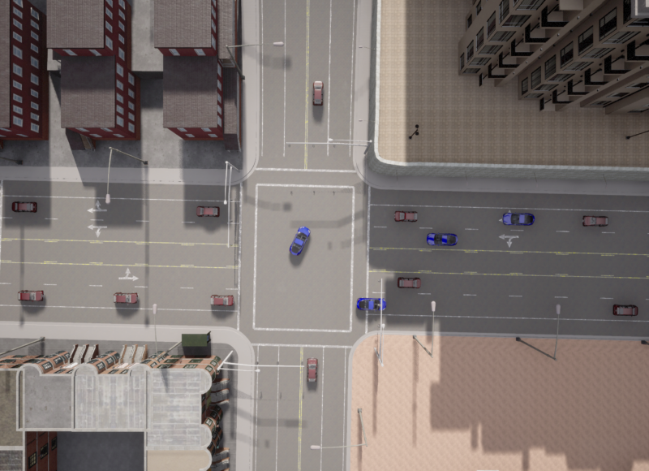

Scenes e11 (Figure 2, parked) and e12 (Figure 2 + 9 vehicles, all driving, one frame per second) are the main 4-CAV
datasets. The ready-made configurations: [docs/EXPERIMENTS.md](../docs/EXPERIMENTS.md).

## 2. Processing quality

Per CAV and per sweep: ego-body mask → drivable-road filter → ground removal → BEV (0.5 m, ±60 m) → 4 sectors →
metadata. Method: [docs/PROCESSING.md](../docs/PROCESSING.md).

| Test | Data | Result |
|---|---|---|
| Ground removal: first prototype → slope-aware height prior | 200 scans (e11, e12, qgis_e2e, routes_demo, slope_check) | vehicle points removed 11.0 % → **0.26 %**; ground left 2.6 % → 1.5 %; vehicles on the slope 13.2 % → **0.05 %**; slope ground left 1.8 % → 0.5 % |
| Close pairs (a car a few metres from another) | 5 pairs | 22–37 % of the neighbour's body removed → **0 %** in all 5 |
| Whole cleaning step | 6 runs, 260 scans | vehicle points removed **0.20 %** (none by the road filter); ground left **0.77 %**; the road filter removes 42 % of all returns |
| Ego-body mask | first study, 2 scenes | own-roof returns 9,244 → **0** per scan at a 1.6 m mount (35 % of the scan) and 917 → 0 at 1.9 m; the roof had inflated the sector quality S̃ by 12 % (flat) and 26 % (slope) |
| Ego-body mask | all 240 benchmark runs | other vehicles' points removed **0**, own-body points left **0** |
| Known limit | qgis_e2e, routes_demo | 15 % of the far slope ground (93–119 m) is kept on purpose: unknown ground is kept, not guessed |
| Sector metadata | e12, 4 static sectors | ~6,500 points (0.10–0.11 MB) per sector, S̃ from 0 to 0.04 |

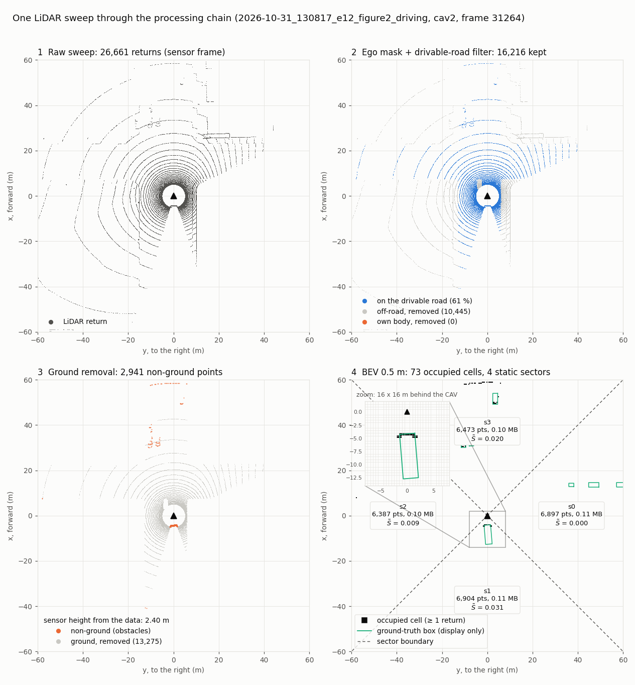

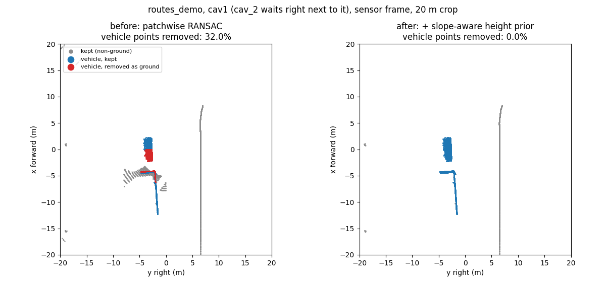

## 3. What each CAV sees, before and after filtering

`tools/compare_cavs.py`, or the editor's BEV tab. A vehicle is *seen* by a CAV with at least 10 points on its body.

| Frame | Points on vehicles, raw → after filtering | Vehicles seen: one CAV alone → all 4 | Vehicles with no point at all |
|---|---|---|---|
| e12, frame 31264 (CAVs 52–117 m apart) | 3,610 → 3,583 (**99.3 %**) | 3 to 7 → **12 of 24** | 6 |
| e01, frame 361114 | 4,909 → 4,893 (**99.7 %**) | 5 to 7 → **17 of 24** | 5 |

The filtering keeps the vehicles. A car missing from a BEV was never hit by that CAV's LiDAR, for one of these reasons:

- it is outside the BEV's ±60 m;
- it is hidden behind another vehicle (in e12 a fire truck 8 m behind cav2 fills its whole rear sector);
- it is hidden behind buildings.

A car 35–40 m away gets 2–3 of the 32 laser rings: 10–20 points on its near side. One CAV alone sees a few vehicles,
and the four together see half or more. That gap is what the paper's sharing is for.

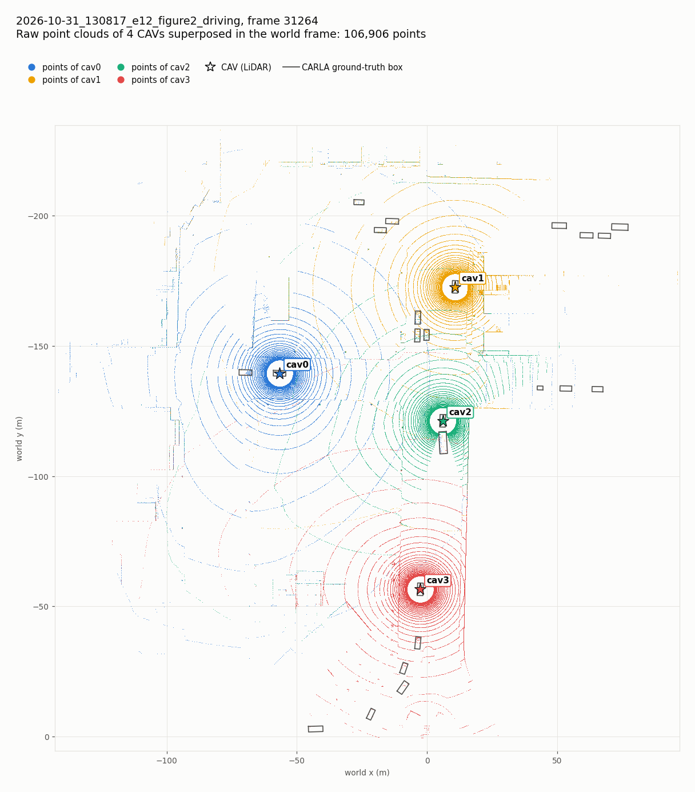

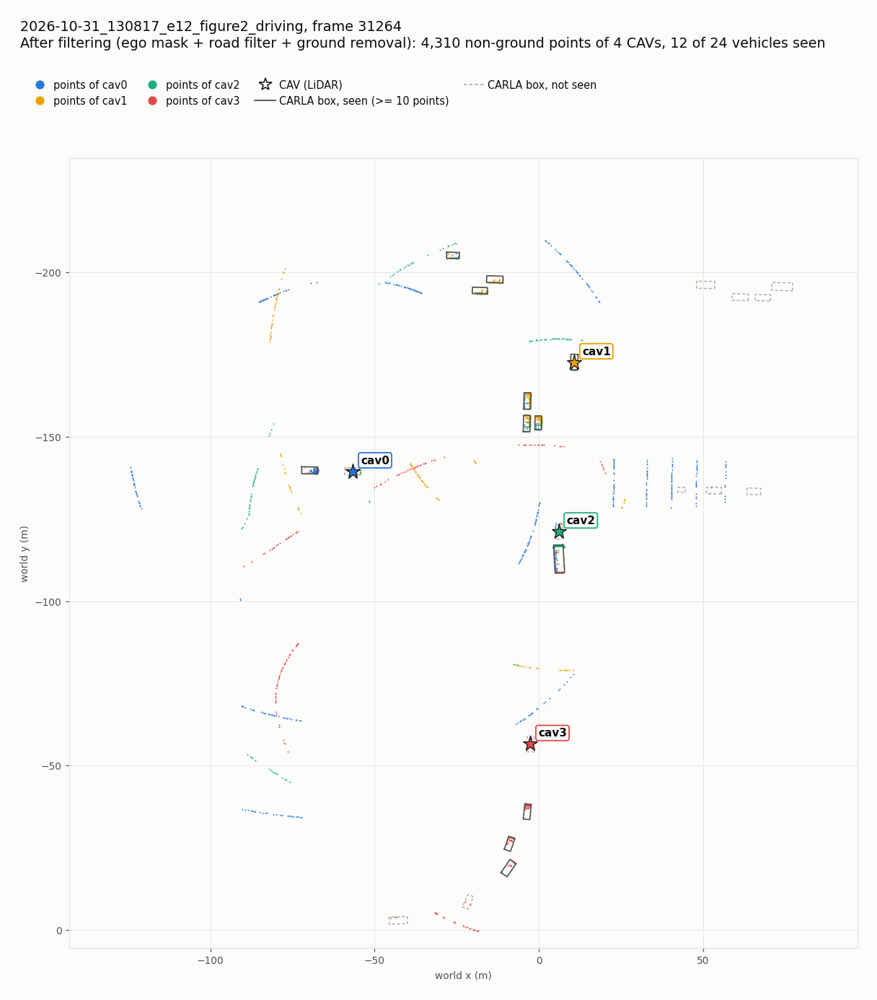

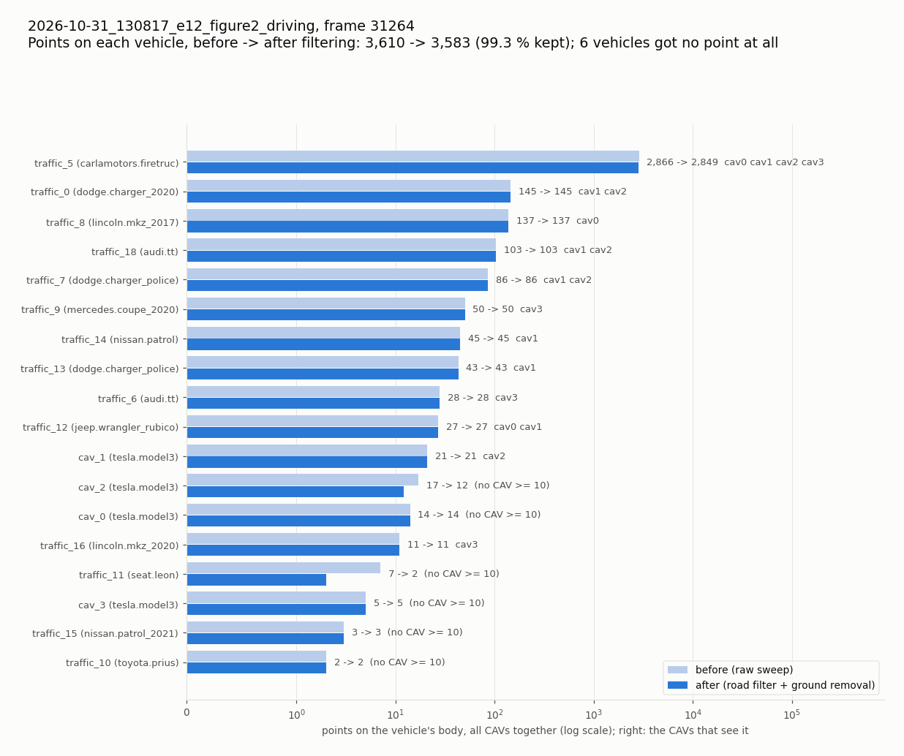

## 4. LiDAR sensitivity benchmark

One sensor setting changed per run, on fixed scenes placed around junction 1221 from a seed:

- 5 flat scenes, 5 slope scenes and 3 population scenes, all parked;
- 2 scenes in moving traffic;
- 240 scored runs in total.

Every value is the change from each scene's own baseline, as mean ± sd across scenes, with the number of scenes that
agree in brackets. Full tables (slope, moving, per scene): [docs/SENSITIVITY.md](../docs/SENSITIVITY.md). Data:
[sensitivity/](sensitivity/).

Baseline settings: 32 ch, 120 m, 1M points/s, noise 0, mount 2.4 m, drop-off 0.45.

| Metric | Meaning |
|---|---|
| coverage % | other vehicles with ≥ 10 body points kept: vehicle visibility |
| false cells | occupied BEV cells whose points are all ground, i.e. cells that should be empty |
| observed cells | BEV cells with at least one road return: how much road the sensor sees |
| ground left % | ground returns still in the cloud after ground removal |
| vehicle loss % | vehicle body points removed by the processing |

**Flat scenes (5)**. Baseline: coverage 73.2 ± 11.0 %, false cells 47.4 ± 15.3, observed cells 2,243 ± 161, ground
left 0.95 %, vehicle loss 0.27 %, 77 ms per scan.

| Factor | Value | Coverage % | False cells | Observed cells | Ground left % | Vehicle loss % | ms / scan |
|---|---|---|---|---|---|---|---|
| noise | 0.02 m | −4.2 ± 4.4 [4/5] | +16.0 ± 10.2 [5/5] | +18 [5/5] | +0.19 [5/5] | +0.45 [5/5] | −2 |
| noise | 0.05 m | −5.1 ± 4.6 [5/5] | +30.4 ± 6.5 [5/5] | +101 [5/5] | +0.31 [5/5] | +0.45 [5/5] | −2 |
| noise | 0.10 m | −4.1 ± 4.4 [4/5] | +45.2 ± 6.6 [5/5] | +281 [5/5] | +0.40 [5/5] | +0.31 [5/5] | −3 |
| mount | 1.6 m | −4.4 ± 2.9 [5/5] | −5.5 ± 11.4 [3/5] | **−791** [5/5] | +0.54 [5/5] | +1.15 [4/5] | −19 |
| mount | 1.9 m | +1.1 ± 4.6 [2/5] | −18.8 ± 14.1 [5/5] | −289 [5/5] | +0.02 [2/5] | +1.62 [5/5] | −2 |
| mount | 2.8 m | +0.1 ± 3.1 [3/5] | −16.8 ± 8.4 [5/5] | +119 [5/5] | +0.26 [4/5] | +0.03 [3/5] | −4 |
| channels | 16 | +5.5 ± 7.3 [4/5] | −41.8 ± 15.1 [5/5] | **−905** [5/5] | +0.44 [5/5] | +0.41 [3/5] | −5 |
| channels | 64 | −0.5 ± 1.5 [3/5] | −5.5 ± 19.9 [3/5] | **+823** [5/5] | −0.02 [2/5] | −0.16 [4/5] | −1 |
| range | 50 m | −5.9 ± 6.8 [3/5] | −37.2 ± 14.1 [5/5] | −118 [5/5] | −0.86 [5/5] | −0.03 [4/5] | −5 |
| range | 80 m | −1.2 ± 3.1 [2/5] | +1.3 ± 5.5 [3/5] | −1 [2/5] | −0.48 [5/5] | +0.02 [3/5] | −2 |
| drop-off | 0 | **+12.4 ± 7.4** [5/5] | −27.6 ± 7.7 [5/5] | +176 [5/5] | −0.34 [5/5] | +0.18 [4/5] | +33 |
| drop-off | 0.2 | +9.0 ± 8.0 [5/5] | −24.0 ± 10.5 [5/5] | +124 [5/5] | −0.29 [5/5] | +0.09 [4/5] | +22 |
| drop-off | 0.3 | +7.2 ± 5.5 [5/5] | −16.8 ± 8.8 [5/5] | +86 [5/5] | −0.21 [5/5] | +0.07 [4/5] | +15 |
| drop-off | 0.6 | −10.8 ± 4.5 [5/5] | +21.6 ± 17.5 [5/5] | −141 [5/5] | +0.38 [5/5] | +0.01 [2/5] | −14 |
| points/s | 0.5M | **−21.4 ± 4.9** [5/5] | +20.2 ± 10.2 [5/5] | −265 [5/5] | +0.52 [5/5] | −0.11 [5/5] | −26 |
| points/s | 2M | **+14.1 ± 7.8** [5/5] | −28.8 ± 12.7 [5/5] | +142 [5/5] | −0.34 [5/5] | +0.14 [4/5] | +42 |

**Slope scenes (5)**. Baseline: coverage 59.9 %, false cells 22.6. The same directions as on flat ground, smaller in
size:

- 0.5M points/s: −7.2 ± 3.3 coverage [5/5];
- 2M points/s: +8.4 ± 4.4 [5/5];
- noise 0.10 m: +50.7 false cells [5/5];
- 2.8 m mount: +5.0 ± 1.2 coverage [5/5], against +0.1 on flat ground;
- 1.6 m mount: ground left +1.76 % with a large spread.

**Moving traffic (2 scenes)**. Every value of a factor is mounted on the same CAVs in one simulation, so all of them
see the same traffic.

- 0.5M points/s: −14.3 coverage;
- 2M points/s: +10.9;
- noise 0.02 m: +35.0 false cells;
- 16 channels: −935 observed cells.

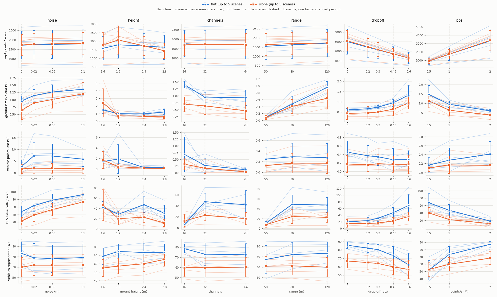

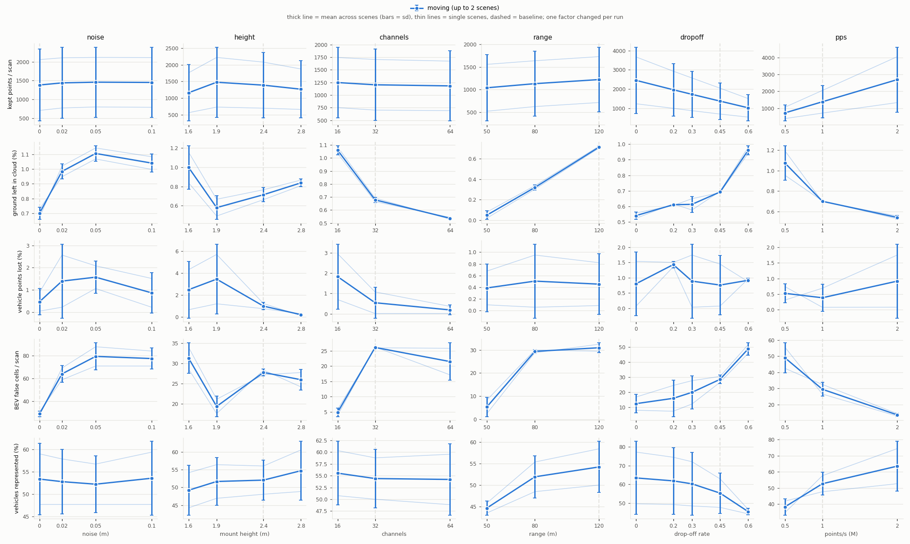

**What the benchmark shows**

1. **Point density is the strongest sensor factor.** Points per second and drop-off act the same way, through the
   points per sweep. Half the points (0.5M points/s) loses 21 points of vehicle coverage, and twice the points gains
   12–14 points of coverage and removes ~28 false cells, at +33 to +42 ms per scan.
2. **Noise hurts the BEV, not visibility.** Each step adds false cells (+16 per scan at 2 cm, +45 to +51 at 10 cm, 5/5
   on both terrains), while coverage does not move consistently.
3. **Low mounts cost road and visibility.** At 1.6 m, 35 % less road is observed (5/5) and coverage drops 4–5 points.
   Below ~2 m the ego-body mask is required. A 2.8 m mount reduces false cells (5/5).
4. **There is no best channel count.** Observed road scales with channels (16 ch −40 %, 64 ch +37 %, 5/5), but the
   false-cell ranking of 32 vs 64 channels changes from scene to scene.
5. **Range differences are truncation.** Within the 0–50 m that every setting covers, 50, 80 and 120 m give the same
   result.

**Audits (10 parked scenes)**

- The sensor height is inferred from the points alone: within 5.4 mm on flat ground, up to 0.29 m at slope
  transitions.
- False cells are real road surface kept by the sparse-patch rule (70–100 % of them for 32 and 64 channels).
- Lowering that rule's minimum from 18 to 8 points cuts them, but raises vehicle loss in some scenes. Choosing it on
  the evaluation scenes would be tuning, so 18 is kept.

## 5. CAV count and traffic density

The two population factors are measured on 3 scenes with a pool of the same parked cars:

- **CAV count:** only the roles change, so the effect is the extra viewpoints.
- **Traffic density:** cars are added, so it is a scene change, not a sensor effect.

Baseline: 4 CAVs, 30 vehicles; the other rows are changes from it.

| Factor | Value | Road cells observed together | Union false cells | Union false cells per 1,000 observed | Per-CAV coverage % |
|---|---|---|---|---|---|
| CAVs | 4 (baseline) | 6,964 ± 422 | 178.5 ± 22.2 | 25.7 ± 4.0 | 58.2 ± 6.4 |
| CAVs | 6 | +1,951 [3/3] | +46.1 [3/3] | −0.6 ± 2.6 [1/3] | +3.8 [3/3] |
| CAVs | 8 | +3,401 [3/3] | +123.1 [3/3] | +3.3 ± 2.2 [3/3] | +2.6 [2/3] |
| CAVs | 10 | **+4,059 (+58 %)** [3/3] | **+195.3 (×2.1)** [3/3] | **+8.0 ± 3.3 (+31 %)** [3/3] | +3.7 [3/3] |
| traffic | 20 | +58 [3/3] | −4.7 [1/3] | −0.9 ± 3.7 [1/3] | +5.3 [3/3] |
| traffic | 40 | −90 [3/3] | +0.1 [1/3] | +0.3 ± 1.6 [2/3] | −1.0 [1/3] |

- **Coverage.** The CAVs together already see 97.6 % of the vehicles with 4 CAVs in these scenes, so this benchmark
  cannot show a visibility gain from more CAVs.
- **False cells.** Every CAV adds its own leftover ground to a fused BEV: the raw count doubles from 4 to 10 CAVs.
  Per observed road cell the union's rate rises by 31 %, while each CAV's own rate does not rise.

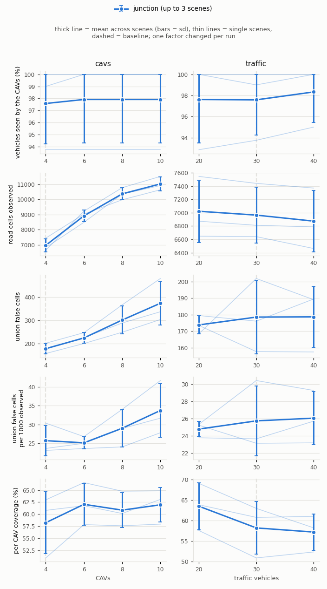

## 6. Reproducibility of CARLA

| Scene type | Two recordings of the same configuration |
|---|---|
| Parked | **bit-identical**, 20 of 20 scans, in the same session and across CARLA sessions; positions to 0.0000 m |
| Moving (Traffic Manager, synchronous, same seeds) | diverge by up to **3.56 m** (moving1) and 0.63 m (moving2); no scan matches |

- **Parked scenes:** one recording per setting is enough.
- **Moving scenes:** every value of a factor is recorded in one simulation.
- **Motion rule:** a moving simulation counts only if ≥ 50 % of the vehicle states move, a rule fixed before looking at
  any metric. 2 of 12 simulations, where the traffic waited at red lights, were recorded again.

## 7. Ground-truth boxes of moving vehicles

**Method.** A semantic LiDAR, which labels every return with the vehicle it hit, ran next to the recorder's LiDAR, and
every tick was saved with CARLA's snapshots. The test measures the time offset τ between the boxes and the returns. A
box one tick late would give τ = −0.05 s.

| Case | Content | τ (s), 95 % interval |
|---|---|---|
| straight | targets 0–18 m/s, 4 models | +0.0042 [−0.0019, +0.0158] |
| straight_dt10 | the same with a 0.1 s step | +0.0029 [−0.0035, +0.0134] |
| observer | LiDAR driving at 15 m/s past parked cars | −0.0083 [−0.0273, +0.0012] |
| slope | targets up and down the 12° leg | −0.0011 [−0.0088, +0.0026] |
| traffic1, traffic2 | the moving benchmark scenes | +0.0070, +0.0008 |
| e12 | the Figure 2 driving scene | +0.0013 [−0.0015, +0.0038] |
| pooled | 0.05 s cases | **+0.0005 [−0.0024, +0.0036]** |

**Result.** The boxes are frame-matched: the box of the LiDAR's tick fits best in 96–100 % of the moving views.

**The earlier offset.** A first check had reported boxes up to ~0.9 m ahead of their returns. That offset came from the
check's own estimator, not from the boxes. The corrected check gives +0.02 … +0.07 m (rear) and −0.03 … −0.06 m
(front), the same sampling gap as for parked cars.

Details: [docs/LABEL_ALIGNMENT.md](../docs/LABEL_ALIGNMENT.md). Data: [label_alignment/](label_alignment/).

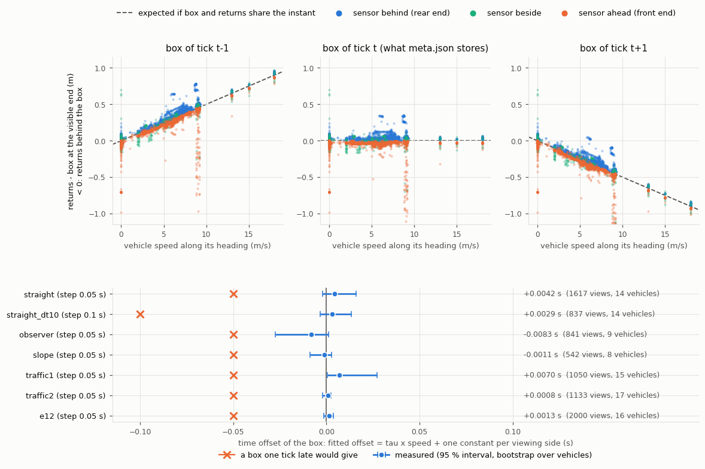

## 8. Scenarios generated with OpenCDA

The paper generated its 228 scenarios with OpenCDA. `tools/opencda_scenario.py` draws one such scenario from a seed
and saves it in the same run format: [docs/OPENCDA.md](../docs/OPENCDA.md).

The setup follows the paper's Table 1:

- CAVs driven by OpenCDA's behaviour agent: max speed 20–50 km/h, tailgate speed 30–60 km/h;
- 20–40 other vehicles in the paper's spawn area, each with a speed of −20 to +20 % and red lights ignored 0–100 %;
- the LiDAR mounted by OpenCDA: z 1.9 m, drop-off 0.3, noise 0.02 m.

| Scenario | Seed 1: 4 CAVs, 24 vehicles, 10 frames | Seed 2: 10 CAVs, 21 vehicles, 3 frames |
|---|---|---|
| Points per sweep | 33,836 – 34,508 | 33,670 – 35,120 |
| CAV speeds | 25 – 45 km/h | 18 – 40 km/h |
| Vehicles seen in the first frame (by at least one CAV) | 6 of 28 | 16 of 31 |
| Vehicles with no LiDAR point at all | 17 | 15 |

- **Points per sweep.** ~34,000, against ~27,000 with the project's recorder. The difference is mostly OpenCDA's lower
  drop-off (0.3 vs CARLA's default 0.45 of the 50,000 points per sweep).
- **Unseen vehicles.** The other vehicles start anywhere in the 200 m × 400 m spawn area, as in the paper, so many are
  out of every CAV's reach.
- **Not run yet.** The 228-scenario set has not been recorded.

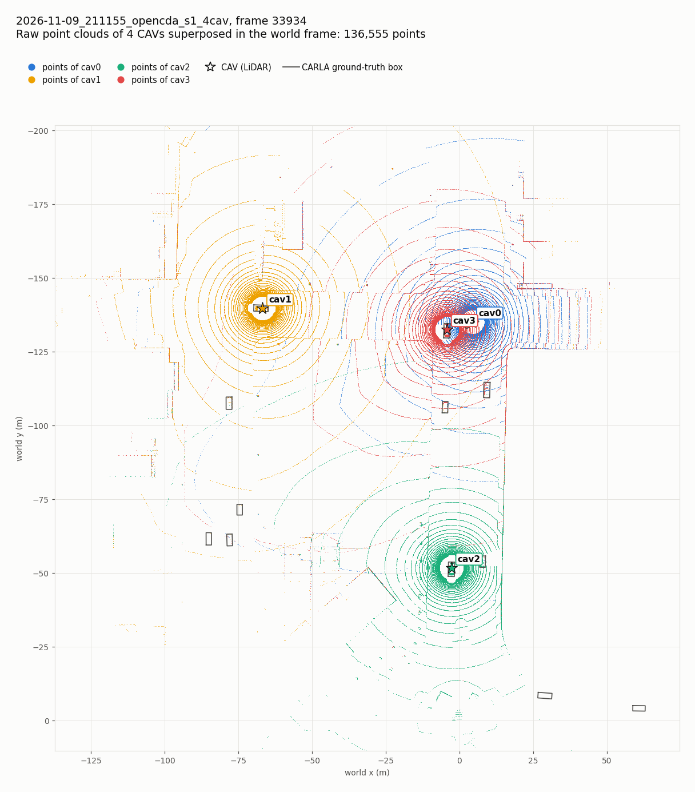

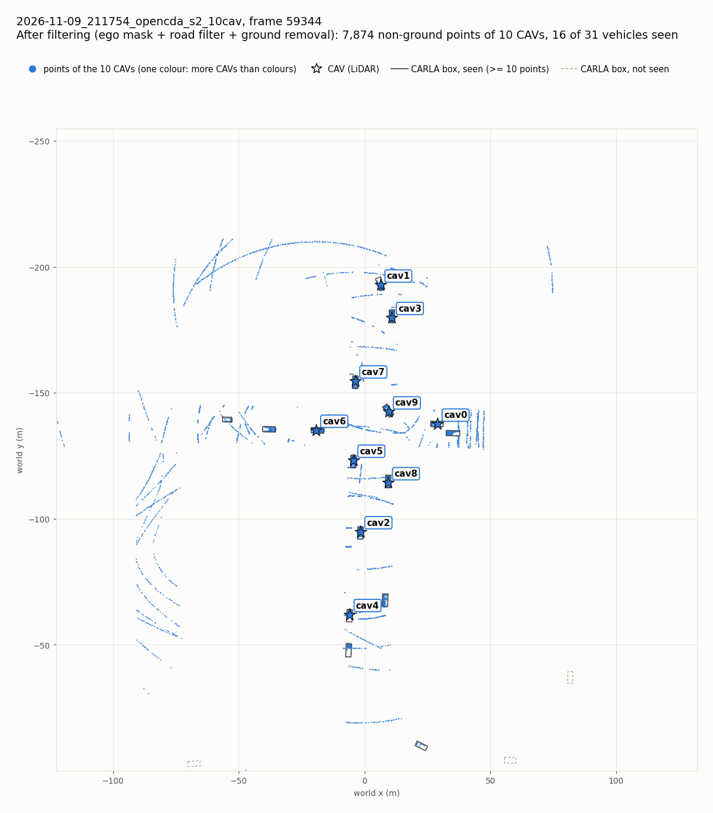

## 9. Time

| Measured | Value |
|---|---|
| Processing per CAV and sweep (ego mask + road filter + ground removal + BEV), e12, 40 scans, CARLA closed | median **99 ms** (p95 153 ms); one sweep arrives every 50 ms, so **not real-time** |
| By point rate (flat baseline, fastest of 3) | 51 / 77 / 119 ms at 0.5M / 1M / 2M points/s; the ego mask alone 2.2 ms |
| Simulation, 4 CAVs + 20 vehicles | 0.059 s per tick |
| Simulation, 10 CAVs + 40 vehicles | 0.146 s per tick |

Measured on one laptop (Ryzen 5 4600H, GTX 1650 4 GB), Python, one process: these numbers compare settings and are not
real-time claims.

## Limits

- **Scenes.** All of them are at one junction of Town03, and the slope scenes share one 50 m leg. With 5, 3 and 2
  scenes per group, the standard deviations are rough, and effects marked 3/5, 2/3 or 1/2 are not established.
- **Population scenes.** They use one vehicle model, so that roles can change without changing the scene.
- **CARLA's boxes.** A few models' boxes are larger than their body (Jeep Wrangler +0.33 m, Carlacola +0.12 m).
- **Not done in this repository:**
  - dynamic sectorization;
  - the paper's 228 scenarios;
  - e08 (chaotic traffic).
- **Beyond the BEV.** The sharing optimization, the fusion and the detection (PIXOR, AP@0.5) are not in this
  repository. Nothing here reproduces the paper's final results.

## Reproduce

```bash
python main.py record --config config/experiments/scenario/e12_figure2_driving.yaml --name e12 --process
python tools/compare_cavs.py data/runs/<run> --frame <frame>                # section 3
python tools/run_ablation.py --scenes flat2 slope2                          # section 4 (parked scenes)
python tools/record_moving_sensors.py --scenes moving1 moving2              # section 4 (moving traffic)
python tools/eval_ablation.py --timing-repeats 3                            # scores, tables, plots
python tools/diagnose_label_alignment.py record                             # section 7
python tools/opencda_scenario.py --cavs 4 --seed 1 --frames 10              # section 8 (opencda env)
```

Every step from installing CARLA: [docs/GUIDE.md](../docs/GUIDE.md).
